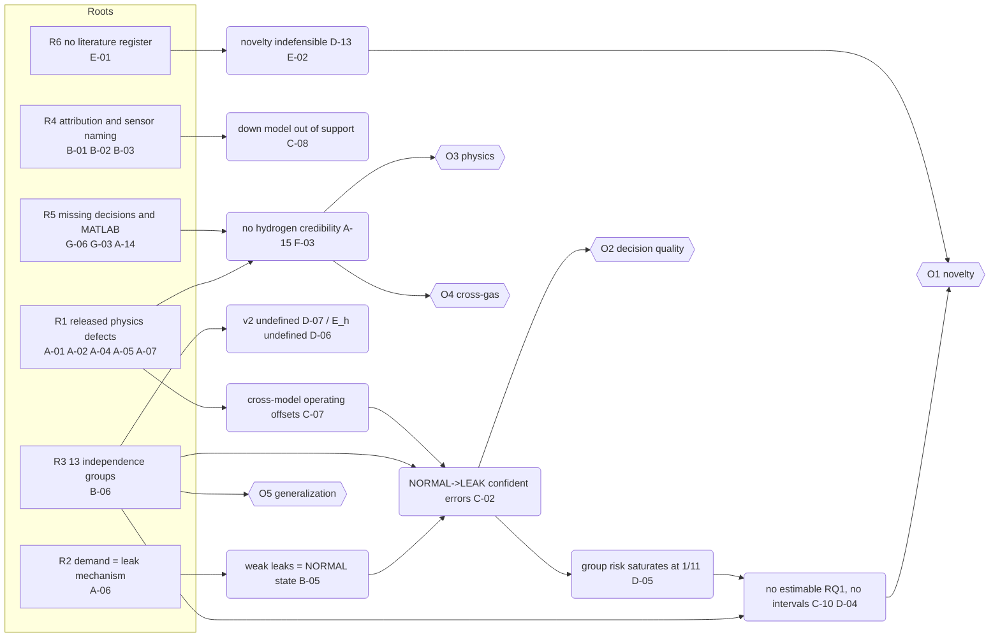

# H₂-PRISM comprehensive gap analysis (2026-11-13)

**Status:** final evidence consolidation before the Master Execution Prompt. Documentation only:
- no simulation, training, evaluation or authorization change;
- frozen artifacts verified, not modified.

**Single sources of truth (this file links them and does not repeat them):**

| Deliverable | File |
| --- | --- |
| A. MASTER_ISSUE_REGISTER | `00_governance/MASTER_ISSUE_REGISTER.csv` (95 issues, 18 fields each; built by `tools/governance/build_master_issue_register.py`) |
| G. EXECUTION_DEPENDENCY_MATRIX | `00_governance/EXECUTION_DEPENDENCY_MATRIX.csv` (27 actions; every open issue covered; built by `tools/governance/build_execution_dependency_matrix.py`) |
| B–F, H | this file |

## 0. Verified project state

| Item | Verified value |
| --- | --- |
| Branch / HEAD at start | `audit/preparation-integration` / `bbc80f9`; working tree clean |
| R2 primary `a10530f1fcf2` | 68/68 hashes |
| R1 `db9acd23ef58` (archived INVALID_CALIBRATION) | 68/68 after removing the pre-archive `PRIMARY/` path prefix from its list (as listed: 0/68). The data are intact; the verification path is wrong (issue B-15). |
| Robustness and 7 sensitivity runs | 43/43, 68/68, 68/68, 80/80, 92/92, 74/74, 62/62, 80/80 |
| Development arms A–H | 9/9 each |
| Diagnostics (arm H, v2, feature representation) and H2Net v1 properties | 19/19, 4/4, 6/6, 4/4 |
| RC1 | `0566843e…` = pin; status NOT_APPROVED; not activated |
| Manifest | v0.2 (release attribution); candidate v0.3 (source-model attribution) |
| Position map | v0.1 `7b3b8cf1…`; owner acceptance pending |
| Software | installed versions equal the frozen config pins (Python 3.12.1, scikit-learn 1.7.0, numpy 2.3.1, pandas 2.3.3, scipy 1.16.0, pyarrow 25.0.1); `pip check` clean; no private paths in tracked files |
| Full test suite (non-training) | 442 passed, 2 skipped |

**Authorizations:**

| Record | State |
| --- | --- |
| `EXECUTION_AUTHORIZATION_PRIMARY.yaml` (R1) | executed; result invalid (archived) |
| `EXECUTION_AUTHORIZATION_PRIMARY_R2.yaml` | executed (R2) |
| 8 robustness/sensitivity authorizations | executed |
| Arm authorizations A–G2 and H | executed (development only) |
| `AUTH_SIMULATION_GENERATION.yaml` (v1) | VOID_SUPERSEDED, never executed |
| `AUTH_SIMULATION_GENERATION_V2_REQUEST.yaml` | VOID_SUPERSEDED, never executed (record preserved) |
| `AUTH_SIMULATION_GENERATION_V3_REQUEST.yaml` | PENDING, not authorized (project-lead decision: keep unauthorized); no claim file |
| `AUTH_MODEL_DEVELOPMENT_H2NET_V1_REQUEST.yaml` | ACTIVE: part (a) done; (b) and (c) blocked |

**Owner decisions outstanding:**
- **Yazan:** D1, D2, D6, the H2Net v1 parameters, Gate 1–3 attestation.
- **Faisal:** the component decisions, F-D15/F-D16/F-D18, the endpoint reporting rule.
- **Ahmed:** A-APPROVE.
- **Team plan:** 38 COMPLETE, 12 COMPLETE_WITH_LIMITATION, 7 BLOCKED, 1 N/A.

**Implementation vs validation.** Implemented and tested:
- the classifier pipeline;
- calibration with a monotonicity guard;
- D(x), E_h and v2 (research);
- the position map;
- causal representations;
- the gas-physics reference;
- the authorization gates;
- the sealing tools.

Experimentally validated: **nothing confirmatory**. Every performance figure is exploratory development evidence on an air-like simulator.

## 1. Register summary

| Severity \ status | BLOCKED | FIXED | NOT_VERIFIED | PARTIALLY_FIXED | UNRESOLVED | Total |
| --- | --- | --- | --- | --- | --- | --- |
| CRITICAL | 11 | 1 | 0 | 3 | 4 | 19 |
| HIGH | 5 | 3 | 1 | 8 | 18 | 35 |
| MEDIUM | 2 | 0 | 5 | 10 | 13 | 30 |
| LOW | 0 | 6 | 0 | 2 | 3 | 11 |
| **Total** | **18** | **10** | **6** | **23** | **38** | **95** |

**Root causes:** 76 CONFIRMED, 12 LIKELY, 7 UNKNOWN. A root cause is CONFIRMED only with direct evidence, i.e. block parameters, recomputed statistics or a reproduction; explaining an observation is not enough.

**Contradictions resolved in this analysis:**
1. **"10% H₂ / 90% CH₄ blend" (B-14).** The README, the claim register, the dataset description and the provenance file said "unverified"; the legacy status file and the readiness report stated it as fact. The released gas constant (air) **refutes** it. The living documents now carry a dated correction, and the historical approval dossiers are kept as records. A new claim C16 prohibits hydrogen interpretation of released-data results.
2. **R1 hash list (B-15).** The apparent 0/68 is a path-prefix artifact; the data are intact.
3. **Earlier statements based on inactive gas fields.** The 10 MPa table limit and the ~580 K outlet temperature are corrected by errata (`FINAL_PRE_EXECUTION_CHECK.md`).
4. **Superseded handoff.** Tag `v2-normal-handoff-1` and package v2 are void; the v3 handoff states this.

**Critical unresolved items (18 CRITICAL not FIXED):** A-01, A-02, A-06, A-13, A-15, B-01, B-02, B-05, B-06, C-02, D-04, D-07, E-01, E-05, F-01, F-03, G-03, G-06 (the register has full fields).

## 2. Root-cause and dependency map (B)

Foundational roots are drawn as boxes, downstream symptoms as rounded nodes, objectives as hexagons.

**Readings:**
- **Fixes that unlock the most:**
  - X05/X07 (build and validate H2Net v1): R1, R2 and A-15;
  - X12/X13 (independent multiclass groups): R3, and through it D-04, D-07, C-02 and C-10;
  - X01/X03 (owner decisions): R4 and R5.

  None of these can be bypassed.
- **Downstream symptoms, not to be "fixed" directly:** C-02, C-05, C-09, D-02, D-05, D-06, D-07, C-10. Reweighting, threshold tuning or a new statistic on current data would **waste effort** and violate O8, because the data cannot support the claims these issues block.
- **Critical unverified assumptions:**
  - the active gas specification (A-16);
  - the Simscape friction correlation (A-17);
  - the meaning of the released weak-leak labels (B-05);
  - whether v2's prespecified m = 2 and τ = 1 are adequate (D-08);
  - sim-to-field transfer (A-13).
- **Parallel workstreams that can start now:**
  - governance decisions (X01–X03, X10, X25);
  - literature and comparators (X08, X09);
  - software (X14, X22, X26);
  - external outreach (X23, X24, X27).

## 3. Scientific novelty gap assessment (C)

**Established techniques** (must be cited and compared, never claimed as new):
- reject option and selective classification (Chow 1970; El-Yaniv & Wiener 2010; Geifman & El-Yaniv 2017), including risk–coverage curves;
- calibration (Platt scaling; isotonic regression);
- conformal prediction sets (Vovk et al.; Angelopoulos & Bates), the natural competitor to H₂-PRISM's ambiguity sets;
- nearest-neighbour trust and OOD scores (e.g. trust score, Jiang et al. 2018; deep-kNN OOD; Mahalanobis OOD). The trust score compares distances to the predicted class and the nearest other class, which is **structurally close to v2's margin M(x; h)**;
- grouped and blocked cross-validation for dependent data (e.g. Roberts et al. 2017);
- data-driven leak and fault detection in gas pipelines (a large literature, to be surveyed).

These references are pointers for the literature register (X08); each must be verified and summarized there before use.

**Engineering integrations:**
- the three-outcome policy combining a classifier, calibration, support flags and a fail-closed meta-model;
- the authorization, provenance and sealing infrastructure.

These are valuable for reproducibility, but they are not scientific novelty.

| Candidate contribution | Kind | Status | Minimum evidence to be defensible |
| --- | --- | --- | --- |
| Counting **independent scenario ancestors** (not windows) as the unit of evidential support in neighbourhood-based diagnosis | conceptual / methodological | implemented (v2, independence groups); untested on data | literature check (X08) shows no equivalent; on independent data, group-level support changes decisions **and** reduces scenario-balanced risk vs window-level support at matched coverage |
| Explicit separation of **detectability**, **distinguishability**, **support sufficiency** and **classifier confidence** in a three-outcome decision | conceptual | specified and implemented; untested | literature check; prospective E vs A (H-R3) with a pre-registered falsification criterion |
| Group-level separability margin M(x; h) in within-scenario resolution units | mathematical (incremental) | implemented | demonstrated difference from the trust score and conformal sets (formal and empirical); otherwise present it as an adaptation |
| Evidence-guided selective diagnosis for **hydrogen** networks with physically validated simulation | application / experimental | not started (H2Net v1 not built) | V1–V8 passed; multiclass independent data; confirmatory run |
| A cross-configuration / cross-gas evaluation protocol with sealed confirmation | experimental | designed | executed, including G4 (new graph) and blends |

**Unsupported novelty claims (prohibited):**
- "D(x) measures physical identifiability";
- any statement that D(x) or v2 improves decision quality;
- hydrogen or blend relevance of released-data results;
- generalization to other networks;
- industrial readiness.

**Hypotheses that remain empirically untested:** H-R1, H-R2 and H-R3 (`DISTINGUISHABILITY_V2.md` §4).

## 4. Framework architecture review (D)

The ten proposed modules map onto existing code as follows, with a recommendation for each:

| # | Proposed module | Exists | Recommendation |
| --- | --- | --- | --- |
| 1 | Gas and physics metadata | `gas_physics.py`, H2 tables | **Keep:** a data contract (composition, EOS source, validity envelope) attached to every dataset and model |
| 2 | Topology and sensor registry | position map, diagram trace | **Keep:** generalize the position map to a registry (sensor ID → physical node, quantity, unit, availability) |
| 3 | Data quality and causal features | causal representations; no DQ gate | **Keep; add the data-quality gate (F-08)** |
| 4 | Classifier and calibration | yes | Keep. Calibration stays monotone and development-only |
| 5 | Independent-evidence engine | independence groups | **Merge 5, 6 and 8** into one *evidence module* (support sufficiency, detectability, distinguishability, out-of-support). They share the reference index, the scaling and the group accounting, so separating them would duplicate state. |
| 6 | Detectability and distinguishability | v2 | ↑ (merged into 5) |
| 7 | Three-outcome decision policy | yes | Keep; one policy with registered variants |
| 8 | OOD and support monitoring | v2 out-of-support | ↑ (merged into 5) |
| 9 | Evaluation and provenance | yes (strong) | Keep |
| 10 | Deployment and scalability | none | **Defer** until confirmatory evidence exists; only a replay prototype (X21) |

**Simplification:** the s_C meta-model is unstable and was not better than confidence alone (C-11). Keep it only as a historical comparator; do not build new layers on it.

**What generalizes through interfaces, and what needs more:**

| Change | Interfaces and metadata suffice | Also requires |
| --- | --- | --- |
| New sensor layout | registry | retraining (or missing-sensor-aware models) and new reference sets |
| New topology configuration | registry and model metadata | new reference scenarios; evaluation by leave-one-configuration-out |
| New network graph | none | **new physics model and validation (V1–V8)**, new data, retraining or calibrated adaptation, independent validation |
| New gas composition | gas metadata | **new property model and validation**, new data, retraining; transfer across compositions is **unsupported** until tested |
| New operating regime | none | out-of-support detection; new reference scenarios if it falls outside support |
| New event classes | class registry | new independent groups (≥ 3 development per class for v2) |
| Field data | data contract | data-quality gate, sim-to-real validation (A-13) |

**Interface contracts, required in every dataset:**
- canonical sensor IDs with units;
- gas composition and EOS reference;
- network/model version and hash;
- independence-group ID per run;
- partition and seal hash;
- event mechanism parameters.

## 5. Physics and simulation readiness (E)

| Item | Status |
| --- | --- |
| Released simulator | air-like gas (R = 0.287), physically inconsistent constants (γ 5.75), adiabatic, ideal compressors, demand = leak mechanism, lumped pipes. **Usable only as a disclosed methodological benchmark.** |
| H2 property tables | **DONE.** CoolProp 7.2.0 (Leachman 2009 / Muzny 2013 / Assael 2011); V1 PASS. |
| Independent steady-state solver | **DONE.** Tested on closed form, friction limits, choked orifice and mass conservation; loads the H2 tables. |
| H2Net v1 network model | **NOT BUILT.** Blocked on owner parameters (X03) and MATLAB (X27). |
| Validation V2–V8 | not started |
| Multiclass generation | designed only (`MULTICLASS_SIMULATION_DESIGN.md`); requires X07 |
| H₂–CH₄ mixtures | not started; needs a GERG-2008 implementation and validation (X20) |
| Sim-to-field | no data; external partnership required (X23) |

**Rule:** no simulation-generated result is used before its model passes the relevant validation gates. The v3 NORMAL package on the released models stays unauthorized by decision.

## 6. Distinguishability resolution assessment (F)

**What each statistic measures:**

| Statistic | Measures | Fails when |
| --- | --- | --- |
| D(x) = q₍₁₎ − q₍₂₎ over the k = 25 nearest windows | neighbourhood class agreement | saturates at 1 (60–68% of windows) and counts duplicated windows |
| E_h | group-balanced vote margin for hypothesis h | undefined (79.6%: single-group neighbourhoods, own-group-only classes, OOS) |
| v2 M(x; h) | difference between the m-th-nearest independent-scenario distances of competitor and hypothesis, in within-scenario resolution units | undefined on the current data (100%) because thin classes have < 2 groups |

**Required assumptions:**
- correct labels;
- position-matched features;
- references that cover the configuration;
- distance reflecting physical similarity;
- independence groups that capture ancestry.

**Can evidence absence be separated from genuine overlap?** Yes, by construction in v2:
- **absence:** UNSUPPORTED or INSUFFICIENT_EVIDENCE (no distance computed);
- **overlap:** a defined M with |M| < τ;
- **evidence against:** M ≤ −τ.

The constructed tests 2, 3, 8 and 13 verify this.

**Is m = 2 justified?** It is the smallest number at which agreement is *corroborated* by more than one independent scenario. It is a principled minimum, not an optimized value. Sensitivity to m ∈ {2, 3} must be prespecified (D-08).

**Does v2 carry information the classifier lacks?** Unknown. The only empirical hint is from the original D(x) in arm H:
- its standalone correctness AUROC was 0.64–0.88, versus confidence 0.48–0.89;
- yet inside s_C it showed no group-level gain.

Testing this requires the matrix arms D/E/F against A on independent data.

**Is the policy coherent?**
- v2's decide() never switches a SPECIFIC label, and contradictions become ambiguity sets.
- The registered endpoint, group-balanced risk, saturates when one all-wrong group is selected (D-05). Window- and group-level reporting must be registered beside it (X10).

**Alternatives to compare** (registered before data, X09):
- the trust-score ratio;
- split-conformal prediction sets (APS);
- Mahalanobis / density OOD;
- ensemble disagreement.

**Minimum data:**
- ≥ 3 development groups per class (≥ 4 NORMAL) for definability;
- ≥ 4 confirmation groups per class (≥ 20 in total) for group-level inference;
- power fixed from the development variance (E-08).

**Falsification.** The innovation is **rejected** if, on the sealed confirmation partition at matched development-fixed coverage, either:
- the scenario-balanced selective risk of E (support + separability) is **not lower** than that of A (confidence only) with the group-bootstrap interval excluding 0 in E's favour; or
- E is not better than D (support only), in which case any gain is attributable to support counting, not to distinguishability.

A null or NOT_ESTIMABLE result is reported as such.

**Smallest defensible program:** X11 → X12 → X13 → X15 → X16 → X17. That means:
- one validated hydrogen model;
- the multiclass minima;
- one frozen protocol (arms A–F plus the registered comparators);
- one confirmatory contrast.

## 7. Generalization and industrial scalability (requirements)

Four levels are kept strictly distinct:

| Level | Status |
| --- | --- |
| (1) Software interoperability (interfaces, registry, metadata) | partly present |
| (2) Adaptability after recalibration or retraining | not tested |
| (3) Demonstrated generalization without retraining | not demonstrated; requires G1–G5 on independent data |
| (4) Industrial readiness | not claimable; requires field data, safety case and operational validation |

**Tests required:**
- **G1** unseen scenarios;
- **G2** unseen operating levels;
- **G3** leave-one-configuration-out;
- **G4** a new graph;
- **G5** sensor dropout and layout change;
- **G6** class and reference scaling;
- **cross-gas:** pure H₂, then blends (each with its own validated property model; zero-shot transfer is reported, never assumed);
- **OOD:** held-out regimes;
- **computational:** v2 fit is about N^1.7 (offline) and per-query time about 1 ms on synthetic data. Re-measure on real data and set a real-time budget per window (X21).

## 8. Execution dependency matrix (G): critical path and authorization boundaries

The full table is in `00_governance/EXECUTION_DEPENDENCY_MATRIX.csv`.

**Critical path to the core hypothesis:**
1. X03 (parameters) and X27 (MATLAB);
2. X05 → X07 (H2Net v1 validated);
3. X11 → X12 → X13 (data);
4. X15 (frozen protocol, needs X02, X09, X10);
5. X16 (development);
6. X17 (confirmation).

**Authorization boundaries:**
- X05 and X07 are covered by the active H2Net v1 authorization.
- X12 and X13 need new SIMULATION_GENERATION authorizations, one per stage.
- X16 needs DEVELOPMENT_EXPERIMENT authorizations.
- X17 needs a confirmatory authorization.
- X20 needs a model-development authorization (software install).

**Would be wasted before prerequisites:**
- generating data on the released models;
- tuning v2 or thresholds on current windows;
- deployment engineering before confirmation;
- mixture data before pure-H₂ validation.

## 9. Master execution prompt input (H)

**Decisions that can be made from existing evidence (owners):**
- D1 = adopt v0.3;
- D2 = adopt position map v0.1;
- exclude F (E_h);
- keep D as an integrity rule;
- E remains optional and is tested prospectively;
- endpoint reporting rule (X10);
- disclosure C16 on every released-data artifact.

**Decisions that require new external information:**
- H2Net v1 engineering parameters and envelope (X03);
- the authors' account of the weak-leak and event mechanisms (X24);
- MATLAB environment (X27);
- literature review (X08);
- GERG-2008 implementation choice (X20);
- field-data partner (X23).

**Shortest valid path to test the core hypothesis (O1/O2):**
1. validated H2Net v1;
2. the multiclass independent groups at the design minima;
3. a frozen protocol with arms A–F plus the standard comparators;
4. the development analysis;
5. one sealed confirmatory contrast, E vs A, with E vs D as the attribution check.

**Shortest valid path to hydrogen and cross-gas applicability (O3/O4/O5):**
1. V1–V8 for pure H₂;
2. GERG-2008 blend tables per composition, with their own validation;
3. a fourth network graph;
4. G1–G5 per gas;
5. field or laboratory data for any real-world claim.

**What cannot currently be proven:**
- that D(x), E_h or v2 adds decision-quality value beyond confidence or support safeguards;
- any hydrogen, blend or physically quantitative result;
- generalization to new configurations, networks, gases or sensor layouts;
- leak localization;
- industrial readiness;
- statistical significance on the 13 released groups;
- that any released label reflects an observable physical event, for the eight low-visibility runs.

**Full test suite (non-training, this analysis):** 442 passed, 2 skipped (15 min 58 s), run on the code state at `bbc80f9`.

After the documentation corrections, the documentation-dependent tests were re-run: 58 passed (`test_dataset_audit`, `test_plan_deliverables`, `test_reporting_outputs`).
