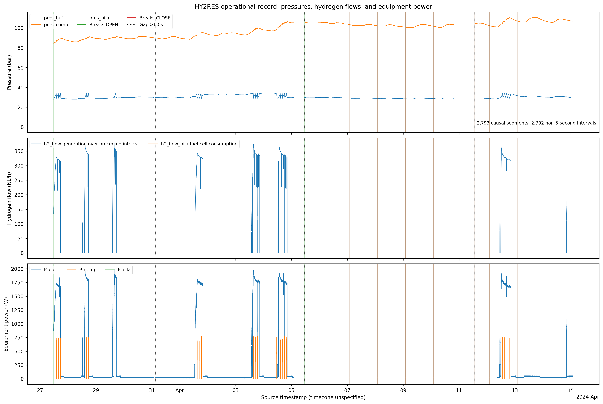
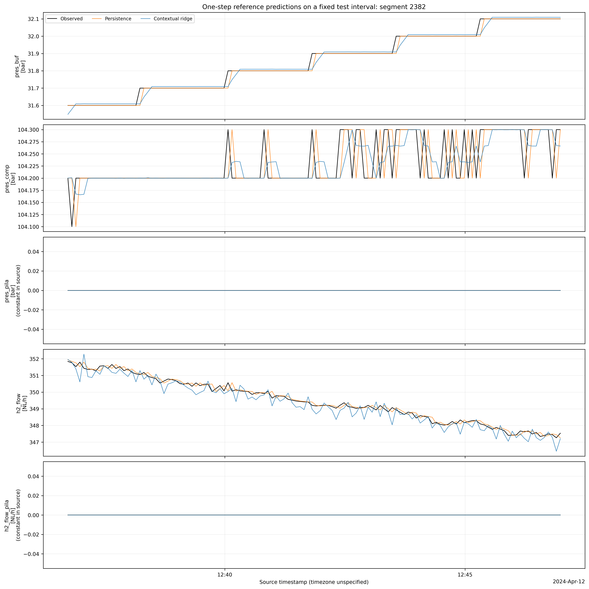
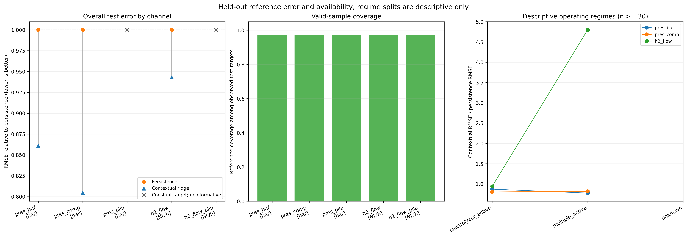

# HY2RES external reference-prediction results

**Model choice:** contextual_ridge. Validation selected **contextual_ridge** (mean contextual-to-persistence RMSE ratio 0.8784 across 3/5 channels with nonzero persistence RMSE; +12.16% reduction by the selection statistic). Other channels had undefined ratios because persistence RMSE was zero.
**Held-out period:** 2024-04-12 12:13:56 through 2024-04-15 02:00:00 (timezone unspecified); 44,397 source rows in the fixed test partition.

## Per-channel held-out performance

| Target | Method | Scored rows | Test target variation | Reference coverage | MAE | RMSE |
|---|---|---:|---|---:|---:|---:|
| pres_buf | persistence | 43,168 | 52 unique | 97.2% | 0.00396358 | 0.0199088 |
| pres_buf | contextual_ridge | 43,168 | 52 unique | 97.2% | 0.0055002 | 0.0171375 |
| pres_comp | persistence | 43,168 | 70 unique | 97.2% | 0.0255977 | 0.0505987 |
| pres_comp | contextual_ridge | 43,168 | 70 unique | 97.2% | 0.0251415 | 0.0406982 |
| pres_pila | persistence | 43,168 | constant | 97.2% | 0 | 0 |
| pres_pila | contextual_ridge | 43,168 | constant | 97.2% | 0 | 0 |
| h2_flow | persistence | 43,168 | 5,388 unique | 97.2% | 0.0327303 | 1.25697 |
| h2_flow | contextual_ridge | 43,168 | 5,388 unique | 97.2% | 0.178005 | 1.18526 |
| h2_flow_pila | persistence | 43,168 | constant | 97.2% | 0 | 0 |
| h2_flow_pila | contextual_ridge | 43,168 | constant | 97.2% | 0 | 0 |

Metrics are in the channel units shown in `per_channel_reference_metrics.csv`. Coverage is the eligible reference count divided by observed target rows, with effective denominators and segment counts included in that CSV. The table contains both methods on the same eligible test rows. Constant targets are explicitly flagged because zero error on an inactive channel is not evidence of predictive skill.

### Channel-level comparison

- **pres_buf** (bar): persistence RMSE 0.0199088; contextual ridge RMSE 0.0171375; contextual MAE is higher.
- **pres_comp** (bar (tank pressure; not compressor-discharge pressure)): persistence RMSE 0.0505987; contextual ridge RMSE 0.0406982.
- **pres_pila** (bar): constant at 0 across the source; zero test error is uninformative and does not demonstrate predictive skill.
- **h2_flow** (NL/h (generated over the preceding sample interval)): persistence RMSE 1.25697; contextual ridge RMSE 1.18526; contextual MAE is higher.
- **h2_flow_pila** (NL/h (fuel-cell consumption)): constant at 0 across the source; zero test error is uninformative and does not demonstrate predictive skill.

## Figures

### F1 — Audited operational timeline and context

### F2 — Persistence and contextual reference traces on a chronological test segment

Interval shown: segment 2382, 2024-04-12 12:36:44 to 2024-04-12 12:46:59. It was chosen by chronological position and segment length, not by test error.

### F3 — Error, reference coverage, and descriptive regimes

## Main tables

- `data_and_splits.csv` — source rows, chronological roles, embargo, time range, and split proportions.
- `validity_summary.csv` and `validity_mask.csv.gz` — per-role, per-channel eligible-sample counts and the row-level prediction mask/exclusion reason.
- `target_channel_audit.csv` — source-wide target ranges and variation; `per_channel_reference_metrics.csv` — original-unit MAE/RMSE, test variation, coverage denominators, segment counts, and regime strata.
- `limitations_and_claims.csv` — explicit evidence boundary and permitted interpretation.

## Limitations and claim boundary

| Claim or limit | Status | Evidence / boundary |
|---|---|---|
| Reference prediction | Evaluated | One-step pressure/flow MAE and RMSE against persistence on the fixed chronological test; see per_channel_reference_metrics.csv. |
| Reference availability | Measured | Valid prediction counts, observed-target denominators, coverage, and segment counts are reported per channel. |
| Incident detection or false-alarm rate | Not evaluated | No independently qualified incident labels are present; no detection accuracy or false-alarm rate is claimed. |
| Leak/fault/delay classification, D(Y), or localization | Out of scope | No incident labels or evidence supporting these claims; this notebook does not train an incident classifier. |
| Cross-plant or pipeline transfer | Not established | One residential pilot-system record; results do not establish independent-plant generalization. |
| Timezone and gap interpretation | Limited | Timezone is unspecified; non-5-second intervals and OPEN/CLOSE boundaries conservatively split causal segments without interpolation. |
| Units and flow interpretation | Source-bounded | Published units are retained; h2_flow is a preceding-interval rate, pres_comp is tank pressure, and undocumented columns are excluded. |
| Targets with no observed variation | No predictive evidence | pres_pila and h2_flow_pila are constant at zero across the source; their zero errors are uninformative and excluded from validation selection ratios. |

No alarm threshold or alert policy was specified, so no alert burden is reported. The result estimates within-record chronological reference prediction on one pilot system; it is not an incident-detection or independent-plant validation study.

See [`SOURCE.md`](SOURCE.md), [`AUDIT.md`](AUDIT.md), [`PROTOCOL.md`](PROTOCOL.md), `metrics.json`, and the saved test predictions for provenance and denominators.
