# H₂-PRISM advanced validation — Results

Authoritative Results narrative. Each section: question → evidence → method → numeric result (figure captions and tables, generated from verified outputs) → comparator → interpretation → limitation. Protocol: `protocols/AV_PROTOCOL.md`; decisions on scope: `ADVANCED_VALIDATION_EXECUTION_DECISION.md`.

## R1. H1 at matched coverage

- **Question.** Does the evidence policy reduce wrong-specific risk at matched coverage on the frozen R2 predictions?
- **Evidence / method.** Frozen R2 predictions (27,993 windows, 17 templates); registered rank-matched selection; fixed grid 0.05–0.25.
- **Comparator.** Classifier without abstention; conventional confidence abstention; guarded confidence, margin, −entropy, D(x) only; s_C−D.

**Results.**

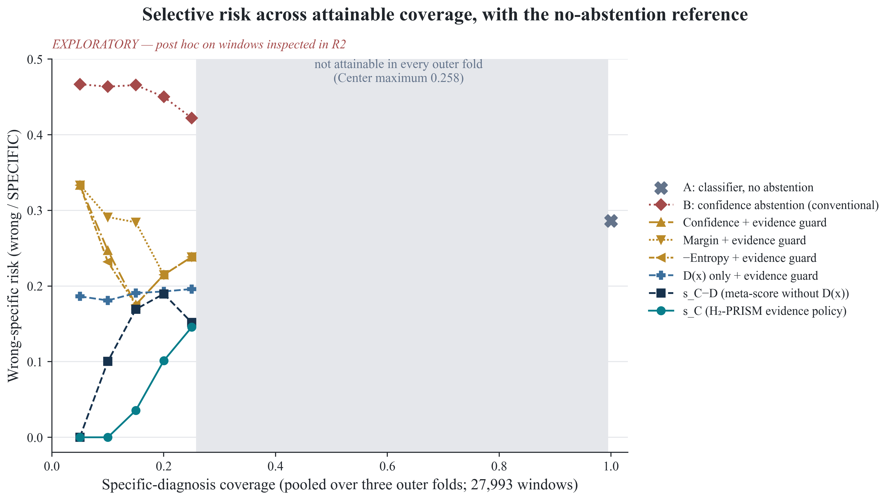

*AV-F01 — Matched reliability–coverage frontier.* Wrong-specific risk of each registered selection score at the five fixed coverage points inside the shared attainable region, and of the frozen classifier without abstention (all 27,993 windows: risk 0.286). Grey: coverage not attainable in every outer fold under the registered flags. No curve is extrapolated. Values and denominators in A01/A02a. ([caption](captions/AV-F01_reliability_coverage.md))

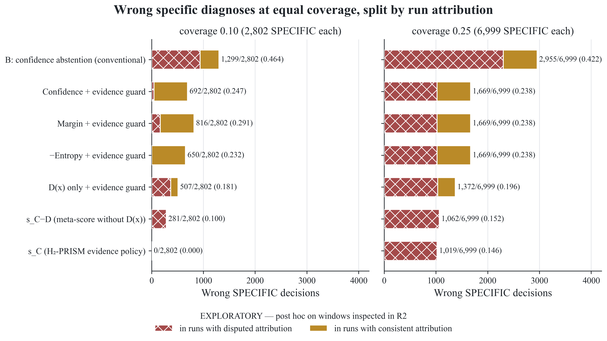

*AV-F02 — False-specific risk at equal coverage.* Counts of wrong SPECIFIC decisions with denominator and risk at two fixed coverage points (identical SPECIFIC counts per method). Every wrong SPECIFIC decision of s_C (1019 at 0.25) lies in runs whose topology attribution is disputed; the guarded conventional scores add 650 errors from the one undisputed Downstream NORMAL run, which the evidence policy withholds. Counts are comparable only because population and coverage are identical. ([caption](captions/AV-F02_false_specific_equal_coverage.md))

#### A01 — H1 matched-coverage benchmark

Rank-matched exact-count selections on the 27,993 frozen R2 windows (identical counts per method). relative_change undefined when the comparator risk is 0. Registered verdict unchanged: NOT_ESTIMABLE.

| coverage | comparator | specific_each | risk_s_C | risk_comparator | relative_change | delta_R | family_ci_low | family_ci_high | ancestor_ci_low | ancestor_ci_high | ancestors_discordant_errors | n_errors_undisputed_a | n_errors_undisputed_b | status |
|---|---|---|---|---|---|---|---|---|---|---|---|---|---|---|
| 0.05 | s_C_minus_D | 1,401 | 0 | 0 | — | 0 | 0 | 0 | 0 | 0 | 0 | 0 | 0 | EXPLORATORY_POST_HOC |
| 0.05 | confidence | 1,401 | 0 | 0.3333 | -1 | -0.3333 | -0.735 | 0 | -0.746 | 0 | 1 | 0 | 467 | EXPLORATORY_POST_HOC |
| 0.05 | margin | 1,401 | 0 | 0.3333 | -1 | -0.3333 | -0.735 | 0 | -0.746 | 0 | 1 | 0 | 467 | EXPLORATORY_POST_HOC |
| 0.05 | neg_entropy | 1,401 | 0 | 0.3333 | -1 | -0.3333 | -0.7343 | 0 | -0.7448 | 0 | 1 | 0 | 467 | EXPLORATORY_POST_HOC |
| 0.05 | D_only | 1,401 | 0 | 0.1863 | -1 | -0.1863 | -0.4149 | -0.003125 | -0.4406 | -0.004773 | 4 | 0 | 74 | EXPLORATORY_POST_HOC |
| 0.05 | confidence_no_evidence_guard | 1,401 | 0 | 0.4668 | -1 | -0.4668 | -0.7141 | -0.1703 | -0.7099 | -0.1669 | 5 | 0 | 187 | EXPLORATORY_POST_HOC |
| 0.1 | s_C_minus_D | 2,802 | 0 | 0.1003 | -1 | -0.1003 | -0.365 | 0 | -0.3926 | 0 | 1 | 0 | 0 | EXPLORATORY_POST_HOC |
| 0.1 | confidence | 2,802 | 0 | 0.247 | -1 | -0.247 | -0.58 | -0.003259 | -0.5182 | -0.003566 | 4 | 0 | 650 | EXPLORATORY_POST_HOC |
| 0.1 | margin | 2,802 | 0 | 0.2912 | -1 | -0.2912 | -0.6185 | -0.007933 | -0.5957 | -0.007496 | 4 | 0 | 650 | EXPLORATORY_POST_HOC |
| 0.1 | neg_entropy | 2,802 | 0 | 0.232 | -1 | -0.232 | -0.5669 | 0 | -0.4831 | 0 | 1 | 0 | 650 | EXPLORATORY_POST_HOC |
| 0.1 | D_only | 2,802 | 0 | 0.1809 | -1 | -0.1809 | -0.4045 | -0.005724 | -0.4316 | -0.008474 | 4 | 0 | 139 | EXPLORATORY_POST_HOC |
| 0.1 | confidence_no_evidence_guard | 2,802 | 0 | 0.4636 | -1 | -0.4636 | -0.7135 | -0.1677 | -0.7059 | -0.1677 | 5 | 0 | 365 | EXPLORATORY_POST_HOC |
| 0.15 | s_C_minus_D | 4,200 | 0.03548 | 0.1693 | -0.7904 | -0.1338 | -0.3166 | 0 | -0.312 | 0 | 2 | 0 | 0 | EXPLORATORY_POST_HOC |
| 0.15 | confidence | 4,200 | 0.03548 | 0.1752 | -0.7976 | -0.1398 | -0.4111 | 0.06651 | -0.3174 | 0.07427 | 4 | 0 | 650 | EXPLORATORY_POST_HOC |
| 0.15 | margin | 4,200 | 0.03548 | 0.2843 | -0.8752 | -0.2488 | -0.5296 | 0.05294 | -0.5156 | 0.05861 | 4 | 0 | 650 | EXPLORATORY_POST_HOC |
| 0.15 | neg_entropy | 4,200 | 0.03548 | 0.1752 | -0.7976 | -0.1398 | -0.4138 | 0.07031 | -0.3193 | 0.08098 | 3 | 0 | 650 | EXPLORATORY_POST_HOC |
| 0.15 | D_only | 4,200 | 0.03548 | 0.1907 | -0.814 | -0.1552 | -0.3082 | -0.008354 | -0.3362 | -0.01228 | 4 | 0 | 219 | EXPLORATORY_POST_HOC |
| 0.15 | confidence_no_evidence_guard | 4,200 | 0.03548 | 0.4657 | -0.9238 | -0.4302 | -0.6909 | -0.1233 | -0.6758 | -0.1051 | 7 | 0 | 556 | EXPLORATORY_POST_HOC |
| 0.2 | s_C_minus_D | 5,601 | 0.1012 | 0.1896 | -0.4661 | -0.08838 | -0.2134 | 0.001363 | -0.1819 | 0.001153 | 3 | 0 | 0 | EXPLORATORY_POST_HOC |
| 0.2 | confidence | 5,601 | 0.1012 | 0.2148 | -0.5287 | -0.1136 | -0.3571 | 0.1428 | -0.315 | 0.1557 | 4 | 0 | 650 | EXPLORATORY_POST_HOC |
| 0.2 | margin | 5,601 | 0.1012 | 0.2148 | -0.5287 | -0.1136 | -0.3555 | 0.1425 | -0.3058 | 0.156 | 4 | 0 | 650 | EXPLORATORY_POST_HOC |
| 0.2 | neg_entropy | 5,601 | 0.1012 | 0.2148 | -0.5287 | -0.1136 | -0.3552 | 0.1381 | -0.313 | 0.1513 | 4 | 0 | 650 | EXPLORATORY_POST_HOC |
| 0.2 | D_only | 5,601 | 0.1012 | 0.1928 | -0.475 | -0.09159 | -0.2064 | 0 | -0.2239 | 0.006001 | 4 | 0 | 277 | EXPLORATORY_POST_HOC |
| 0.2 | confidence_no_evidence_guard | 5,601 | 0.1012 | 0.4501 | -0.7751 | -0.3489 | -0.6385 | -0.01895 | -0.6256 | 0.01603 | 8 | 0 | 654 | EXPLORATORY_POST_HOC |
| 0.25 | s_C_minus_D | 6,999 | 0.1456 | 0.1517 | -0.04049 | -0.006144 | -0.04941 | 0.03373 | -0.04422 | 0.02301 | 3 | 0 | 0 | EXPLORATORY_POST_HOC |
| 0.25 | confidence | 6,999 | 0.1456 | 0.2385 | -0.3895 | -0.09287 | -0.2586 | 0.0292 | -0.2325 | 0.02176 | 4 | 0 | 650 | EXPLORATORY_POST_HOC |
| 0.25 | margin | 6,999 | 0.1456 | 0.2385 | -0.3895 | -0.09287 | -0.2544 | 0.02554 | -0.2268 | 0.02104 | 3 | 0 | 650 | EXPLORATORY_POST_HOC |
| 0.25 | neg_entropy | 6,999 | 0.1456 | 0.2385 | -0.3895 | -0.09287 | -0.2573 | 0.02602 | -0.2322 | 0.01973 | 4 | 0 | 650 | EXPLORATORY_POST_HOC |
| 0.25 | D_only | 6,999 | 0.1456 | 0.196 | -0.2573 | -0.05044 | -0.1598 | 0.03449 | -0.165 | 0.03664 | 3 | 0 | 338 | EXPLORATORY_POST_HOC |
| 0.25 | confidence_no_evidence_guard | 6,999 | 0.1456 | 0.4222 | -0.6552 | -0.2766 | -0.5585 | 0.01897 | -0.5527 | 0.06081 | 10 | 0 | 655 | EXPLORATORY_POST_HOC |

Source: `h1_validation/analysis/h1_05_paired_comparisons.csv`

**Interpretation.** The registered test remains NOT_ESTIMABLE. Inside the shared region the evidence policy has the lowest point risk, but every interval for the registered contrast includes 0 and no policy errs outside the disputed runs, so the apparent benefit cannot be separated from the attribution defect.

**Limitation.** Inspected windows; 17 templates; label defect.

## R2. Wrong-specific accounting and error attribution

- **Question.** Which wrong SPECIFIC decisions does each policy make, where, and with what confidence?
- **Evidence / method.** Same population; per-class, per-attribution, per-confidence and per-template counts.
- **Comparator.** As R1.

**Results.**

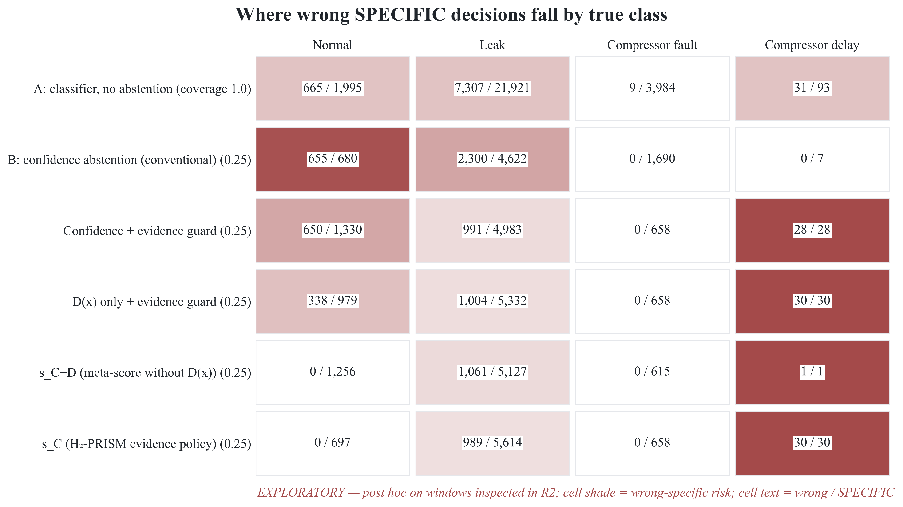

*AV-F03 — Classification error attribution.* Wrong / SPECIFIC decisions per true class for the classifier without abstention (all windows) and for each policy at coverage 0.25. LEAK errors (LEAK → NORMAL in Center) dominate every policy; the NORMAL errors of the conventional scores (NORMAL → LEAK) come from one template. Class supports: NORMAL 1,995, LEAK 21,921, FAULT 3,984, DELAY 93 windows from 1, 13, 2 and 1 scenario templates. ([caption](captions/AV-F03_error_attribution_by_class.md))

#### A02a — Wrong-specific accounting (R2)

Denominator: 27,993 windows (population); risk = wrong / specific. Confidence = max calibrated probability. Disputed runs: source-model attribution inconsistent with the manifest (D1 pending). EXPLORATORY_POST_HOC.

| coverage_requested | method | n_population | n_specific | coverage | n_wrong_specific | n_correct_specific | wrong_specific_risk | wrong_conf_ge_0.9 | wrong_conf_lt_0.9 | wrong_in_disputed_runs | wrong_in_undisputed_runs | eligible_not_selected | error_rate_eligible_not_selected | errors_blocked_by_evidence_flags | ancestors_selected | ancestors_with_wrong_specific | families_with_wrong_specific |
|---|---|---|---|---|---|---|---|---|---|---|---|---|---|---|---|---|---|
| 1 | A_classifier_no_abstention | 27,993 | 27,993 | 1 | 8,012 | 19,981 | 0.2862 | 2,991 | 5,021 | 7,347 | 665 | 0 | — | 0 | 17 | 16 | 13 |
| 0.05 | s_C | 27,993 | 1,401 | 0.05005 | 0 | 1,401 | 0 | 0 | 0 | 0 | 0 | 14,608 | 0.1192 | 6,271 | 13 | 0 | 0 |
| 0.05 | s_C_minus_D | 27,993 | 1,401 | 0.05005 | 0 | 1,401 | 0 | 0 | 0 | 0 | 0 | 14,608 | 0.1192 | 6,271 | 11 | 0 | 0 |
| 0.05 | confidence | 27,993 | 1,401 | 0.05005 | 467 | 934 | 0.3333 | 467 | 0 | 0 | 467 | 14,608 | 0.08721 | 6,271 | 13 | 1 | 1 |
| 0.05 | margin | 27,993 | 1,401 | 0.05005 | 467 | 934 | 0.3333 | 467 | 0 | 0 | 467 | 14,608 | 0.08721 | 6,271 | 13 | 1 | 1 |
| 0.05 | neg_entropy | 27,993 | 1,401 | 0.05005 | 467 | 934 | 0.3333 | 467 | 0 | 0 | 467 | 14,608 | 0.08721 | 6,271 | 13 | 1 | 1 |
| 0.05 | D_only | 27,993 | 1,401 | 0.05005 | 261 | 1,140 | 0.1863 | 74 | 187 | 187 | 74 | 14,608 | 0.1013 | 6,271 | 13 | 4 | 4 |
| 0.05 | confidence_no_evidence_guard | 27,993 | 1,401 | 0.05005 | 654 | 747 | 0.4668 | 654 | 0 | 467 | 187 | 26,592 | 0.2767 | 0 | 15 | 5 | 5 |
| 0.1 | s_C | 27,993 | 2,802 | 0.1001 | 0 | 2,802 | 0 | 0 | 0 | 0 | 0 | 13,207 | 0.1318 | 6,271 | 15 | 0 | 0 |
| 0.1 | s_C_minus_D | 27,993 | 2,802 | 0.1001 | 281 | 2,521 | 0.1003 | 0 | 281 | 281 | 0 | 13,207 | 0.1105 | 6,271 | 11 | 1 | 1 |
| 0.1 | confidence | 27,993 | 2,802 | 0.1001 | 692 | 2,110 | 0.247 | 650 | 42 | 42 | 650 | 13,207 | 0.07943 | 6,271 | 16 | 4 | 4 |
| 0.1 | margin | 27,993 | 2,802 | 0.1001 | 816 | 1,986 | 0.2912 | 650 | 166 | 166 | 650 | 13,207 | 0.07004 | 6,271 | 16 | 4 | 4 |
| 0.1 | neg_entropy | 27,993 | 2,802 | 0.1001 | 650 | 2,152 | 0.232 | 650 | 0 | 0 | 650 | 13,207 | 0.08261 | 6,271 | 13 | 1 | 1 |
| 0.1 | D_only | 27,993 | 2,802 | 0.1001 | 507 | 2,295 | 0.1809 | 139 | 368 | 368 | 139 | 13,207 | 0.09344 | 6,271 | 14 | 4 | 4 |
| 0.1 | confidence_no_evidence_guard | 27,993 | 2,802 | 0.1001 | 1,299 | 1,503 | 0.4636 | 1,299 | 0 | 934 | 365 | 25,191 | 0.2665 | 0 | 15 | 5 | 5 |
| 0.15 | s_C | 27,993 | 4,200 | 0.15 | 149 | 4,051 | 0.03548 | 0 | 149 | 149 | 0 | 11,809 | 0.1348 | 6,271 | 15 | 2 | 2 |
| 0.15 | s_C_minus_D | 27,993 | 4,200 | 0.15 | 711 | 3,489 | 0.1693 | 0 | 711 | 711 | 0 | 11,809 | 0.08722 | 6,271 | 14 | 2 | 2 |
| 0.15 | confidence | 27,993 | 4,200 | 0.15 | 736 | 3,464 | 0.1752 | 650 | 86 | 86 | 650 | 11,809 | 0.0851 | 6,271 | 16 | 4 | 4 |
| 0.15 | margin | 27,993 | 4,200 | 0.15 | 1,194 | 3,006 | 0.2843 | 650 | 544 | 544 | 650 | 11,809 | 0.04632 | 6,271 | 16 | 4 | 4 |
| 0.15 | neg_entropy | 27,993 | 4,200 | 0.15 | 736 | 3,464 | 0.1752 | 650 | 86 | 86 | 650 | 11,809 | 0.0851 | 6,271 | 15 | 3 | 3 |
| 0.15 | D_only | 27,993 | 4,200 | 0.15 | 801 | 3,399 | 0.1907 | 219 | 582 | 582 | 219 | 11,809 | 0.0796 | 6,271 | 14 | 4 | 4 |
| 0.15 | confidence_no_evidence_guard | 27,993 | 4,200 | 0.15 | 1,956 | 2,244 | 0.4657 | 1,956 | 0 | 1,400 | 556 | 23,793 | 0.2545 | 0 | 16 | 5 | 5 |
| 0.2 | s_C | 27,993 | 5,601 | 0.2001 | 567 | 5,034 | 0.1012 | 0 | 567 | 567 | 0 | 10,408 | 0.1128 | 6,271 | 16 | 3 | 3 |
| 0.2 | s_C_minus_D | 27,993 | 5,601 | 0.2001 | 1,062 | 4,539 | 0.1896 | 0 | 1,062 | 1,062 | 0 | 10,408 | 0.06524 | 6,271 | 16 | 3 | 3 |
| 0.2 | confidence | 27,993 | 5,601 | 0.2001 | 1,203 | 4,398 | 0.2148 | 650 | 553 | 553 | 650 | 10,408 | 0.05169 | 6,271 | 16 | 4 | 4 |
| 0.2 | margin | 27,993 | 5,601 | 0.2001 | 1,203 | 4,398 | 0.2148 | 650 | 553 | 553 | 650 | 10,408 | 0.05169 | 6,271 | 16 | 4 | 4 |
| 0.2 | neg_entropy | 27,993 | 5,601 | 0.2001 | 1,203 | 4,398 | 0.2148 | 650 | 553 | 553 | 650 | 10,408 | 0.05169 | 6,271 | 16 | 4 | 4 |
| 0.2 | D_only | 27,993 | 5,601 | 0.2001 | 1,080 | 4,521 | 0.1928 | 277 | 803 | 803 | 277 | 10,408 | 0.06351 | 6,271 | 14 | 4 | 4 |
| 0.2 | confidence_no_evidence_guard | 27,993 | 5,601 | 0.2001 | 2,521 | 3,080 | 0.4501 | 2,521 | 0 | 1,867 | 654 | 22,392 | 0.2452 | 0 | 17 | 5 | 5 |
| 0.25 | s_C | 27,993 | 6,999 | 0.25 | 1,019 | 5,980 | 0.1456 | 0 | 1,019 | 1,019 | 0 | 9,010 | 0.08013 | 6,271 | 16 | 3 | 3 |
| 0.25 | s_C_minus_D | 27,993 | 6,999 | 0.25 | 1,062 | 5,937 | 0.1517 | 0 | 1,062 | 1,062 | 0 | 9,010 | 0.07536 | 6,271 | 16 | 3 | 3 |
| 0.25 | confidence | 27,993 | 6,999 | 0.25 | 1,669 | 5,330 | 0.2385 | 650 | 1,019 | 1,019 | 650 | 9,010 | 0.007991 | 6,271 | 16 | 4 | 4 |
| 0.25 | margin | 27,993 | 6,999 | 0.25 | 1,669 | 5,330 | 0.2385 | 650 | 1,019 | 1,019 | 650 | 9,010 | 0.007991 | 6,271 | 16 | 4 | 4 |
| 0.25 | neg_entropy | 27,993 | 6,999 | 0.25 | 1,669 | 5,330 | 0.2385 | 650 | 1,019 | 1,019 | 650 | 9,010 | 0.007991 | 6,271 | 16 | 4 | 4 |
| 0.25 | D_only | 27,993 | 6,999 | 0.25 | 1,372 | 5,627 | 0.196 | 338 | 1,034 | 1,034 | 338 | 9,010 | 0.04095 | 6,271 | 14 | 4 | 4 |
| 0.25 | confidence_no_evidence_guard | 27,993 | 6,999 | 0.25 | 2,955 | 4,044 | 0.4222 | 2,955 | 0 | 2,300 | 655 | 20,994 | 0.2409 | 0 | 17 | 7 | 6 |

Source: `advanced_validation/analysis/av_r2_wrong_specific_accounting.csv`

#### A02b — Wrong-specific accounting by true class (R2; no abstention and coverage 0.25)

class_coverage = specific / windows of the class. EXPLORATORY_POST_HOC.

| coverage_requested | method | true_class | n_class_windows | n_specific | class_coverage | n_wrong_specific | wrong_specific_risk | ancestors_specific |
|---|---|---|---|---|---|---|---|---|
| 1 | A_classifier_no_abstention | NORMAL | 1,995 | 1,995 | 1 | 665 | 0.3333 | 1 |
| 1 | A_classifier_no_abstention | LEAK | 21,921 | 21,921 | 1 | 7,307 | 0.3333 | 13 |
| 1 | A_classifier_no_abstention | COMPRESSOR_FAULT | 3,984 | 3,984 | 1 | 9 | 0.002259 | 2 |
| 1 | A_classifier_no_abstention | COMPRESSOR_DELAY | 93 | 93 | 1 | 31 | 0.3333 | 1 |
| 0.25 | s_C | NORMAL | 1,995 | 697 | 0.3494 | 0 | 0 | 1 |
| 0.25 | s_C | LEAK | 21,921 | 5,614 | 0.2561 | 989 | 0.1762 | 13 |
| 0.25 | s_C | COMPRESSOR_FAULT | 3,984 | 658 | 0.1652 | 0 | 0 | 1 |
| 0.25 | s_C | COMPRESSOR_DELAY | 93 | 30 | 0.3226 | 30 | 1 | 1 |
| 0.25 | s_C_minus_D | NORMAL | 1,995 | 1,256 | 0.6296 | 0 | 0 | 1 |
| 0.25 | s_C_minus_D | LEAK | 21,921 | 5,127 | 0.2339 | 1,061 | 0.2069 | 13 |
| 0.25 | s_C_minus_D | COMPRESSOR_FAULT | 3,984 | 615 | 0.1544 | 0 | 0 | 1 |
| 0.25 | s_C_minus_D | COMPRESSOR_DELAY | 93 | 1 | 0.01075 | 1 | 1 | 1 |
| 0.25 | confidence | NORMAL | 1,995 | 1,330 | 0.6667 | 650 | 0.4887 | 1 |
| 0.25 | confidence | LEAK | 21,921 | 4,983 | 0.2273 | 991 | 0.1989 | 13 |
| 0.25 | confidence | COMPRESSOR_FAULT | 3,984 | 658 | 0.1652 | 0 | 0 | 1 |
| 0.25 | confidence | COMPRESSOR_DELAY | 93 | 28 | 0.3011 | 28 | 1 | 1 |
| 0.25 | margin | NORMAL | 1,995 | 1,330 | 0.6667 | 650 | 0.4887 | 1 |
| 0.25 | margin | LEAK | 21,921 | 4,981 | 0.2272 | 989 | 0.1986 | 13 |
| 0.25 | margin | COMPRESSOR_FAULT | 3,984 | 658 | 0.1652 | 0 | 0 | 1 |
| 0.25 | margin | COMPRESSOR_DELAY | 93 | 30 | 0.3226 | 30 | 1 | 1 |
| 0.25 | neg_entropy | NORMAL | 1,995 | 1,330 | 0.6667 | 650 | 0.4887 | 1 |
| 0.25 | neg_entropy | LEAK | 21,921 | 4,984 | 0.2274 | 992 | 0.199 | 13 |
| 0.25 | neg_entropy | COMPRESSOR_FAULT | 3,984 | 658 | 0.1652 | 0 | 0 | 1 |
| 0.25 | neg_entropy | COMPRESSOR_DELAY | 93 | 27 | 0.2903 | 27 | 1 | 1 |
| 0.25 | D_only | NORMAL | 1,995 | 979 | 0.4907 | 338 | 0.3453 | 1 |
| 0.25 | D_only | LEAK | 21,921 | 5,332 | 0.2432 | 1,004 | 0.1883 | 11 |
| 0.25 | D_only | COMPRESSOR_FAULT | 3,984 | 658 | 0.1652 | 0 | 0 | 1 |
| 0.25 | D_only | COMPRESSOR_DELAY | 93 | 30 | 0.3226 | 30 | 1 | 1 |
| 0.25 | confidence_no_evidence_guard | NORMAL | 1,995 | 680 | 0.3409 | 655 | 0.9632 | 1 |
| 0.25 | confidence_no_evidence_guard | LEAK | 21,921 | 4,622 | 0.2108 | 2,300 | 0.4976 | 13 |
| 0.25 | confidence_no_evidence_guard | COMPRESSOR_FAULT | 3,984 | 1,690 | 0.4242 | 0 | 0 | 2 |
| 0.25 | confidence_no_evidence_guard | COMPRESSOR_DELAY | 93 | 7 | 0.07527 | 0 | 0 | 1 |

Source: `advanced_validation/analysis/av_r2_wrong_specific_by_class.csv`

**Interpretation.** Without abstention 28.6 % of windows are wrong and 2,991 errors carry confidence ≥ 0.9. At coverage 0.25 every wrong SPECIFIC decision of s_C is low-confidence (< 0.9) and lies in a disputed run; the guarded conventional scores add 650 confident errors from the single undisputed Downstream NORMAL run. At coverage 0.25 the wrong decisions come from 3 templates (s_C, s_C−D), 4 (guarded scores) and 7 (conventional abstention) of 17.

**Limitation.** One NORMAL template; inspected data.

## R3. Negative controls

- **Question.** Do the policies mistake normal operation or command interventions for leaks?
- **Evidence / method.** R2 NORMAL windows (one template); Center pressure-command and timing interventions.
- **Comparator.** Classifier without abstention; nearest-mechanism rule.

**Results.**

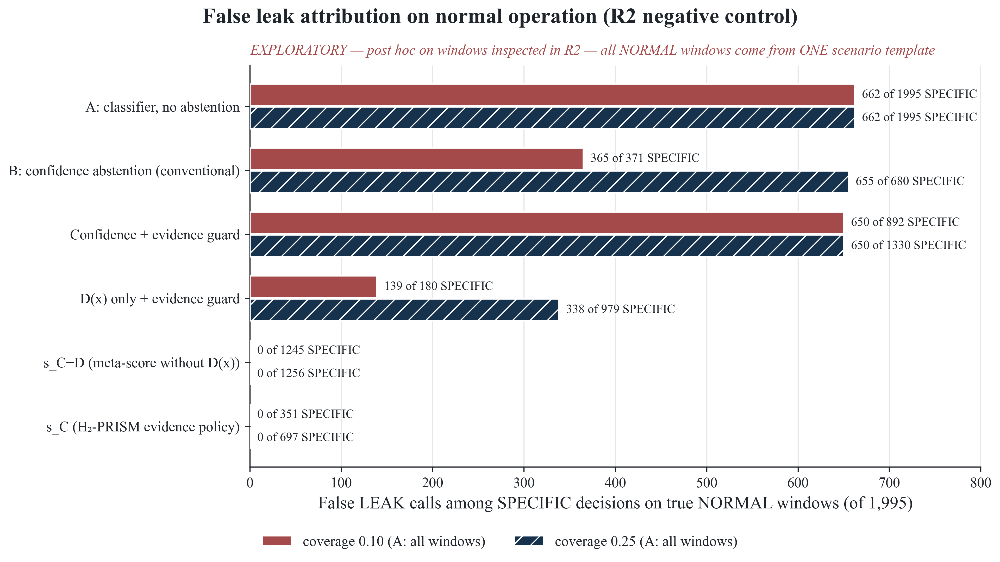

*AV-F11 — Negative-control false leak attribution.* Wrong LEAK attributions on the 1,995 NORMAL windows (one normal-operation template simulated in three topologies). The classifier without abstention calls 662 of them LEAK; conventional confidence abstention still issues 655 at coverage 0.25; the evidence policies (s_C, s_C−D) issue none. On Center, the nearest-mechanism rule assigns the command-timing intervention to withdrawal once its own template is removed, whereas formal D(Y) issues no withdrawal decision for either operational intervention (A11b). One template cannot support a rate. ([caption](captions/AV-F11_negative_control_false_leak.md))

#### A11a — Negative control — R2 NORMAL windows

False LEAK calls among SPECIFIC decisions on true NORMAL windows. All NORMAL windows come from ONE scenario template (one run per topology). EXPLORATORY_POST_HOC.

| coverage_requested | method | normal_windows | normal_specific | false_leak_calls | false_fault_or_delay_calls | normal_ancestors |
|---|---|---|---|---|---|---|
| 1 | A_classifier_no_abstention | 1,995 | 1,995 | 662 | 3 | 1 |
| 0.1 | s_C | 1,995 | 351 | 0 | 0 | 1 |
| 0.1 | s_C_minus_D | 1,995 | 1,245 | 0 | 0 | 1 |
| 0.1 | confidence | 1,995 | 892 | 650 | 0 | 1 |
| 0.1 | margin | 1,995 | 768 | 650 | 0 | 1 |
| 0.1 | neg_entropy | 1,995 | 968 | 650 | 0 | 1 |
| 0.1 | D_only | 1,995 | 180 | 139 | 0 | 1 |
| 0.1 | confidence_no_evidence_guard | 1,995 | 371 | 365 | 0 | 1 |
| 0.25 | s_C | 1,995 | 697 | 0 | 0 | 1 |
| 0.25 | s_C_minus_D | 1,995 | 1,256 | 0 | 0 | 1 |
| 0.25 | confidence | 1,995 | 1,330 | 650 | 0 | 1 |
| 0.25 | margin | 1,995 | 1,330 | 650 | 0 | 1 |
| 0.25 | neg_entropy | 1,995 | 1,330 | 650 | 0 | 1 |
| 0.25 | D_only | 1,995 | 979 | 338 | 0 | 1 |
| 0.25 | confidence_no_evidence_guard | 1,995 | 680 | 655 | 0 | 1 |

Source: `advanced_validation/analysis/av_r2_negative_control_normal.csv`

#### A11b — Negative control — Center operational interventions

Pressure-command change (SID 55), command-issuance shift (SID 59) and nominal run. These are command interventions, not equipment failures.

| query | condition | true_mechanism | predicted | status | method |
|---|---|---|---|---|---|
| PRESSURE | frozen | Pressure command | Pressure command | CORRECT | B3 nearest mechanism |
| PRESSURE | loto | Pressure command | Timing shift | UNSUPPORTED | B3 nearest mechanism |
| TIMING | frozen | Timing shift | Timing shift | CORRECT | B3 nearest mechanism |
| TIMING | loto | Timing shift | Withdrawal | UNSUPPORTED | B3 nearest mechanism |
| NOMINAL | frozen | Normal | Normal | CORRECT | B3 nearest mechanism |
| NOMINAL | loto | Normal | Normal | CORRECT | B3 nearest mechanism |
| PRESSURE | restricted, S3/S4/S5/REF | operational | UNRESOLVED_MODEL_MISMATCH ×4 | no false withdrawal call | formal D(Y) |
| TIMING | restricted, S3/S4/S5/REF | operational | UNRESOLVED_MODEL_MISMATCH ×4 | no false withdrawal call | formal D(Y) |

Source: `TAB_C02`; `dy_experiment_runs.csv`

**Interpretation.** Conventional abstention keeps 655 false LEAK calls among 680 NORMAL SPECIFIC decisions at 0.25; the evidence policies issue none. On Center the nearest-mechanism rule routes the timing intervention to withdrawal once its own template is removed; formal D(Y) issues no withdrawal decision for either intervention.

**Limitation.** One NORMAL template; two Center interventions.

## R4. Formal D(Y): mathematical integrity

- **Question.** Does the engine respect evidence monotonicity, and are its certificates valid?
- **Evidence / method.** 2,376 new decisions on the hash-verified Center captures plus the 672 frozen decisions.
- **Comparator.** Paired runs with frozen bounds: sensor removal, clock widening, bound widening; independent certificate re-verification.

**Results.**

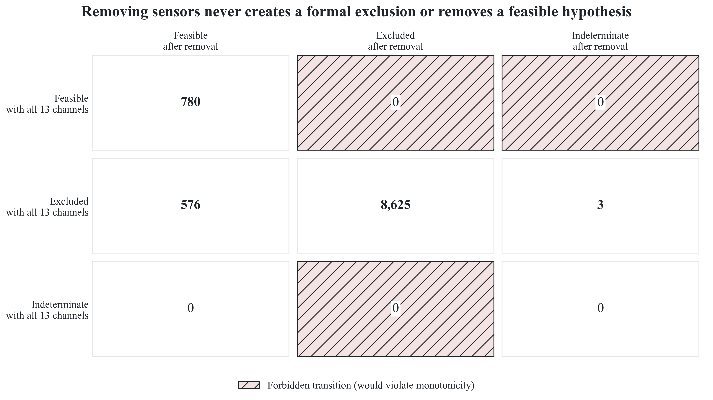

*AV-F05 — Formal D(Y) decision-state transitions.* Hypothesis-status transitions between the all-channel run and each of the 78 reduced sensor configurations (9,984 hypothesis checks, 6 queries × 4 bound scenarios). Forbidden cells (hatched) are all zero. Across all invariant tests — sensor removal, clock-bound widening and bound widening on the frozen grid — 25,024 paired hypothesis checks show 0 violations (A04a). ([caption](captions/AV-F05_dy_status_transitions.md))

#### A04a — Formal D(Y) mathematical and numerical integrity

Allowed transitions when information is removed or uncertainty widened: FEASIBLE→FEASIBLE; EXCLUDED→any; INDETERMINATE→INDETERMINATE/FEASIBLE. 'violations' counts forbidden transitions or failed re-verifications.

| test | paired_comparisons | hypothesis_checks | violations | result |
|---|---|---|---|---|
| bound widening (frozen grid) | 1,920 | 13,760 | 0 | PASS |
| clock-bound widening | 240 | 1,280 | 0 | PASS |
| sensor removal (subset of all 13 channels) | 1,872 | 9,984 | 0 | PASS |
| EXCLUDED certificates re-verified independently | 2,376 | 11,061 | 0 | PASS |
| FEASIBLE witnesses re-verified (exact rationals) | 2,376 | 1,552 | 0 | PASS |

Source: `advanced_validation/analysis/dy_invariant_checks.csv`; `dy_experiment_runs.csv`

#### A04b — Formal D(Y) qualification by aspect

Evidence versus decision are reported separately.

| aspect | status | evidence |
|---|---|---|
| Mathematical correctness (engine semantics) | VERIFIED | 0 invariant violations; all certificates and witnesses re-verify |
| Invalid-input handling | IMPLEMENTED | MeasurementContract.issues → UNRESOLVED/INVALID_MEASUREMENT (tests/test_certified_evidence.py) |
| Unsupported hypotheses | VERIFIED | always INDETERMINATE; full universe 42/42 UNRESOLVED (E4) |
| Observation and model bounds | HYPOTHETICAL | declared ladder S1–S6; REF = solver-refinement deltas (scale reference, not an enclosure) |
| Physical uncertainty qualification | NOT ESTABLISHED | no instrument specification or model-error enclosure |
| Decision correctness inside an incomplete library | FAILS AS EXPECTED | restricted universe: wrong SPECIFIC whenever truth absent and a rival fits |
| Physical validation | NOT ESTABLISHED | air-like simulation, one source family |

Source: `A04a`; `A05`; `02_methodology/HYDROGEN_MODEL_SPECIFICATION.md`

**Interpretation.** Zero forbidden transitions in 25,024 paired hypothesis checks; all 11,061 exclusion certificates and 1,552 feasibility witnesses re-verify. The engine is mathematically sound on these inputs.

**Limitation.** Mathematical property only; bounds hypothetical.

## R5. Hypothesis-library completeness

- **Question.** What happens when the true mechanism or an operating rival is missing?
- **Evidence / method.** E4: four libraries × 6 queries × 7 bound scenarios.
- **Comparator.** Full declared universe.

**Results.**

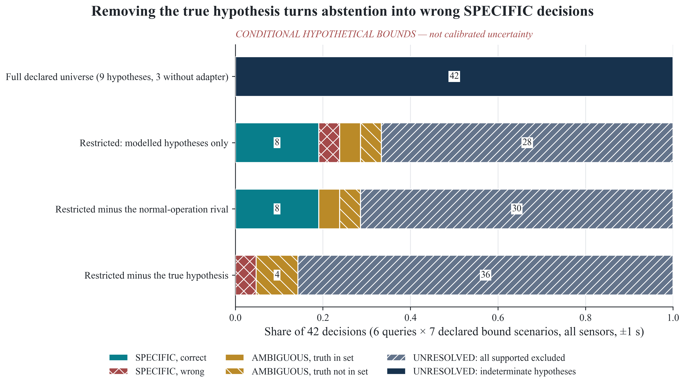

*AV-F04 — Hypothesis-library completeness and false specificity.* Formal D(Y) outcomes for four hypothesis libraries. Full declared universe: all UNRESOLVED. Restricted: 8 correct and 2 wrong SPECIFIC. Removing the normal-operation rival removes both wrong decisions (they selected that rival). Removing the true hypothesis of the two supported queries gives 2 wrong SPECIFIC and 4 ambiguity sets without the truth; the rest abstain as MODEL_MISMATCH. False specificity is unavoidable when the truth is absent and a rival remains consistent. ([caption](captions/AV-F04_library_completeness.md))

#### A05 — Hypothesis-library completeness

All 13 channels, ±1 s, S1–S6 and REF (42 decisions per variant: 6 queries × 7 scenarios). CONDITIONAL_HYPOTHETICAL_BOUNDS.

| experiment | config_family | decisions | specific | specific_correct | specific_wrong | specific_coverage | wrong_specific_risk | ambiguous | ambiguous_truth_in | mean_ambiguity_set_size | unresolved_model_mismatch | unresolved_indeterminate | truth_retained | truth_in_library | mean_excluded_hypotheses | n_channels |
|---|---|---|---|---|---|---|---|---|---|---|---|---|---|---|---|---|
| E4_library | full | 42 | 0 | 0 | 0 | 0 | — | 0 | 0 | — | 0 | 42 | 38 | 14 | 4.762 | 13 |
| E4_library | minus_NORMAL | 42 | 8 | 8 | 0 | 0.1905 | 0 | 4 | 2 | 2.5 | 30 | 0 | 10 | 14 | 3.905 | 13 |
| E4_library | minus_true | 42 | 2 | 0 | 2 | 0.04762 | 1 | 4 | 0 | 3 | 36 | 0 | 0 | 0 | 4.667 | 13 |
| E4_library | restricted | 42 | 10 | 8 | 2 | 0.2381 | 0.2 | 4 | 2 | 3.5 | 28 | 0 | 10 | 14 | 4.762 | 13 |

Source: `advanced_validation/analysis/dy_outcome_summary.csv`

**Interpretation.** The full declared universe never decides (42/42 UNRESOLVED). Removing the true hypothesis converts abstention into wrong SPECIFIC decisions and ambiguity sets without the truth; removing the normal-operation rival removes the two wrong decisions because they had selected it. False specificity is unavoidable whenever the truth is absent and one rival stays consistent.

**Limitation.** Conditional bounds; six captures.

## R6. Missing sensors and evidence availability

- **Question.** Does losing sensors lead to abstention or to false certainty?
- **Evidence / method.** E1: 79 predeclared sensor configurations.
- **Comparator.** All 13 channels.

**Results.**

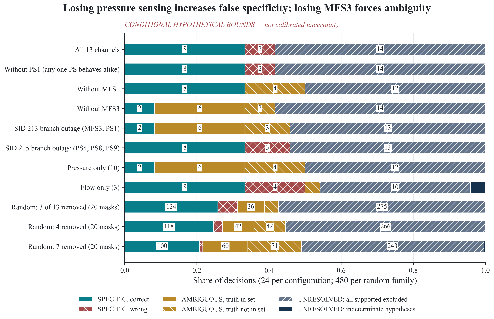

*AV-F08 — Missing-sensor robustness.* Formal D(Y) outcomes under predeclared sensor losses (restricted universe, ±1 s, S3, S4, S5, REF). Flow-only sensing raises wrong SPECIFIC from 2 to 4 of 24; without MFS3 the correct SPECIFIC decisions drop from 8 to 2 and become ambiguity sets. Removing any single pressure sensor other than those of the SID 215 branch changes nothing. Ambiguity sets without the truth (hatched ochre) are not safe outcomes. ([caption](captions/AV-F08_missing_sensor_robustness.md))

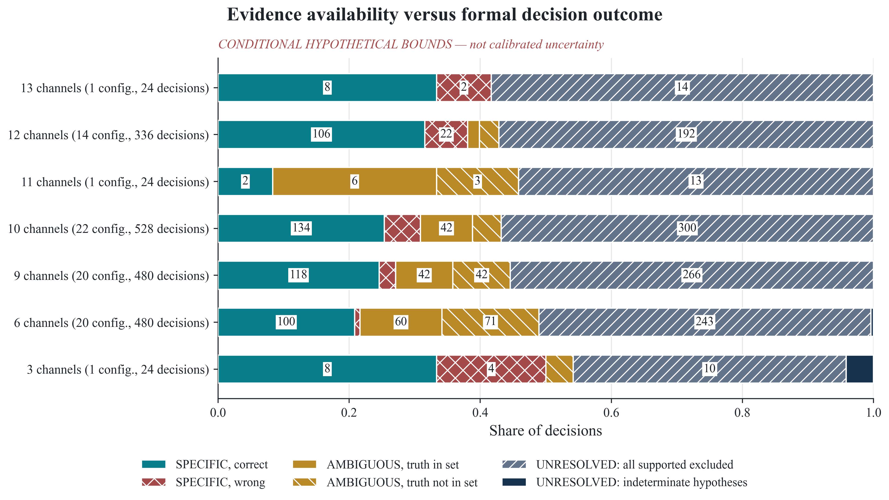

*AV-F10 — Evidence availability versus decision outcomes.* All predeclared sensor configurations grouped by the number of available channels (an objective information axis; configurations with the same count differ in which channels remain, see AV-F08). Correct SPECIFIC decisions become rarer and ambiguity more frequent as channels are removed, but wrong SPECIFIC decisions do not fall monotonically: the 3-channel flow-only set has the highest wrong-specific share. Channel identity matters more than count. ([caption](captions/AV-F10_evidence_availability.md))

#### A08 — Missing-sensor robustness

Restricted universe, ±1 s; 24 decisions per configuration (6 queries × S3, S4, S5, REF); random_dropk rows pool 20 fixed masks (480 decisions). CONDITIONAL_HYPOTHETICAL_BOUNDS.

| experiment | config_family | decisions | specific | specific_correct | specific_wrong | specific_coverage | wrong_specific_risk | ambiguous | ambiguous_truth_in | mean_ambiguity_set_size | unresolved_model_mismatch | unresolved_indeterminate | truth_retained | truth_in_library | mean_excluded_hypotheses | n_channels |
|---|---|---|---|---|---|---|---|---|---|---|---|---|---|---|---|---|
| E1_sensors | all | 24 | 10 | 8 | 2 | 0.4167 | 0.2 | 0 | 0 | — | 14 | 0 | 8 | 8 | 4.917 | 13 |
| E1_sensors | drop_MFS1 | 24 | 8 | 8 | 0 | 0.3333 | 0 | 4 | 0 | 2 | 12 | 0 | 8 | 8 | 4.667 | 12 |
| E1_sensors | drop_MFS2 | 24 | 10 | 8 | 2 | 0.4167 | 0.2 | 0 | 0 | — | 14 | 0 | 8 | 8 | 4.917 | 12 |
| E1_sensors | drop_MFS3 | 24 | 2 | 2 | 0 | 0.08333 | 0 | 8 | 6 | 2.5 | 14 | 0 | 8 | 8 | 4.417 | 12 |
| E1_sensors | drop_PS1 | 24 | 10 | 8 | 2 | 0.4167 | 0.2 | 0 | 0 | — | 14 | 0 | 8 | 8 | 4.917 | 12 |
| E1_sensors | drop_PS10 | 24 | 10 | 8 | 2 | 0.4167 | 0.2 | 0 | 0 | — | 14 | 0 | 8 | 8 | 4.917 | 12 |
| E1_sensors | drop_PS2 | 24 | 10 | 8 | 2 | 0.4167 | 0.2 | 0 | 0 | — | 14 | 0 | 8 | 8 | 4.917 | 12 |
| E1_sensors | drop_PS3 | 24 | 10 | 8 | 2 | 0.4167 | 0.2 | 0 | 0 | — | 14 | 0 | 8 | 8 | 4.917 | 12 |
| E1_sensors | drop_PS4 | 24 | 10 | 8 | 2 | 0.4167 | 0.2 | 0 | 0 | — | 14 | 0 | 8 | 8 | 4.917 | 12 |
| E1_sensors | drop_PS5 | 24 | 10 | 8 | 2 | 0.4167 | 0.2 | 0 | 0 | — | 14 | 0 | 8 | 8 | 4.917 | 12 |
| E1_sensors | drop_PS6 | 24 | 10 | 8 | 2 | 0.4167 | 0.2 | 0 | 0 | — | 14 | 0 | 8 | 8 | 4.917 | 12 |
| E1_sensors | drop_PS7 | 24 | 10 | 8 | 2 | 0.4167 | 0.2 | 0 | 0 | — | 14 | 0 | 8 | 8 | 4.917 | 12 |
| E1_sensors | drop_PS8 | 24 | 10 | 8 | 2 | 0.4167 | 0.2 | 0 | 0 | — | 14 | 0 | 8 | 8 | 4.917 | 12 |
| E1_sensors | drop_PS9 | 24 | 10 | 8 | 2 | 0.4167 | 0.2 | 0 | 0 | — | 14 | 0 | 8 | 8 | 4.917 | 12 |
| E1_sensors | flow_only | 24 | 12 | 8 | 4 | 0.5 | 0.3333 | 1 | 0 | 3 | 10 | 1 | 8 | 8 | 4.583 | 3 |
| E1_sensors | outage_branch_SID213(MFS3,PS1) | 24 | 2 | 2 | 0 | 0.08333 | 0 | 9 | 6 | 2.889 | 13 | 0 | 8 | 8 | 4.167 | 11 |
| E1_sensors | outage_branch_SID215(PS4,PS8,PS9) | 24 | 11 | 8 | 3 | 0.4583 | 0.2727 | 0 | 0 | — | 13 | 0 | 8 | 8 | 4.875 | 10 |
| E1_sensors | outage_branch_SID312(MFS1) | 24 | 8 | 8 | 0 | 0.3333 | 0 | 4 | 0 | 2 | 12 | 0 | 8 | 8 | 4.667 | 12 |
| E1_sensors | pressure_only | 24 | 2 | 2 | 0 | 0.08333 | 0 | 10 | 6 | 3.2 | 12 | 0 | 8 | 8 | 3.917 | 10 |
| E1_sensors | random_drop3 | 480 | 150 | 124 | 26 | 0.3125 | 0.1733 | 55 | 36 | 2.655 | 275 | 0 | 160 | 160 | 4.717 | 10 |
| E1_sensors | random_drop4 | 480 | 130 | 118 | 12 | 0.2708 | 0.09231 | 84 | 42 | 2.333 | 266 | 0 | 160 | 160 | 4.654 | 9 |
| E1_sensors | random_drop7 | 480 | 104 | 100 | 4 | 0.2167 | 0.03846 | 131 | 60 | 2.84 | 243 | 2 | 160 | 160 | 4.329 | 6 |

Source: `advanced_validation/analysis/dy_outcome_summary.csv`

#### A10 — Evidence availability (channel count) versus decision outcome

All E1 configurations grouped by number of available channels (configurations differ in which channels; see A08).

| n_channels | decisions | specific | specific_correct | specific_wrong | specific_coverage | wrong_specific_risk | ambiguous | ambiguous_truth_in | mean_ambiguity_set_size | unresolved_model_mismatch | unresolved_indeterminate | truth_retained | truth_in_library | mean_excluded_hypotheses | configs |
|---|---|---|---|---|---|---|---|---|---|---|---|---|---|---|---|
| 3 | 24 | 12 | 8 | 4 | 0.5 | 0.3333 | 1 | 0 | 3 | 10 | 1 | 8 | 8 | 4.583 | 1 |
| 6 | 480 | 104 | 100 | 4 | 0.2167 | 0.03846 | 131 | 60 | 2.84 | 243 | 2 | 160 | 160 | 4.329 | 20 |
| 9 | 480 | 130 | 118 | 12 | 0.2708 | 0.09231 | 84 | 42 | 2.333 | 266 | 0 | 160 | 160 | 4.654 | 20 |
| 10 | 528 | 163 | 134 | 29 | 0.3087 | 0.1779 | 65 | 42 | 2.738 | 300 | 0 | 176 | 176 | 4.688 | 22 |
| 11 | 24 | 2 | 2 | 0 | 0.08333 | 0 | 9 | 6 | 2.889 | 13 | 0 | 8 | 8 | 4.167 | 1 |
| 12 | 336 | 128 | 106 | 22 | 0.381 | 0.1719 | 16 | 6 | 2.25 | 192 | 0 | 112 | 112 | 4.845 | 14 |
| 13 | 24 | 10 | 8 | 2 | 0.4167 | 0.2 | 0 | 0 | — | 14 | 0 | 8 | 8 | 4.917 | 1 |

Source: `advanced_validation/analysis/dy_evidence_availability.csv`

**Interpretation.** It depends on which channels are lost. Losing MFS3 (SID 213 branch meter) turns correct SPECIFIC decisions into ambiguity; losing pressure sensing (flow only) doubles wrong SPECIFIC decisions (2 → 4 of 24) because pressure is what excludes normal operation for the flow-blind SID 215 withdrawal. Random removals reduce both correct and wrong SPECIFIC decisions.

**Limitation.** Conditional bounds; counts.

## R7. Timing uncertainty

- **Question.** How do clock uncertainty and observation delay affect formal decisions?
- **Evidence / method.** E2 (τ 0–10 s) and E3 (delay 0–10 s, τ = 1 s or τ = delay).
- **Comparator.** τ = 1 s, no delay.

**Results.**

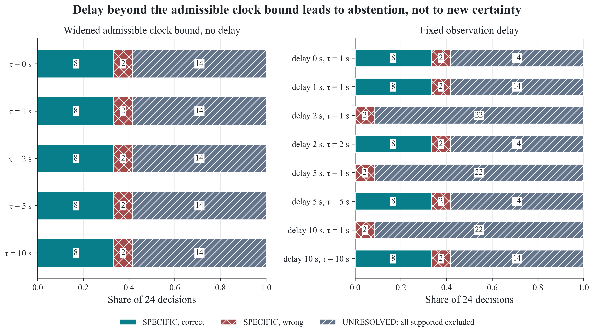

*AV-F09 — Timing-alignment robustness.* Left: widening the admissible clock-shift set from 0 to 10 s leaves every decision unchanged (no new exclusions, as required). Right: an observation delay of 2 s or more with τ = 1 s removes every correct SPECIFIC decision (UNRESOLVED: all supported hypotheses excluded); declaring τ equal to the delay restores them. The two wrong SPECIFIC decisions (SID 215 → normal operation) are delay-invariant because the normal-operation template is constant. Jitter was not tested (no jitter model). ([caption](captions/AV-F09_timing_robustness.md))

#### A09 — Timing uncertainty and alignment

E2: admissible clock bound τ widened with no delay. E3: observed signal delayed by d with τ = 1 s (unchanged) or τ = d (widened). Jitter not executed (no jitter model).

| experiment | config_family | decisions | specific | specific_correct | specific_wrong | specific_coverage | wrong_specific_risk | ambiguous | ambiguous_truth_in | mean_ambiguity_set_size | unresolved_model_mismatch | unresolved_indeterminate | truth_retained | truth_in_library | mean_excluded_hypotheses | n_channels |
|---|---|---|---|---|---|---|---|---|---|---|---|---|---|---|---|---|
| E2_clock_bound | tau_0s | 24 | 10 | 8 | 2 | 0.4167 | 0.2 | 0 | 0 | — | 14 | 0 | 8 | 8 | 4.917 | 13 |
| E2_clock_bound | tau_10s | 24 | 10 | 8 | 2 | 0.4167 | 0.2 | 0 | 0 | — | 14 | 0 | 8 | 8 | 4.917 | 13 |
| E2_clock_bound | tau_1s | 24 | 10 | 8 | 2 | 0.4167 | 0.2 | 0 | 0 | — | 14 | 0 | 8 | 8 | 4.917 | 13 |
| E2_clock_bound | tau_2s | 24 | 10 | 8 | 2 | 0.4167 | 0.2 | 0 | 0 | — | 14 | 0 | 8 | 8 | 4.917 | 13 |
| E2_clock_bound | tau_5s | 24 | 10 | 8 | 2 | 0.4167 | 0.2 | 0 | 0 | — | 14 | 0 | 8 | 8 | 4.917 | 13 |
| E3_delay | delay_0s_tau_1s | 24 | 10 | 8 | 2 | 0.4167 | 0.2 | 0 | 0 | — | 14 | 0 | 8 | 8 | 4.917 | 13 |
| E3_delay | delay_10s_tau_10s | 24 | 10 | 8 | 2 | 0.4167 | 0.2 | 0 | 0 | — | 14 | 0 | 8 | 8 | 4.917 | 13 |
| E3_delay | delay_10s_tau_1s | 24 | 2 | 0 | 2 | 0.08333 | 1 | 0 | 0 | — | 22 | 0 | 0 | 8 | 5.25 | 13 |
| E3_delay | delay_1s_tau_1s | 24 | 10 | 8 | 2 | 0.4167 | 0.2 | 0 | 0 | — | 14 | 0 | 8 | 8 | 4.917 | 13 |
| E3_delay | delay_2s_tau_1s | 24 | 2 | 0 | 2 | 0.08333 | 1 | 0 | 0 | — | 22 | 0 | 0 | 8 | 5.25 | 13 |
| E3_delay | delay_2s_tau_2s | 24 | 10 | 8 | 2 | 0.4167 | 0.2 | 0 | 0 | — | 14 | 0 | 8 | 8 | 4.917 | 13 |
| E3_delay | delay_5s_tau_1s | 24 | 2 | 0 | 2 | 0.08333 | 1 | 0 | 0 | — | 22 | 0 | 0 | 8 | 5.25 | 13 |
| E3_delay | delay_5s_tau_5s | 24 | 10 | 8 | 2 | 0.4167 | 0.2 | 0 | 0 | — | 14 | 0 | 8 | 8 | 4.917 | 13 |

Source: `advanced_validation/analysis/dy_outcome_summary.csv`

**Interpretation.** Widening τ changes nothing (no new exclusions). A delay of 2 s or more beyond τ removes all correct SPECIFIC decisions in favour of MODEL_MISMATCH abstention; declaring τ = delay restores them. The two wrong decisions are delay-invariant.

**Limitation.** Fixed-step simulation clock; jitter not tested.

## R8. Pairwise isolability and minimum sensor sets

- **Question.** Which hypothesis pairs are formally separable with which sensors?
- **Evidence / method.** Template-level isolability over admissible shifts; exhaustive search over 8,191 channel subsets.
- **Comparator.** All 13 channels.

**Results.**

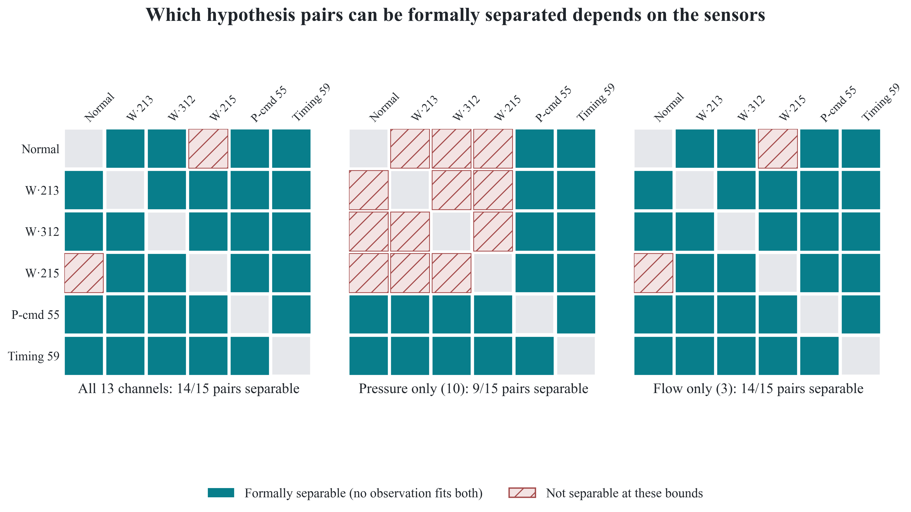

*AV-F07 — Sensor-dependent pairwise isolability.* Template-level pairwise isolability at the REF bounds (0.0344 MPa, 0.0182 kg/s total) with ±1 s alignment: a pair is separable if, for every pair of admissible shifts, some coordinate differs by more than twice the bound. Normal operation and the SID 215 withdrawal are not separable even with all channels. Exhaustive search: 2 channels (MFS1+MFS3) preserve all 14 separable pairs (A16b). Conditional on declared bounds. ([caption](captions/AV-F07_pairwise_isolability.md))

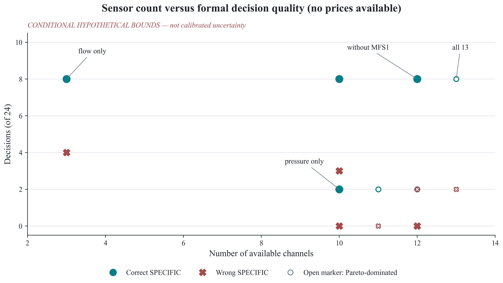

*AV-F13 — Sensor count–risk–coverage trade-off.* Structured sensor configurations of the Center network: correct and wrong SPECIFIC formal decisions (24 per configuration) against the number of channels, the only measured cost axis (no source-supported sensor prices exist, A15). Filled markers: Pareto-nondominated on (fewer channels, more correct, fewer wrong). 'Without MFS1' avoids the two wrong decisions only by returning ambiguity sets without the truth. Template-level isolability needs 2 channels (MFS1+MFS3) at REF bounds (A16b). ([caption](captions/AV-F13_sensor_count_tradeoff.md))

#### A16a — Sensor count versus diagnostic utility (Center, conditional)

Pareto on (fewer channels, more correct SPECIFIC, fewer wrong SPECIFIC) over the predeclared structured configurations; channel count is the only cost axis measured. isolable_pairs_REF from template-level isolability.

| config_family | n_channels | specific_coverage | specific_correct | specific_wrong | ambiguous | unresolved_model_mismatch | isolable_pairs_REF | pareto_nondominated |
|---|---|---|---|---|---|---|---|---|
| all | 13 | 0.4167 | 8 | 2 | 0 | 14 | 14 | no |
| drop_MFS1 | 12 | 0.3333 | 8 | 0 | 4 | 12 | 12 | yes |
| drop_MFS2 | 12 | 0.4167 | 8 | 2 | 0 | 14 | 14 | no |
| drop_MFS3 | 12 | 0.08333 | 2 | 0 | 8 | 14 | 12 | no |
| drop_PS1 | 12 | 0.4167 | 8 | 2 | 0 | 14 | 14 | no |
| drop_PS10 | 12 | 0.4167 | 8 | 2 | 0 | 14 | 14 | no |
| drop_PS2 | 12 | 0.4167 | 8 | 2 | 0 | 14 | 14 | no |
| drop_PS3 | 12 | 0.4167 | 8 | 2 | 0 | 14 | 14 | no |
| drop_PS4 | 12 | 0.4167 | 8 | 2 | 0 | 14 | 14 | no |
| drop_PS5 | 12 | 0.4167 | 8 | 2 | 0 | 14 | 14 | no |
| drop_PS6 | 12 | 0.4167 | 8 | 2 | 0 | 14 | 14 | no |
| drop_PS7 | 12 | 0.4167 | 8 | 2 | 0 | 14 | 14 | no |
| drop_PS8 | 12 | 0.4167 | 8 | 2 | 0 | 14 | 14 | no |
| drop_PS9 | 12 | 0.4167 | 8 | 2 | 0 | 14 | 14 | no |
| flow_only | 3 | 0.5 | 8 | 4 | 1 | 10 | 14 | yes |
| outage_branch_SID213(MFS3,PS1) | 11 | 0.08333 | 2 | 0 | 9 | 13 | — | no |
| outage_branch_SID215(PS4,PS8,PS9) | 10 | 0.4583 | 8 | 3 | 0 | 13 | — | yes |
| outage_branch_SID312(MFS1) | 12 | 0.3333 | 8 | 0 | 4 | 12 | — | yes |
| pressure_only | 10 | 0.08333 | 2 | 0 | 10 | 12 | 9 | yes |

Source: `dy_outcome_summary.csv`; `dy_pairwise_isolability.csv`

#### A16b — Minimum sensor sets preserving formal pairwise isolability

Exhaustive search over all 8,191 non-empty channel subsets; a set qualifies if every hypothesis pair isolable with all 13 channels stays isolable (template level, ±1 s, conditional bounds).

| scenario | isolable_pairs_full_set | total_pairs | min_channels | n_minimal_sets | minimal_sets | isolable_pairs_list |
|---|---|---|---|---|---|---|
| S3 | 15 | 15 | 2 | 14 | PS1+PS2;PS1+PS3;PS1+PS4;PS1+PS6;PS1+PS8;PS1+PS9;PS1+PS10;PS2+MFS3;PS3+MFS3;PS4+MFS3;PS6+MFS3;PS8+MFS3;PS9+MFS3;PS10+MFS3 | H213-H215;H213-H312;H213-HP55;H213-HT59;H215-HP55;H215-HT59;H312-H215;H312-HP55;H312-HT59;HN-H213;HN-H215;HN-H312;HN-HP55;HN-HT59;HP55-HT59 |
| S4 | 15 | 15 | 3 | 3 | PS4+MFS1+MFS3;PS8+MFS1+MFS3;PS9+MFS1+MFS3 | H213-H215;H213-H312;H213-HP55;H213-HT59;H215-HP55;H215-HT59;H312-H215;H312-HP55;H312-HT59;HN-H213;HN-H215;HN-H312;HN-HP55;HN-HT59;HP55-HT59 |
| S5 | 14 | 15 | 3 | 1 | PS1+MFS1+MFS3 | H213-H215;H213-H312;H213-HP55;H213-HT59;H215-HP55;H215-HT59;H312-H215;H312-HP55;H312-HT59;HN-H213;HN-H312;HN-HP55;HN-HT59;HP55-HT59 |
| REF | 14 | 15 | 2 | 1 | MFS1+MFS3 | H213-H215;H213-H312;H213-HP55;H213-HT59;H215-HP55;H215-HT59;H312-H215;H312-HP55;H312-HT59;HN-H213;HN-H312;HN-HP55;HN-HT59;HP55-HT59 |

Source: `advanced_validation/analysis/dy_minimum_sensor_sets.csv`

**Interpretation.** At REF bounds 14 of 15 pairs are separable with all channels and with flow only; pressure only separates 9. Normal operation vs the SID 215 withdrawal is never separable at REF bounds. Two channels (MFS1 + MFS3) preserve every separable pair at REF bounds.

**Limitation.** Template-level, conditional bounds; not a field sensor design.

## R9. Localization

- **Question.** Which localization level is demonstrated, on how many independent locations?
- **Evidence / method.** TAB_C03 rankings; formal decisions of the withdrawal queries.
- **Comparator.** Nearest template with and without abstention.

**Results.**

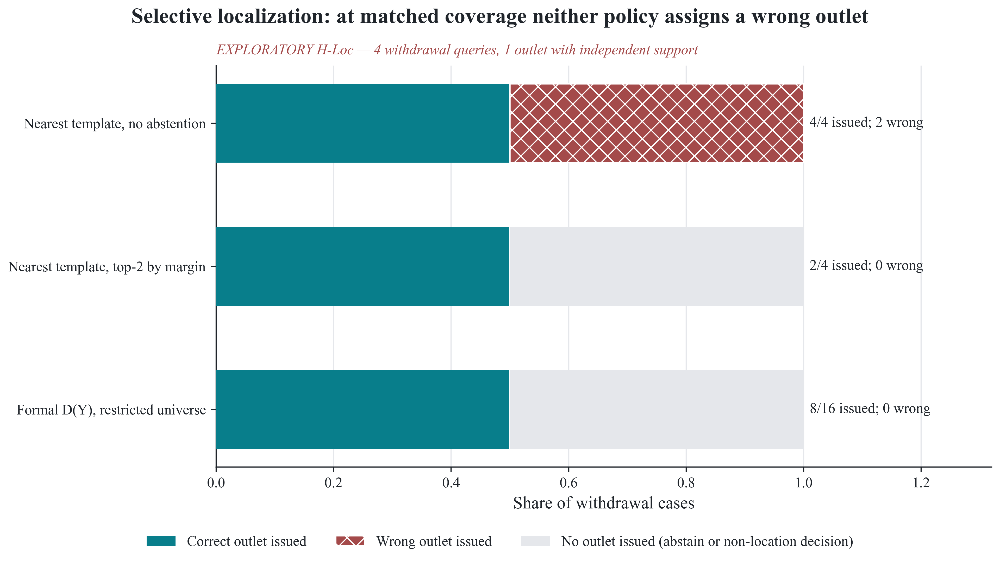

*AV-F06 — Localization ranking and eligibility.* Location decisions for the four withdrawal queries (SID 213, its alternate-profile replicate, SID 312, SID 215). The nearest-template rule always names an outlet and is wrong for SID 312 and SID 215, whose own outlet has no independent template. Matched to the formal policy's coverage (0.5), a margin-ranked nearest-template rule and formal D(Y) both name only SID 213, correctly. Only one outlet has independent support, so no localization rate generalises. ([caption](captions/AV-F06_selective_localization.md))

#### A06a — Localization levels

Highest demonstrated level: 2, for one outlet.

| level | status | eligible_cases | limitation |
|---|---|---|---|
| Level 1 — candidate-site ranking | DEMONSTRATED (conditional) | 4 withdrawal queries; 3 candidate outlets | ranking exists for every query, but only queries with an independent same-outlet template can be correct |
| Level 2 — correct categorical outlet identification | DEMONSTRATED FOR ONE OUTLET | SID 213: 2 captures (Q213 with replicate, Q213-alt); near-duplicates → 1 independent location | SID 312 and SID 215 unsupported (no independent template) |
| Level 3 — topological branch localization | NOT DEMONSTRATED BEYOND LEVEL 2 | outlets are branch ends; no intra-branch position | lumped pipes without inertia (HYDROGEN_MODEL_SPECIFICATION P6) |
| Level 4 — physical coordinate / distance | NOT POSSIBLE | no coordinates; SIDs are block identifiers | — |
| Level 5 — validated real-world localization | NOT ESTABLISHED | MHC/HY2RES: no locations | — |

Source: `TAB_C03`; `localization_cases.csv`

#### A06b — Categorical location-ranking metrics

Eight query×condition rows of TAB_C03 (4 queries × 2 template conditions); repeated captures are not independent locations. Reciprocal rank 0 when the true outlet is absent from the candidates.

| method | cases | supported_cases | independent_locations_supported | top1_correct_supported | top1_correct_all | mean_reciprocal_rank_supported | mean_reciprocal_rank_all_forced |
|---|---|---|---|---|---|---|---|
| B3 nearest-template (forced, own template excluded + replicate) | 8 | 3 | 1 | 3 | 3 | 1 | 0.375 |

Source: `advanced_validation/analysis/localization_cases.csv`

#### A07 — Selective localization (H-Loc)

Location-specific = a single outlet issued. Matched coverage uses the ranking margin, fixed as the selection score before looking at correctness. With one supported location no rate generalises.

| policy | cases | location_specific | coverage | wrong_location | wrong_location_risk | independent_locations_with_support | status |
|---|---|---|---|---|---|---|---|
| B3 nearest template, no abstention | 4 | 4 | 1 | 2 | 0.5 | 1 | H-Loc EXPLORATORY (4 queries, 1 supported location) |
| B3 nearest template, top-2 by ranking margin (matched to D(Y) coverage) | 4 | 2 | 0.5 | 0 | 0 | 1 | H-Loc EXPLORATORY (4 queries, 1 supported location) |
| Formal D(Y), restricted universe (4 scenarios per query) | 16 | 8 | 0.5 | 0 | 0 | 1 | H-Loc EXPLORATORY (4 queries, 1 supported location) |

Source: `advanced_validation/analysis/localization_cases.csv`

**Interpretation.** Level 2 (correct categorical outlet) for one outlet (SID 213, two near-duplicate captures). At matched coverage 0.5 neither the margin-ranked nearest template nor formal D(Y) names a wrong outlet; without abstention the nearest template is wrong for both unsupported outlets.

**Limitation.** One supported location; H-Loc exploratory.

## R10. Leakage and generalization

- **Question.** Which leakage pathways are confirmed, and how strong is out-of-template generalization?
- **Evidence / method.** Forensic attribution, hash audits, template-sharing analysis, train/test gap.
- **Comparator.** —

**Results.**

#### A03 — Data leakage and evaluation-integrity register

Confirmed defects are separated from risks that could not be verified.

| issue | affected_study | files | evidence | severity | impacted_claims | corrective_action | approval_needed | status |
|---|---|---|---|---|---|---|---|---|
| L01 source-folder / topology attribution | R2 (H2-SimNet) | 03_results/diagnostics/forensics/source_model_attribution.csv | 36/57 runs inconsistent; 7,347/8,012 classifier errors in disputed runs | critical | R2 accuracy, RQ1 feasibility, every exploratory H1 contrast | adopt manifest v0.3 (option B) or ask authors | D1 (dataset owner) | CONFIRMED DEFECT, UNCORRECTED |
| L02 exact duplicate captures | Center, R2 | TAB_C01.csv; source_model_attribution.csv | 13/13 Center capture hashes unique; 57/57 R2 file hashes unique | none | — | none | — | CHECKED: NONE FOUND |
| L03 near-duplicate templates | Center | TAB_C02/TAB_C03 | ALT vs SID213 differ only by a +0.005 MPa overlay (B3 2.8e-5); PS3 and PS10 bitwise identical channels | high for localization | SID 213 ranking and recognition (Q213-alt) | report as one location, two captures | none | CONFIRMED, DISCLOSED |
| L04 shared generating templates across held-out topologies | R2 | advanced_validation/analysis/av_r2_template_sharing.csv | 17/17 test templates present in training topologies in every fold (share of test windows 100%); families disjoint | critical for generalization | any out-of-template generalization claim | evaluate on templates absent from development | new data | CONFIRMED (design property) |
| L05 window overlap within runs | R2 | WINDOWING_SPEC.md | windows serially dependent within runs; family-level grouping used | medium | window-level rates | family / ancestor units | none | CONTROLLED (grouped evaluation) |
| L06 split by row instead of source | MHC, HY2RES | study_b/split_manifest.csv; HY2RES Gate D | MHC split by run; HY2RES chronological with 1 h embargo, 0 shared segments | low | — | none | — | CHECKED: NOT PRESENT |
| L07 preprocessing / calibration on evaluation data | R2 | DISTINGUISHABILITY_MATHEMATICAL_SPEC.md; calibration_records.json | z-scoring and calibration fitted on development only; identity calibration selected in all folds | low | — | none | — | CHECKED: NOT PRESENT |
| L08 hyperparameter selection after test inspection | R2 / Protocol 2.0 | folds/*/selection.csv; PROTOCOL_2_0_OWNER_DECISIONS.md | R2 selection inner-CV only; Protocol 2.0 arms reused inspected windows | high for Protocol 2.0 | development ablation claims | independent evaluation | new data | CONFIRMED RISK (Protocol 2.0 exploratory) |
| L09 self-template matching | Center | TAB_C02 | frozen library recognition 7/7 by self or near-duplicate match; 3/5 without | critical (Center) | recognition claims | leave-own-template-out (done) | none | CONFIRMED, CORRECTED IN ANALYSIS |
| L10 topology / source identifiers in features | R2 | FEATURE_DEFINITION_REGISTER.csv; diagnostics/feature_representation | source-model sensor set (PS11, PS12, MFS4 only in down model) is visible in features; neighbour share from same model 0.85 for Center LEAK | high | classification and D(x) behaviour | common-sensor representation (Protocol 2.0 arm C) | D2 | CONFIRMED RISK |
| L11 outcome-derived quantities | MHC | error_vs_change.csv | |Δy| bins use the outcome; used for retrospective explanation only, never as features | low | — | labelled retrospective | — | CONTROLLED |
| L12 post hoc selection of evaluation points | H1 exploratory | diagnose_primary_run.py EXPLORATORY_GRID | grid fixed before the H1 analysis; no point chosen by outcome | medium | exploratory H1 | fixed grid | — | CONTROLLED |
| L13 repeated testing / multiplicity | H1 exploratory | h1_05_paired_comparisons.csv | 6 comparators × 5 coverages × 2 unit types reported; no significance claimed | medium | exploratory H1 | report all; no selection | — | DISCLOSED |
| L14 training vs held-out gap | R2 | advanced_validation/analysis/av_r2_train_test_gap.csv | fold 1: inner CV macro-F1 0.739 vs outer accuracy 0.213; fold 2: inner CV macro-F1 0.304 vs outer accuracy 0.929; fold 3: inner CV macro-F1 0.099 vs outer accuracy 1.000 | high | overfitting interpretation | gap is inverted in folds 2–3: dominated by label corruption and distribution shift, not by capacity | — | EXPLAINED (label corruption + shift) |
| L15 HY2RES model-training code not tracked | HY2RES | STUDY_C_REPRODUCE.md | frozen predictions verified by 60/60 metric reconciliation; historical test-access seal unverified | medium | HY2RES held-out claim | recover or re-register the training script | Study C owner | UNVERIFIED RISK |
| L16 MHC dataset version provenance | MHC | study_b/source_manifest.json | Zenodo 10.5281/zenodo.19036733 v1.2; archive SHA-256 91755fb1… | none | — | none | — | CHECKED |

Source: `see 'files' column`; `advanced_validation/analysis/av_r2_*`

**Interpretation.** Confirmed: label attribution defect, near-duplicate SID 213 captures, template sharing between every held-out topology and its training topologies (17/17 templates), source-model sensor signatures in features, self-template matching on Center. Out-of-template generalization has never been tested.

**Limitation.** Some risks unverifiable (HY2RES training code not tracked).

## R11. Portability and gas transfer

- **Question.** Is the engine portable across studies and gas compositions?
- **Evidence / method.** Import inspection; H2Net v1 property assets; gas-composition interface.
- **Comparator.** —

**Results.**

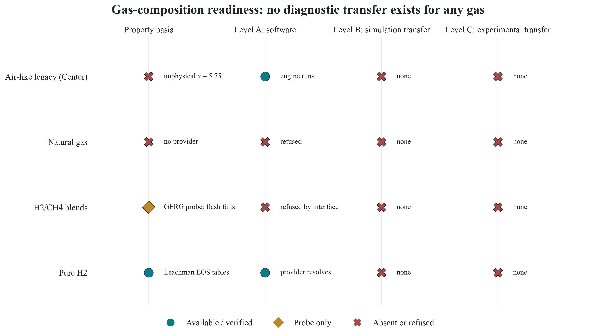

*AV-F14 — Gas-composition qualification matrix.* Qualification of gas compositions (A13). Pure-H2 property tables reproduce the Leachman equation of state (CoolProp 7.2.0) within 250–400 K × 0.1–10 MPa, and the composition interface refuses every blend. No gas-specific transient network model has been built (H2Net v1 blocked), so no simulation (Level B) or experimental (Level C) diagnostic transfer result exists. The legacy Center model is air-like with an unphysical heat-capacity ratio. ([caption](captions/AV-F14_gas_qualification_matrix.md))

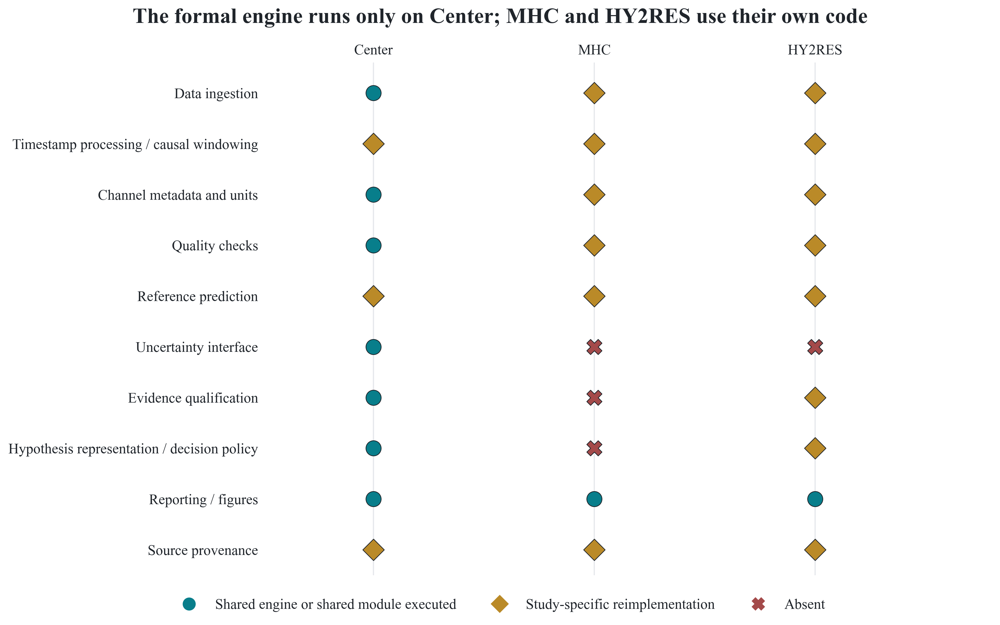

*AV-F15 — Actual cross-study software portability.* Component-by-component code paths (A12). Import inspection shows that the MHC and HY2RES pipelines import no module of the h2prism package; formal D(Y) (certified_evidence.diagnose) has been executed only on Center. Only the presentation layer (Q1 figure style) is shared. Diagnostic portability across the three studies is therefore not demonstrated; code reuse alone would not demonstrate it either. ([caption](captions/AV-F15_software_portability.md))

#### A12 — Cross-study portability (actual code paths)

From import inspection: the MHC and HY2RES pipelines import no module of the h2prism package; the formal engine has been executed only on Center. Code reuse is not evidence of diagnostic generalization.

| component | Center | MHC | HY2RES | classification | h2prism_package_imports_MHC_HY2RES |
|---|---|---|---|---|---|
| Data ingestion | h2prism.nres.load_pairs (hash-verifying) | study_b/replay.py + verify_source.py (own) | own CSV reader (evidence_enhancement/analysis.py) | REIMPLEMENTED per study | 0 (no import of h2prism in study_b/* or hy2res scripts) |
| Timestamp processing / causal windowing | fixed-step 30 s prefix (center_enhancement) | one-step pairs per run (benchmark.py) | causal segments, lag-1 (own) | STUDY-SPECIFIC | 0 (no import of h2prism in study_b/* or hy2res scripts) |
| Channel metadata and units | SensorRecord (data_contracts) | channel_map.json | CHANNEL_SCHEMA.csv | STUDY-SPECIFIC | 0 (no import of h2prism in study_b/* or hy2res scripts) |
| Quality checks | MeasurementContract.issues | source/eligibility checks (own) | validity mask (own) | REIMPLEMENTED | 0 (no import of h2prism in study_b/* or hy2res scripts) |
| Reference prediction | templates (no learned model) | persistence + Ridge (sklearn, own) | persistence + contextual Ridge (code not tracked) | REIMPLEMENTED concept | 0 (no import of h2prism in study_b/* or hy2res scripts) |
| Uncertainty interface | declared hypothetical bounds | none (recording grid analysed) | none (recording grid analysed) | CENTER ONLY | 0 (no import of h2prism in study_b/* or hy2res scripts) |
| Evidence qualification | D(Y) certificates | — | min–max support guard (own) | NOT SHARED | 0 (no import of h2prism in study_b/* or hy2res scripts) |
| Hypothesis representation / decision policy | certified_evidence.diagnose (executed) | not executed | own operating-state rule | NOT PORTED | 0 (no import of h2prism in study_b/* or hy2res scripts) |
| Reporting / figures | shared Q1 style (publication_q1) | shared Q1 style | shared Q1 style | SHARED (presentation only) | 0 (no import of h2prism in study_b/* or hy2res scripts) |
| Source provenance | SHA-256 per capture | archive SHA-256/MD5 | MD5/SHA-256 of CSV | SAME PRINCIPLE, own code | 0 (no import of h2prism in study_b/* or hy2res scripts) |

Source: `study_b/*.py`; `03_results/hy2res_external_validation/**/*.py`; `src/h2prism/center_enhancement.py`

#### A13 — Gas-specific physical-model qualification

Level A = software accepts the composition without changing decision semantics; B = physics-based simulation transfer; C = experimentally qualified diagnostic transfer. No diagnostic transfer result exists for any gas.

| composition | property_basis_in_repository | diagnostic_data | missing_for_transfer | level_A_software | levels_B_C |
|---|---|---|---|---|---|
| Air-like legacy (Center) | R = 0.287 kJ/(kg·K); perfect gas, cp = 0.3469 → γ = 5.75 (>5/3, unphysical) | existing Simscape captures | physically inconsistent gas specification | A: engine runs on it | B/C: NOT QUALIFIED |
| Natural-gas reference | no property provider | none | — | A: refused by interface | B/C: NOT AVAILABLE |
| H2/CH4 blends (e.g. 80–95 % H2) | CoolProp 7.2.0 GERG-2008 binary (Kunz 2012) probe at 300 K, 5 MPa: default flash FAILED for x_CH4 0.05/0.10/0.20; imposed gas phase Z = 1.0266 at x_CH4 = 0.10 | none | phase stability per point and transport validation required | A: refused by interface (MixtureProviderUnavailable) | B/C: NOT AVAILABLE |
| Pure H2 | tables from Leachman EOS (CoolProp 7.2.0), envelope 250–400 K × 0.1–10 MPa; max interpolation error ρ 0.04% | property tables only; no transient model built (H2Net v1 BLOCKED) | transient model, boundary conditions, solver verification | A: provider resolves; engine unit-agnostic | B/C: NOT AVAILABLE |

Source: `06_audit_preparation/simulation/h2net_v1/properties/V1_REPORT.json`; `H2CH4_FEASIBILITY_PROBE.json`; `02_methodology/GAS_COMPOSITION_INTERFACE.md`; `02_methodology/HYDROGEN_MODEL_SPECIFICATION.md`

**Interpretation.** The formal engine has been executed only on Center; MHC and HY2RES use independent code. Pure-H2 property tables exist; no gas-specific transient model exists, so no diagnostic transfer to pure H2 or blends is demonstrated.

**Limitation.** Status assessment.

## R12. Computational performance and cost

- **Question.** How does runtime scale, and can a cost saving be quantified?
- **Evidence / method.** Measured benchmarks (one dimension at a time); parametric cost model.
- **Comparator.** —

**Results.**

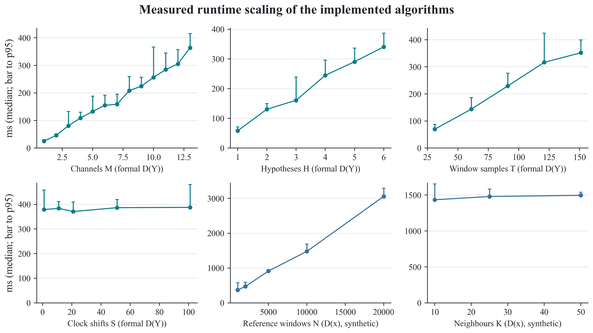

*AV-F12 — Actual computational scaling.* Wall-clock time on AMD Ryzen 5 7520U with Radeon Graphics (8 logical CPUs, 7.2 GB, Python 3.12.1, NumPy 2.3.1), single process, one dimension varied at a time (others at 13 channels, 6 hypotheses, 151 samples, ±1 s). Formal D(Y): log–log slopes 1.02 (M), 0.98 (H), 1.06 (T) and 0.00 (S, early exit). D(x) on synthetic arrays: 0.70 in N over 1k–20k. Slopes describe this implementation over the measured range only; they are not complexity proofs. ([caption](captions/AV-F12_computational_scaling.md))

#### A14a — Measured computational performance

Hardware: AMD Ryzen 5 7520U with Radeon Graphics, 8 logical CPUs, 7.2 GB RAM, Windows-11-10.0.26300-SP0; Python 3.12.1, NumPy 2.3.1; single process; 2 warm-up runs; peak memory from tracemalloc (Python allocations). D(x) rows use SYNTHETIC arrays (numerical benchmark only).

| component | dimension | value | median_s | p95_s | min_s | max_s | reps | peak_tracemalloc_MB |
|---|---|---|---|---|---|---|---|---|
| formal D(Y) decision (diagnose, 6 restricted hypotheses unless varied) | M_channels | 1 | 0.02539 | 0.03024 | 0.01926 | 0.03086 | 15 | 0.07871 |
| formal D(Y) decision (diagnose, 6 restricted hypotheses unless varied) | M_channels | 2 | 0.04597 | 0.05103 | 0.03959 | 0.05115 | 15 | 0.1474 |
| formal D(Y) decision (diagnose, 6 restricted hypotheses unless varied) | M_channels | 3 | 0.08105 | 0.1327 | 0.07708 | 0.2272 | 15 | 0.2164 |
| formal D(Y) decision (diagnose, 6 restricted hypotheses unless varied) | M_channels | 4 | 0.1091 | 0.1302 | 0.1042 | 0.1433 | 15 | 0.2855 |
| formal D(Y) decision (diagnose, 6 restricted hypotheses unless varied) | M_channels | 5 | 0.133 | 0.1884 | 0.1019 | 0.1944 | 15 | 0.4036 |
| formal D(Y) decision (diagnose, 6 restricted hypotheses unless varied) | M_channels | 6 | 0.1551 | 0.1921 | 0.1466 | 0.1947 | 15 | 0.4229 |
| formal D(Y) decision (diagnose, 6 restricted hypotheses unless varied) | M_channels | 7 | 0.1588 | 0.1955 | 0.1321 | 0.225 | 15 | 0.4915 |
| formal D(Y) decision (diagnose, 6 restricted hypotheses unless varied) | M_channels | 8 | 0.2083 | 0.2592 | 0.1642 | 0.2738 | 15 | 0.5602 |
| formal D(Y) decision (diagnose, 6 restricted hypotheses unless varied) | M_channels | 9 | 0.2246 | 0.2569 | 0.1705 | 0.2684 | 15 | 0.7482 |
| formal D(Y) decision (diagnose, 6 restricted hypotheses unless varied) | M_channels | 10 | 0.2566 | 0.3665 | 0.2165 | 0.3729 | 15 | 0.6976 |
| formal D(Y) decision (diagnose, 6 restricted hypotheses unless varied) | M_channels | 11 | 0.2847 | 0.3447 | 0.2302 | 0.3546 | 15 | 0.8825 |
| formal D(Y) decision (diagnose, 6 restricted hypotheses unless varied) | M_channels | 12 | 0.3053 | 0.3573 | 0.2597 | 0.369 | 15 | 0.8349 |
| formal D(Y) decision (diagnose, 6 restricted hypotheses unless varied) | M_channels | 13 | 0.3639 | 0.4151 | 0.3311 | 0.4571 | 15 | 0.904 |
| formal D(Y) decision (diagnose, 6 restricted hypotheses unless varied) | H_hypotheses | 1 | 0.05834 | 0.0711 | 0.04333 | 0.09629 | 15 | 0.9321 |
| formal D(Y) decision (diagnose, 6 restricted hypotheses unless varied) | H_hypotheses | 2 | 0.1307 | 0.1495 | 0.1047 | 0.1552 | 15 | 0.902 |
| formal D(Y) decision (diagnose, 6 restricted hypotheses unless varied) | H_hypotheses | 3 | 0.1608 | 0.2388 | 0.1248 | 0.2876 | 15 | 0.9022 |
| formal D(Y) decision (diagnose, 6 restricted hypotheses unless varied) | H_hypotheses | 4 | 0.2448 | 0.2958 | 0.224 | 0.3212 | 15 | 0.9028 |
| formal D(Y) decision (diagnose, 6 restricted hypotheses unless varied) | H_hypotheses | 5 | 0.2905 | 0.3364 | 0.2787 | 0.3531 | 15 | 0.9034 |
| formal D(Y) decision (diagnose, 6 restricted hypotheses unless varied) | H_hypotheses | 6 | 0.3406 | 0.3866 | 0.2616 | 0.4062 | 15 | 1.111 |
| formal D(Y) decision (diagnose, 6 restricted hypotheses unless varied) | S_shifts | 1 | 0.3788 | 0.4582 | 0.2945 | 0.5014 | 15 | 0.648 |
| formal D(Y) decision (diagnose, 6 restricted hypotheses unless varied) | S_shifts | 11 | 0.3839 | 0.4115 | 0.3345 | 0.4249 | 15 | 0.904 |
| formal D(Y) decision (diagnose, 6 restricted hypotheses unless varied) | S_shifts | 21 | 0.3709 | 0.4095 | 0.3119 | 0.4357 | 15 | 1.272 |
| formal D(Y) decision (diagnose, 6 restricted hypotheses unless varied) | S_shifts | 51 | 0.3865 | 0.4198 | 0.3354 | 0.4483 | 15 | 2.103 |
| formal D(Y) decision (diagnose, 6 restricted hypotheses unless varied) | S_shifts | 101 | 0.3878 | 0.4807 | 0.2918 | 0.4965 | 15 | 3.794 |
| formal D(Y) decision (diagnose, 6 restricted hypotheses unless varied) | T_window_samples | 31 | 0.06951 | 0.08753 | 0.06127 | 0.1077 | 15 | 0.1915 |
| formal D(Y) decision (diagnose, 6 restricted hypotheses unless varied) | T_window_samples | 61 | 0.1436 | 0.1866 | 0.118 | 0.2302 | 15 | 0.3685 |
| formal D(Y) decision (diagnose, 6 restricted hypotheses unless varied) | T_window_samples | 91 | 0.2292 | 0.2762 | 0.1761 | 0.2807 | 15 | 0.5499 |
| formal D(Y) decision (diagnose, 6 restricted hypotheses unless varied) | T_window_samples | 121 | 0.3165 | 0.4244 | 0.231 | 0.4266 | 15 | 0.7269 |
| formal D(Y) decision (diagnose, 6 restricted hypotheses unless varied) | T_window_samples | 151 | 0.3518 | 0.3993 | 0.2657 | 0.4102 | 15 | 0.904 |
| empirical D(x) compute, 500 queries | N_reference_windows | 1,000 | 0.3718 | 0.5781 | 0.3489 | 0.5919 | 5 | 4.532 |
| empirical D(x) compute, 500 queries | N_reference_windows | 2,000 | 0.4714 | 0.592 | 0.4204 | 0.6072 | 5 | 8.346 |
| empirical D(x) compute, 500 queries | N_reference_windows | 5,000 | 0.9137 | 0.9493 | 0.8963 | 0.955 | 5 | 19.79 |
| empirical D(x) compute, 500 queries | N_reference_windows | 10,000 | 1.479 | 1.688 | 1.408 | 1.704 | 5 | 38.94 |
| empirical D(x) compute, 500 queries | N_reference_windows | 20,000 | 3.058 | 3.293 | 2.622 | 3.351 | 5 | 77.25 |
| empirical D(x) compute, 500 queries | K_neighbours | 10 | 1.435 | 1.655 | 1.396 | 1.701 | 5 | 38.94 |
| empirical D(x) compute, 500 queries | K_neighbours | 25 | 1.48 | 1.584 | 1.391 | 1.602 | 5 | 38.94 |
| empirical D(x) compute, 500 queries | K_neighbours | 50 | 1.496 | 1.54 | 1.425 | 1.546 | 5 | 38.94 |

Source: `advanced_validation/benchmarks/*.csv`

#### A14b — Empirical scaling exponents (log–log slope over the measured range only)

Slopes describe this implementation and hardware over the stated range; they are not complexity proofs.

| dimension | points | range | loglog_slope | ratio_max_over_min | component |
|---|---|---|---|---|---|
| H_hypotheses | 6 | 1–6 | 0.9758 | 5.838 | D(Y) |
| M_channels | 13 | 1–13 | 1.016 | 14.33 | D(Y) |
| S_shifts | 5 | 1–101 | 0.004344 | 1.024 | D(Y) |
| T_window_samples | 5 | 31–151 | 1.059 | 5.061 | D(Y) |
| K_neighbours | 3 | 10–50 | 0.02639 | 1.043 | D(x) |
| N_reference_windows | 5 | 1000–20000 | 0.7033 | 8.225 | D(x) |

Source: `advanced_validation/benchmarks/scaling_fits.csv`

#### A14c — Per-decision latency across all 2,376 experiment decisions

Formal D(Y) on real Center captures; variable channel counts, clock bounds and libraries.

| decisions | median_s | p95_s | p99_s | max_s | workers | note |
|---|---|---|---|---|---|---|
| 2,376 | 0.4077 | 1.107 | 2.053 | 3.244 | 7 | per-decision wall time inside 7 parallel workers |

Source: `advanced_validation/benchmarks/dy_decision_runtime_from_experiments.csv`

#### A15 — Sensor-system cost assumptions

No price is invented. A monetary saving cannot be quantified until source-supported values exist; only sensor count (A16) and CPU time (A14) are measured.

| cost_term | parametric_form | source_supported_value | status | total_cost_model |
|---|---|---|---|---|
| A sensor procurement | c_s,i per channel type (pressure, mass flow) | no source-supported price in repository | symbolic | C_total = Σ_i n_i (c_s,i + c_inst,i + c_cal,i + T·c_m,i + c_daq) + c_pwr + c_compute + c_FP·FP + c_FN·FN |
| B installation | c_inst,i (site, hot-tap or insertion) | not available | symbolic | C_total = Σ_i n_i (c_s,i + c_inst,i + c_cal,i + T·c_m,i + c_daq) + c_pwr + c_compute + c_FP·FP + c_FN·FN |
| C calibration | c_cal,i per interval | not available | symbolic | C_total = Σ_i n_i (c_s,i + c_inst,i + c_cal,i + T·c_m,i + c_daq) + c_pwr + c_compute + c_FP·FP + c_FN·FN |
| D maintenance | c_m,i per year | not available | symbolic | C_total = Σ_i n_i (c_s,i + c_inst,i + c_cal,i + T·c_m,i + c_daq) + c_pwr + c_compute + c_FP·FP + c_FN·FN |
| E data acquisition / communication | c_daq per channel | not available | symbolic | C_total = Σ_i n_i (c_s,i + c_inst,i + c_cal,i + T·c_m,i + c_daq) + c_pwr + c_compute + c_FP·FP + c_FN·FN |
| F power / infrastructure | c_pwr | not available | symbolic | C_total = Σ_i n_i (c_s,i + c_inst,i + c_cal,i + T·c_m,i + c_daq) + c_pwr + c_compute + c_FP·FP + c_FN·FN |
| G compute hardware | measured latency (A14) × required decisions per hour | latency measured; hardware price not available | partly measured | C_total = Σ_i n_i (c_s,i + c_inst,i + c_cal,i + T·c_m,i + c_daq) + c_pwr + c_compute + c_FP·FP + c_FN·FN |
| H software runtime | CPU-seconds per decision (A14) | measured | measured (time, not money) | C_total = Σ_i n_i (c_s,i + c_inst,i + c_cal,i + T·c_m,i + c_daq) + c_pwr + c_compute + c_FP·FP + c_FN·FN |
| I inspection / follow-up | c_FP × false-specific rate + c_FN × missed-event rate | rates only conditional (Center) or exploratory (R2) | symbolic | C_total = Σ_i n_i (c_s,i + c_inst,i + c_cal,i + T·c_m,i + c_daq) + c_pwr + c_compute + c_FP·FP + c_FN·FN |

Source: `none — no cost source in the repository`

**Interpretation.** Formal D(Y) runtime grows roughly proportionally with channels, hypotheses and window length and is insensitive to the shift count; D(x) grows sub-linearly with the reference size over 1k–20k windows. No monetary saving can be quantified: no sensor prices are documented.

**Limitation.** One CPU; no prices.

## R13. Literature and claims

- **Question.** How does H₂-PRISM relate to published work, and what is established?
- **Evidence / method.** Nine verified-DOI studies; claim matrix.
- **Comparator.** Published methods (contextual only).

**Results.**

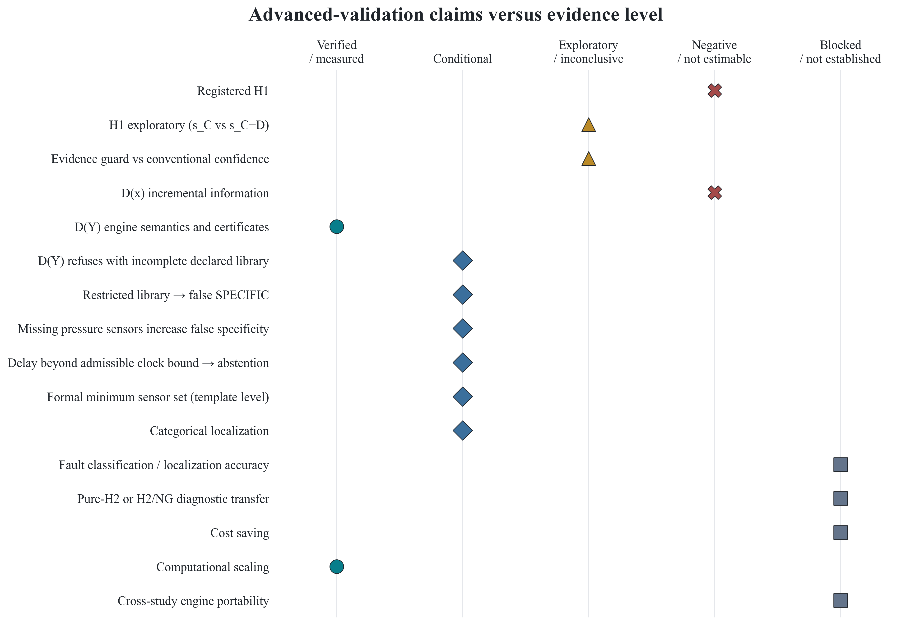

*AV-F16 — Scientific claims versus evidence level.* Each advanced-validation claim placed at its evidence level; exact wording, evidence and limiting factors in A19. ([caption](captions/AV-F16_claims_evidence.md))

#### A17 — Published-study comparison

DOIs taken from publisher or bibliographic listings found by search on 2026-11-18; verify on the publisher page before formal citation. 'Reported metric' quotes abstracts or listings only; NOT EXTRACTED means the paper was not read for metrics. Missing cost is NOT REPORTED, never zero.

| study | year | physical_system | gas_type | data_type | diagnostic_task | sensors | model | reported_metric | runtime | cost | validation_level | source_doi | comparability | comparability_gate |
|---|---|---|---|---|---|---|---|---|---|---|---|---|---|---|
| Chow | 1,970 | pattern recognition (theory) | — | — | optimal error–reject trade-off | — | Bayes reject rule | error–reject relation | NOT REPORTED | NOT REPORTED | theory | 10.1109/TIT.1970.1054406 | CONTEXTUAL (foundation of selective risk) | FAILED (different task, system, data or metric) — no head-to-head number |
| Geifman & El-Yaniv | 2,017 | image classification | — | images | selective classification | — | DNN + rejection function | 2 % top-5 error with 99.9 % probability at ~60 % coverage (ImageNet; abstract) | NOT REPORTED | NOT REPORTED | benchmark dataset | NeurIPS 2017 (arXiv 1705.08500) | CONTEXTUAL (risk–coverage methodology) | FAILED (different task, system, data or metric) — no head-to-head number |
| Puig | 2,010 | industrial and water systems | — | real case studies | set-membership fault diagnosis and FTC | plant sensors | interval / set-membership | NOT EXTRACTED | NOT REPORTED | NOT REPORTED | real cases | 10.2478/v10006-010-0046-y | CONTEXTUAL (closest formal analogue of D(Y)) | FAILED (different task, system, data or metric) — no head-to-head number |
| Krysander, Åslund & Nyberg | 2,008 | automotive engine model | — | structural model | structural diagnosability / MSO sets | — | structural analysis | 1,419 MSOs in < 0.5 s (abstract) | reported (algorithm) | NOT REPORTED | model-based | 10.1109/TSMCA.2007.909555 | CONTEXTUAL (isolability analysis) | FAILED (different task, system, data or metric) — no head-to-head number |
| Pérez et al. | 2,014 | water distribution network (Barcelona) | water | pressure sensors, real network | leak localization, sensor placement | pressure | model-based sensitivity | NOT EXTRACTED | NOT REPORTED | NOT REPORTED | real network | 10.1109/MCS.2014.2320336 | CONTEXTUAL (different fluid) | FAILED (different task, system, data or metric) — no head-to-head number |
| Murvay & Silea | 2,012 | gas pipelines (survey) | gas | survey | leak detection and localization | various | survey | — | — | — | review | 10.1016/j.jlp.2012.05.010 | CONTEXTUAL (survey) | FAILED (different task, system, data or metric) — no head-to-head number |
| Zhu et al. | 2,022 | buried pipeline, hydrogen-blended natural gas | H2/NG blend | experiment + model | leakage and diffusion | concentration | experimental rig + model | leak mass-flow model error 6.85 % (listing) | NOT REPORTED | NOT REPORTED | experimental | 10.1016/j.ijhydene.2022.10.185 | NOT COMPARABLE (dispersion, not diagnosis) | FAILED (different task, system, data or metric) — no head-to-head number |
| Lu et al. | 2,024 | hydrogen-blended natural gas, buried | H2/NG blend | CFD | leakage diffusion and alarm time | — | CFD | NOT EXTRACTED | NOT REPORTED | NOT REPORTED | simulation | 10.1016/j.ijhydene.2024.02.075 | NOT COMPARABLE | FAILED (different task, system, data or metric) — no head-to-head number |
| Review (IJHE) | 2,024 | hydrogen pipeline transport | H2 | review | transient flow, friction, leakage | — | review | — | — | — | review | 10.1016/j.ijhydene.2024.04.140 | CONTEXTUAL (modelling requirements for gas transfer) | FAILED (different task, system, data or metric) — no head-to-head number |

Source: `web search, 2026-11-18`

#### A19 — Scientific claim-to-evidence matrix (advanced validation)

Evidence levels in the project vocabulary.

| claim | evidence_level | evidence | limiting_factor |
|---|---|---|---|
| Registered H1 | NOT ESTIMABLE | R2 rq1.csv 12/12 | Gate 06/19 |
| H1 exploratory (s_C vs s_C−D) | INCONCLUSIVE | A01: intervals include 0; 0 errors outside disputed runs | L01, L04 |
| Evidence guard vs conventional confidence | EXPLORATORY, CONFOUNDED | A02a: 0 vs 655 false LEAK calls on NORMAL at 0.25 — one template | L01, L04 |
| D(x) incremental information | NOT SUPPORTED | development ablation | — |
| D(Y) engine semantics and certificates | VERIFIED (mathematical) | A04a: 0 violations; 11,061 + 1,552 re-verified | — |
| D(Y) refuses with incomplete declared library | CONDITIONALLY DEMONSTRATED | A05 full: 42/42 UNRESOLVED | hypothetical bounds |
| Restricted library → false SPECIFIC | CONDITIONALLY DEMONSTRATED | A05: minus-true 2/2 SPECIFIC wrong; restricted 2/10 | hypothetical bounds |
| Missing pressure sensors increase false specificity | CONDITIONALLY DEMONSTRATED | A08: flow-only 4 wrong vs 2 (all) | one family |
| Delay beyond admissible clock bound → abstention | CONDITIONALLY DEMONSTRATED | A09: correct SPECIFIC 8 → 0, wrong unchanged 2 | one family |
| Formal minimum sensor set (template level) | CONDITIONALLY DEMONSTRATED | A16b: 2 channels (MFS1+MFS3) preserve 14/15 pairs at REF | templates, not field |
| Categorical localization | LEVEL 2, ONE OUTLET | A06: SID 213, 2 captures | L03 |
| Fault classification / localization accuracy | BLOCKED BY EVIDENCE | no independent labels | — |
| Pure-H2 or H2/NG diagnostic transfer | NOT ESTABLISHED | A13: no transient gas-specific model | — |
| Cost saving | NOT QUANTIFIABLE | A15: no source-supported prices | — |
| Computational scaling | MEASURED (this hardware) | A14 | — |
| Cross-study engine portability | NOT DEMONSTRATED | A12: engine executed on Center only | — |

Source: `tables A01–A18`

#### A20 — Confirmatory prerequisites for H1, H-Loc, D(Y) and gas transfer

Nothing here can be met with existing data alone.

| target | prerequisite | current_status | how_to_obtain |
|---|---|---|---|
| H1 | independent scenario templates absent from development | 17 shared templates; all inspected | new simulation campaign (H2Net v1) or new dataset |
| H1 | corrected attribution | 36/57 runs disputed | D1 decision (dataset owner) |
| H1 | attainable registered coverage (0.80) verified on development | Center 0.258 | ≥ 2 independent families per class in every development reference |
| H1 | nonzero independent errors for both policies | 0 outside disputed runs | only new data |
| H-Loc | ≥ 2 independent templates per outlet for ≥ 3 outlets | 1 outlet supported (near-duplicate pair) | new captures per outlet with independent profiles |
| H-Loc | pre-registered location-coverage target | none | write before data access |
| D(Y) | qualified observation bounds | hypothetical | instrument specifications and calibration records |
| D(Y) | qualified model-discrepancy bounds | solver-refinement deltas only | model-validation study against measurements |
| D(Y) | complete declared library with adapters | 6 of 9 declared hypotheses modelled | adapters for SID 222, compressor fault, actuator delay |
| Gas transfer | transient pure-H2 model and verification | H2Net v1 blocked | S2–S6/S8 decisions + MATLAB execution |
| Gas transfer | mixture property provider | probe only | authorization MODEL_DEVELOPMENT:H2NET_V1_BLEND_TABLES |

Source: `h1_validation/H1_CONFIRMATION_REQUIREMENTS.md`; `A06`; `A13`

**Interpretation.** No published result passes the comparability gate; all comparisons are contextual. The defensible distinctive element is auditable, monotone formal evidence qualification that refuses to decide under an incomplete library — demonstrated conditionally on one simulation family.

**Limitation.** No head-to-head benchmark exists.
