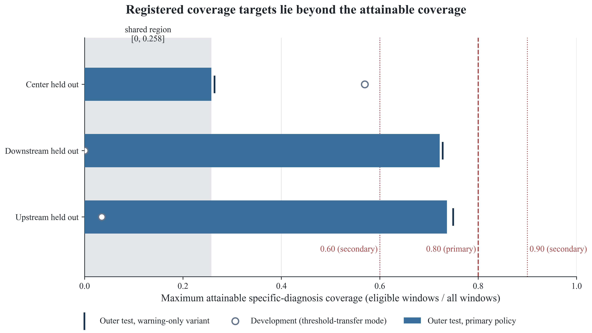
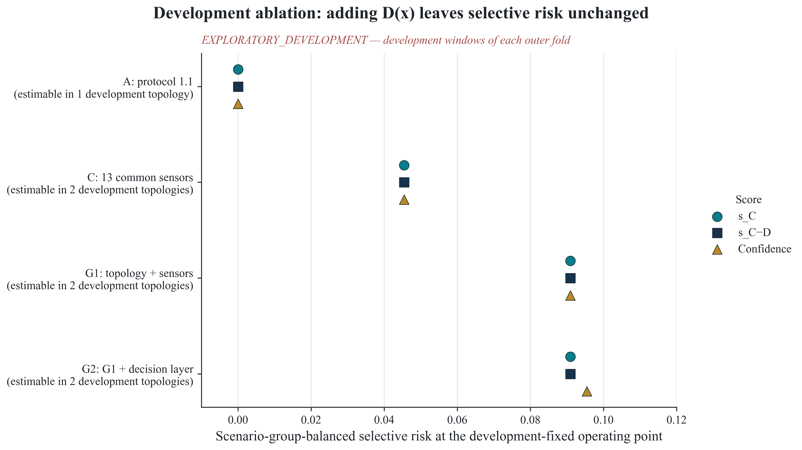
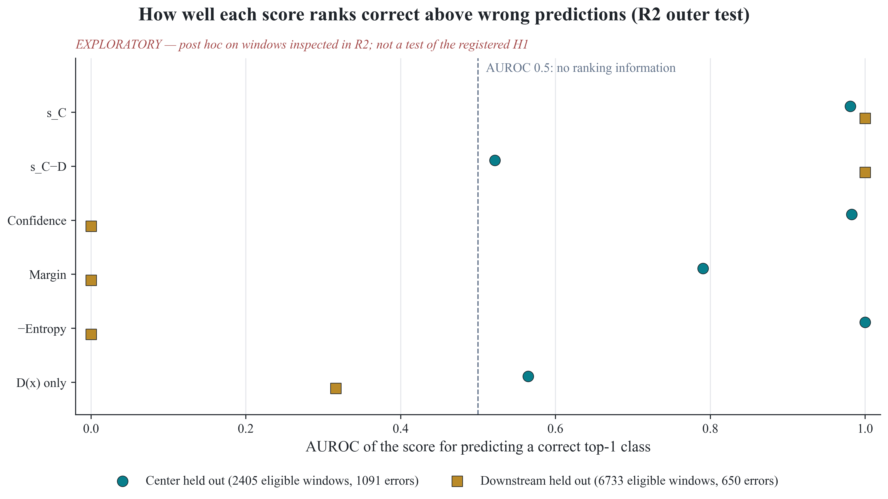
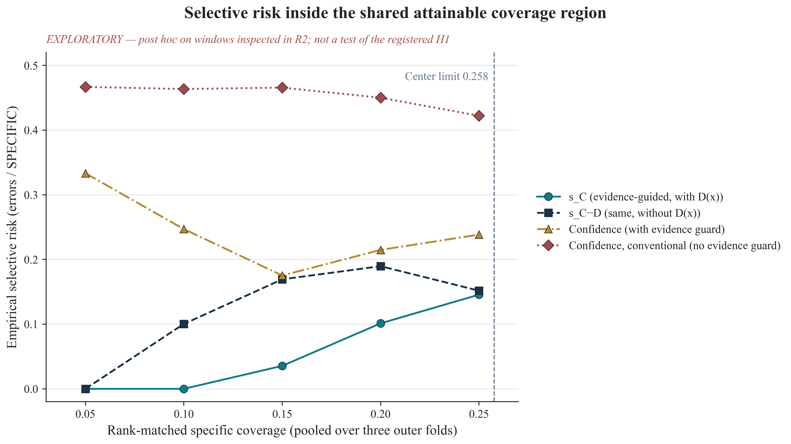
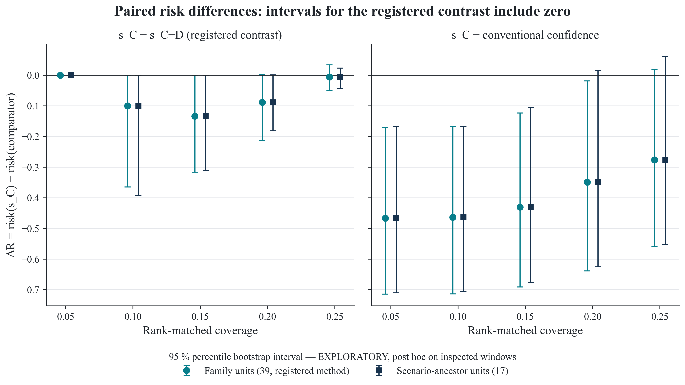
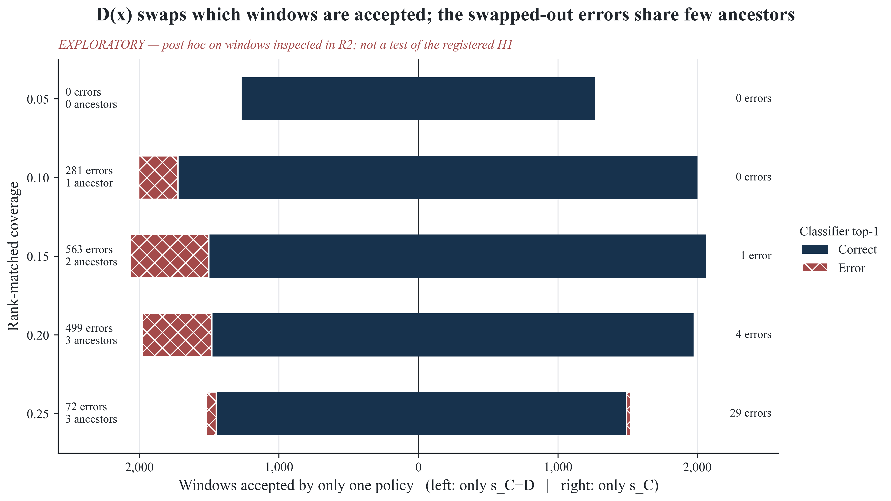
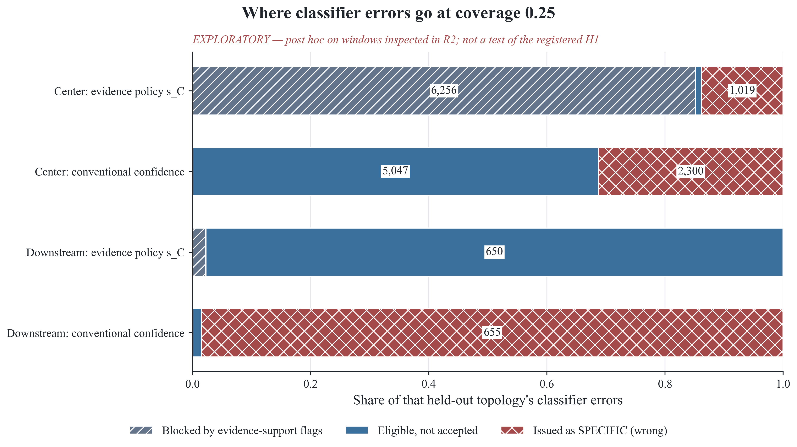
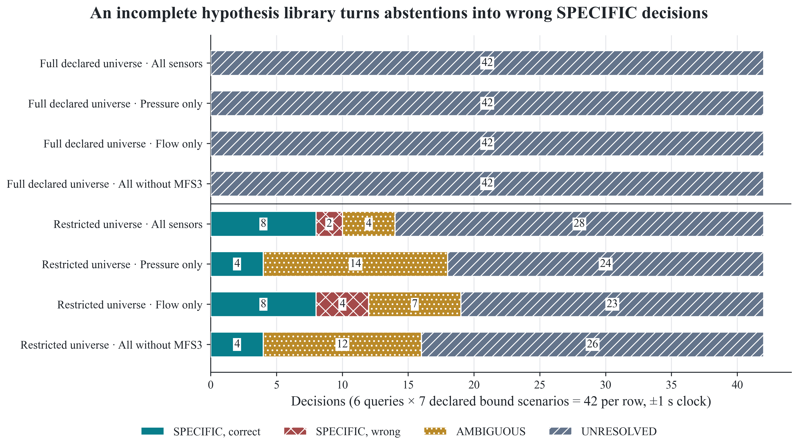
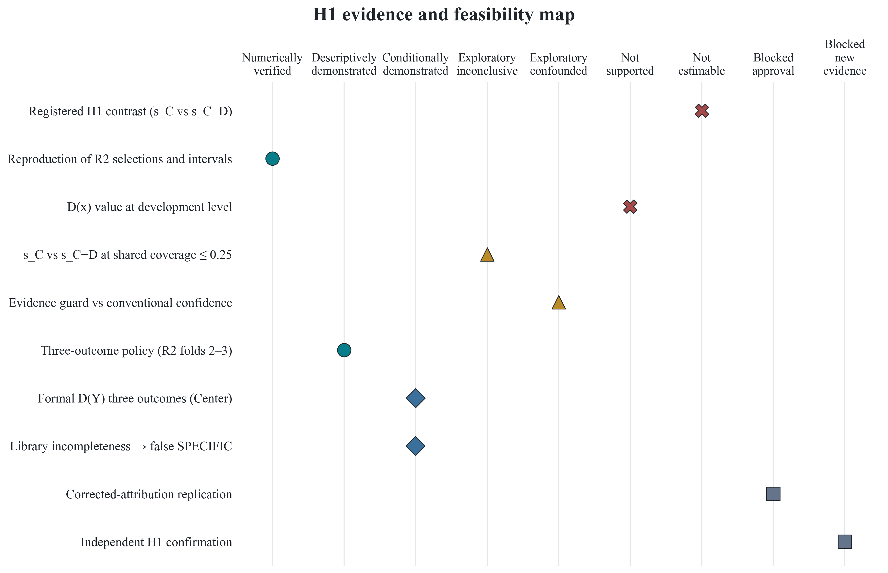

# H1 research report — Results

**Status of every number:** reproduced from frozen artifacts; 161/161 verification checks against
the frozen R2 outputs match (`analysis/h1_verification.csv`). Labels: REGISTERED (re-read), RECOMPUTED_VERIFIED,
EXPLORATORY_POST_HOC (windows inspected in R2), CONDITIONAL_HYPOTHETICAL_BOUNDS (Center D(Y)).

## 4.1 Registered hypothesis and evaluation

**Question.** At matched specific coverage, does adding the distinguishability assessment reduce selective risk?
**Evidence.** Registered primary run R2 (`03_results/primary_protocol/PRIMARY/rq1.csv`).
**Method.** Δ = R_sel(s_C) − R_sel(s_C−D) at rank-matched coverage 0.80 (secondary 0.60, 0.90); pooled only if
estimable in every outer fold (`02_methodology/STATISTICAL_ANALYSIS_PLAN.md`).
**Result.** All 6 primary-contrast rows are **NOT_ESTIMABLE_UNDER_PRIMARY_PROTOCOL**; folds estimable at 0.60 rank-matched:
2/3;
no implementation error was found.
**Interpretation.** H1 was not tested by the registered experiment; this is a feasibility failure, not a null result.

#### H1-T01 — Historical primary evaluation (R2)

Registered estimand: Δ = R_sel(s_C) − R_sel(s_C−D) at rank-matched coverage 0.80 (secondary 0.60, 0.90), pooled only if estimable in every fold. Pooled decision: NOT_ESTIMABLE_UNDER_PRIMARY_PROTOCOL in all 6 primary rows; implementation error found: none. Coverage = SPECIFIC-eligible windows / all windows of the fold.

| protocol | fold | held_out_topology | windows | families | scenario_ancestors | max_coverage_primary | max_coverage_warning_only | dev_max_coverage_primary | rank_matched_0.60 | rank_matched_0.80 | rank_matched_0.90 |
|---|---|---|---|---|---|---|---|---|---|---|---|
| R2 (registered primary) | 1 | Center | 9331 | 13 | 17 | 0.2577 | 0.264 | 0.5693 | NOT_ESTIMABLE | NOT_ESTIMABLE | NOT_ESTIMABLE |
| R2 (registered primary) | 2 | Downstream | 9331 | 13 | 17 | 0.7216 | 0.7277 | 5.36e-05 | ESTIMABLE | NOT_ESTIMABLE | NOT_ESTIMABLE |
| R2 (registered primary) | 3 | Upstream | 9331 | 13 | 17 | 0.7364 | 0.749 | 0.03494 | ESTIMABLE | NOT_ESTIMABLE | NOT_ESTIMABLE |

Source: `03_results/primary_protocol/PRIMARY/{rq1,estimability}.csv`; `h1_validation/analysis/h1_02_fold_feasibility.csv`

## 4.2 Root causes of non-estimability

**Question.** Why did the registered comparison become non-estimable?
**Evidence.** Frozen R2 window predictions (27,993 windows), forensic source-model attribution, development
ablation. **Method.** Recompute eligibility per fold; stratify errors by run attribution and independence unit.
**Result.**
- Binding constraint: the specific-blocking support flags leave 2,405/9,331 Center
  windows eligible (coverage 0.258); Downstream 0.722,
  Upstream 0.736. Threshold transfer fails earlier: development maxima
  0.569, 5.4e-05,
  0.035.
- Root cause: 7,347 of 8,012 classifier errors
  (91.7%) occur in runs whose source model contradicts the manifest
  topology (36/57 runs; D1 pending); the remaining 665 occur in one
  Downstream NORMAL run and follow from the swapped training composition.
- Independence: each held-out topology contains 17 runs, 13 families
  and 17 scenario ancestors; the same 17 ancestors recur in all three
  topologies (`analysis/h1_02_independence_units_check.csv`).
**Interpretation.** Observed chain: attribution defect → confident Center errors and single-family neighbourhoods →
flags block SPECIFIC → Center coverage 0.258 → pooled RQ1 not estimable. The
0.80 target is also unattainable in the two folds not limited by the defect, so correcting attribution alone would not
make the registered contrast estimable. Full cause table: `H1_EXECUTION_DECISION.md` §3.

*H1-F01. Attainable coverage versus registered targets.* ([caption](captions/H1-F01_attainable_coverage.md))

## 4.3 Coverage feasibility

**Result.** The coverage attainable in every fold is [0, 0.258] for every method (identical eligibility). No
registered target lies inside it. The exploratory grid {0.05, …, 0.25} fixed by the R2 diagnostics is reused unchanged.

#### H1-T02 — Matched-coverage feasibility

The same eligible windows, tie key and exact SPECIFIC counts apply to every method (R2 assertion). The conventional baseline uses the same windows and counts but no evidence-support flags. Ancestors: scenario templates shared across the three topologies.

| policy | comparator | role | independent_units_family | independent_units_ancestor | attainable_Center | attainable_Downstream | attainable_Upstream | common_interval | registered_targets_inside | limitation |
|---|---|---|---|---|---|---|---|---|---|---|
| s_C | s_C−D | registered primary contrast | 39 | 17 | 0.2577 | 0.7216 | 0.7364 | [0, 0.2577] | none (0.60, 0.80, 0.90) | all windows inspected in R2; 91.7 % of classifier errors in D1-disputed runs |
| s_C | confidence / margin / −entropy | registered secondary | 39 | 17 | 0.2577 | 0.7216 | 0.7364 | [0, 0.2577] | none (0.60, 0.80, 0.90) | all windows inspected in R2; 91.7 % of classifier errors in D1-disputed runs |
| s_C | D_only | registered secondary | 39 | 17 | 0.2577 | 0.7216 | 0.7364 | [0, 0.2577] | none (0.60, 0.80, 0.90) | all windows inspected in R2; 91.7 % of classifier errors in D1-disputed runs |
| s_C | confidence without evidence guard | exploratory conventional baseline | 39 | 17 | 0.2577 | 0.7216 | 0.7364 | [0, 0.2577] | none (0.60, 0.80, 0.90) | all windows inspected in R2; 91.7 % of classifier errors in D1-disputed runs |

Source: `h1_validation/analysis/h1_02_fold_feasibility.csv`; `h1_02_independence_units_check.csv`

## 4.4 Distinguishability score redundancy

**Question.** Does D(x) carry decision information beyond confidence, margin and entropy?
**Evidence.** Protocol 2.0 development ablation (exploratory); R2 score rankings (exploratory).
**Result.** Development: wherever an operating point is estimable, s_C = s_C−D = confidence (G1:
0.091 each; C: 0.045
each). R2 Center (eligible windows): correctness AUROC s_C 0.981, s_C−D
0.522, confidence 0.983; Downstream:
s_C and s_C−D 1.000, confidence 0.000.
Spearman(D, confidence) = 0.19 (Center), 0.69 (Downstream).
**Interpretation.** D(x) is not a monotone copy of confidence, and inside s_C it restores Center ranking to the level
confidence already reaches; it never exceeds the best conventional score. The meta-model's advantage over confidence in
Downstream exists with or without D(x) and reflects confidence being anti-informative under the attribution defect.

*H1-F04a. Development ablation of D(x).* ([caption](captions/H1-F04a_development_ablation.md))

*H1-F04b. Score ranking quality on the R2 outer test.* ([caption](captions/H1-F04b_score_ranking_quality.md))

#### H1-T05a — Incremental information — development ablation

Development: scenario-group-balanced selective risk at the development-fixed operating point (0 values in A are 0-vs-0 floors on one topology; '—' = not estimable). R2: AUROC of each score for predicting correctness (0.5 = no ranking information; '—' = no errors). D(Y) is not included: it is a set-valued decision, not a score, and was never evaluated on the same windows.

| setting | evidence | s_C_estimable_dev_topologies | s_C_group_balanced_risk_mean | s_C_minus_D_group_balanced_risk_mean | confidence_group_balanced_risk_mean | min_auroc_confidence_over_dev_topologies | min_auroc_D_only_over_dev_topologies | auroc_s_C_minus_auroc_s_C_minus_D_mean | meta_model_undefined_folds |
|---|---|---|---|---|---|---|---|---|---|
| A_P11_DEV | development ablation (exploratory) | 1 | 0 | 0 | 0 | 0.07296 | 0.494 | -0.006561 | 0 |
| B_TOPOLOGY | development ablation (exploratory) | 0 | — | — | — | 0.5135 | 0.5 | 0.01163 | 1 |
| C_COMMON_SENSORS | development ablation (exploratory) | 2 | 0.04545 | 0.04545 | 0.04545 | 0.005 | 0.289 | -0.0153 | 0 |
| F_EVIDENCE_MARGIN | development ablation (exploratory) | 0 | — | — | — | 0.07296 | 0.4903 | — | 2 |
| G1_DATA_CORRECTIONS | development ablation (exploratory) | 2 | 0.09091 | 0.09091 | 0.09091 | 0.6148 | 0.341 | 0.02979 | 0 |
| G2_FULL_CANDIDATE | development ablation (exploratory) | 2 | 0.09091 | 0.09091 | 0.09545 | 0.6148 | 0.2692 | 0.1215 | 2 |

Source: `03_results/ablation/ARM_SUMMARY.csv`

#### H1-T05b — Incremental information — R2 score ranking

Development: scenario-group-balanced selective risk at the development-fixed operating point (0 values in A are 0-vs-0 floors on one topology; '—' = not estimable). R2: AUROC of each score for predicting correctness (0.5 = no ranking information; '—' = no errors). D(Y) is not included: it is a set-valued decision, not a score, and was never evaluated on the same windows.

| setting | evidence | n_windows | n_errors | spearman_D_confidence | auroc_s_C | auroc_s_C_minus_D | auroc_confidence | auroc_margin | auroc_neg_entropy | auroc_D_only |
|---|---|---|---|---|---|---|---|---|---|---|
| R2 Center | R2 outer test, guard-available windows (exploratory) | 2405 | 1091 | 0.1871 | 0.981 | 0.5217 | 0.9826 | 0.7905 | 0.9999 | 0.5648 |
| R2 Downstream | R2 outer test, guard-available windows (exploratory) | 6733 | 650 | 0.6902 | 1 | 1 | 0 | 0 | 0 | 0.3162 |
| R2 Upstream | R2 outer test, guard-available windows (exploratory) | 6871 | 0 | 0.08045 | — | — | — | — | — | — |

Source: `h1_validation/analysis/h1_03_score_redundancy_test.csv`

## 4.5 Exploratory risk–coverage comparisons (EXPLORATORY_POST_HOC)

**Question.** Inside the shared coverage region, is selective risk lower with the evidence components?
**Method.** Registered rank-matched exact-count selection (PA-1 tie key) at each grid point; paired topology-stratified
family bootstrap (registered method) and a single-stratum ancestor bootstrap (17 units), 2,000 replicates, seed 20261104.
**Result.**
- Registered contrast: Δ(s_C − s_C−D) = 0.000, -0.100, -0.134,
  -0.088, -0.006 at 0.05–0.25. Every family interval has upper bound ≥ 0
  (largest upper bound 0.034); every ancestor interval includes 0. Discordant errors come from at most
  3 ancestors. Among windows from undisputed runs, both policies make
  0 and 0 errors over all grid points.
- Full evidence policy against conventional confidence abstention (no guard): Δ = -0.467 to
  -0.277; family interval below 0 at 4/5 points, ancestor interval at
  3/5.
- At 0.25 (6,999 SPECIFIC calls each): s_C 0.146, s_C−D
  0.152, guarded confidence 0.238, conventional confidence
  0.422.
**Interpretation.** Pre-stated exploratory criteria (decision record §10) are not met for the registered contrast:
intervals include 0, discordant errors come from ≤ 3 ancestors, and there is no error outside disputed runs. The result is
**INCONCLUSIVE — EXPLORATORY EVIDENCE ONLY**. The evidence guard's large advantage over conventional confidence is
exploratory and confounded with the attribution defect.

*H1-F02a. Selective risk at shared attainable coverage (exploratory).* ([caption](captions/H1-F02a_selective_risk_shared_coverage.md))

*H1-F02b. Paired risk differences with family- and ancestor-level intervals (exploratory).* ([caption](captions/H1-F02b_paired_risk_difference.md))

*H1-F03. Windows exchanged by adding D(x) (exploratory).* ([caption](captions/H1-F03_selection_swap.md))

#### H1-T03 — Fair baseline comparison

Δ_R = R_sel(s_C) − R_sel(comparator) on the exploratory grid {0.05,…,0.25}; negative favours s_C. Intervals: registered paired topology-stratified family bootstrap (2,000 replicates, seed 20261104) and a single-stratum ancestor bootstrap. EXPLORATORY_POST_HOC: the windows were inspected in R2.

| comparator | score_information | calibration | threshold_provenance | shared_observations | delta_R_at_0.25 | grid_points_delta_negative | grid_points_family_CI_below_0 | grid_points_ancestor_CI_below_0 |
|---|---|---|---|---|---|---|---|---|
| s_C_minus_D | logit confidence, margin, −entropy (meta-model) | identity selected on development in all 3 folds (none) | label-free rank matching on the outer-test fold (PA-1 tie key) | 27,993 windows; identical eligible set | -0.006144 | 4/5 | 0/5 | 0/5 |
| confidence | max calibrated probability | identity selected on development in all 3 folds (none) | label-free rank matching on the outer-test fold (PA-1 tie key) | 27,993 windows; identical eligible set | -0.09287 | 5/5 | 1/5 | 1/5 |
| margin | top-1 − top-2 probability | identity selected on development in all 3 folds (none) | label-free rank matching on the outer-test fold (PA-1 tie key) | 27,993 windows; identical eligible set | -0.09287 | 5/5 | 1/5 | 1/5 |
| neg_entropy | −entropy of p | identity selected on development in all 3 folds (none) | label-free rank matching on the outer-test fold (PA-1 tie key) | 27,993 windows; identical eligible set | -0.09287 | 5/5 | 0/5 | 0/5 |
| D_only | kNN class-proportion margin D(x) | identity selected on development in all 3 folds (none) | label-free rank matching on the outer-test fold (PA-1 tie key) | 27,993 windows; identical eligible set | -0.05044 | 5/5 | 3/5 | 3/5 |
| confidence_no_evidence_guard | max calibrated probability; no support flags | identity selected on development in all 3 folds (none) | label-free rank matching on the outer-test fold (PA-1 tie key) | 27,993 windows; identical eligible set without flags | -0.2766 | 5/5 | 4/5 | 3/5 |

Source: `h1_validation/analysis/h1_05_paired_comparisons.csv`

#### H1-T04 — Exploratory selective risk at shared coverage

Accepted = SPECIFIC calls (pooled over the three outer folds; denominator 27,993 windows). Risk = errors / accepted. 'Undisputed runs' = runs whose source-model attribution is consistent in the forensic audit; selections are held fixed. Not a confirmation of H1.

| coverage | comparator | accepted_each | risk_s_C | risk_comparator | delta_R | family_ci_low | family_ci_high | ancestor_ci_low | ancestor_ci_high | errors_only_s_C | errors_only_comparator | ancestors_discordant_errors | errors_undisputed_runs_s_C | errors_undisputed_runs_comparator | status |
|---|---|---|---|---|---|---|---|---|---|---|---|---|---|---|---|
| 0.05 | s_C_minus_D | 1401 | 0 | 0 | 0 | 0 | 0 | 0 | 0 | 0 | 0 | 0 | 0 | 0 | EXPLORATORY_POST_HOC |
| 0.05 | confidence | 1401 | 0 | 0.3333 | -0.3333 | -0.735 | 0 | -0.746 | 0 | 0 | 467 | 1 | 0 | 467 | EXPLORATORY_POST_HOC |
| 0.05 | confidence_no_evidence_guard | 1401 | 0 | 0.4668 | -0.4668 | -0.7141 | -0.1703 | -0.7099 | -0.1669 | 0 | 654 | 5 | 0 | 187 | EXPLORATORY_POST_HOC |
| 0.1 | s_C_minus_D | 2802 | 0 | 0.1003 | -0.1003 | -0.365 | 0 | -0.3926 | 0 | 0 | 281 | 1 | 0 | 0 | EXPLORATORY_POST_HOC |
| 0.1 | confidence | 2802 | 0 | 0.247 | -0.247 | -0.58 | -0.003259 | -0.5182 | -0.003566 | 0 | 692 | 4 | 0 | 650 | EXPLORATORY_POST_HOC |
| 0.1 | confidence_no_evidence_guard | 2802 | 0 | 0.4636 | -0.4636 | -0.7135 | -0.1677 | -0.7059 | -0.1677 | 0 | 1299 | 5 | 0 | 365 | EXPLORATORY_POST_HOC |
| 0.15 | s_C_minus_D | 4200 | 0.03548 | 0.1693 | -0.1338 | -0.3166 | 0 | -0.312 | 0 | 1 | 563 | 2 | 0 | 0 | EXPLORATORY_POST_HOC |
| 0.15 | confidence | 4200 | 0.03548 | 0.1752 | -0.1398 | -0.4111 | 0.06651 | -0.3174 | 0.07427 | 148 | 735 | 4 | 0 | 650 | EXPLORATORY_POST_HOC |
| 0.15 | confidence_no_evidence_guard | 4200 | 0.03548 | 0.4657 | -0.4302 | -0.6909 | -0.1233 | -0.6758 | -0.1051 | 149 | 1956 | 7 | 0 | 556 | EXPLORATORY_POST_HOC |
| 0.2 | s_C_minus_D | 5601 | 0.1012 | 0.1896 | -0.08838 | -0.2134 | 0.001363 | -0.1819 | 0.001153 | 4 | 499 | 3 | 0 | 0 | EXPLORATORY_POST_HOC |
| 0.2 | confidence | 5601 | 0.1012 | 0.2148 | -0.1136 | -0.3571 | 0.1428 | -0.315 | 0.1557 | 418 | 1054 | 4 | 0 | 650 | EXPLORATORY_POST_HOC |
| 0.2 | confidence_no_evidence_guard | 5601 | 0.1012 | 0.4501 | -0.3489 | -0.6385 | -0.01895 | -0.6256 | 0.01603 | 567 | 2521 | 8 | 0 | 654 | EXPLORATORY_POST_HOC |
| 0.25 | s_C_minus_D | 6999 | 0.1456 | 0.1517 | -0.006144 | -0.04941 | 0.03373 | -0.04422 | 0.02301 | 29 | 72 | 3 | 0 | 0 | EXPLORATORY_POST_HOC |
| 0.25 | confidence | 6999 | 0.1456 | 0.2385 | -0.09287 | -0.2586 | 0.0292 | -0.2325 | 0.02176 | 72 | 722 | 4 | 0 | 650 | EXPLORATORY_POST_HOC |
| 0.25 | confidence_no_evidence_guard | 6999 | 0.1456 | 0.4222 | -0.2766 | -0.5585 | 0.01897 | -0.5527 | 0.06081 | 1019 | 2955 | 10 | 0 | 655 | EXPLORATORY_POST_HOC |

Source: `h1_validation/analysis/h1_05_paired_comparisons.csv`

## 4.6 Specific and ambiguous decision validity (RQ3)

**Evidence.** Registered s_C decisions at rank-matched 0.60 in the two folds where it is attainable.
**Result.** 11,198 SPECIFIC decisions with 0 wrong; 31
ambiguity sets (size 2), 31 containing the true class; 7,433
UNRESOLVED. All 665 classifier errors in these folds ended UNRESOLVED (one Downstream
NORMAL run). Classes LEAK and NORMAL receive SPECIFIC decisions; COMPRESSOR_FAULT never does (flag-blocked).
**Interpretation.** Descriptively, the three-outcome policy issued no wrong SPECIFIC decision where it could be
evaluated, but the support is one family per thin class and the errors it avoided stem from the attribution defect.

*H1-F05. Where classifier errors go (exploratory).* ([caption](captions/H1-F05_error_abstention.md))

#### H1-T06a — Three-outcome decision validity — R2 registered decisions

Registered s_C policy at rank-matched 0.60 in the two folds where it is attainable (Center absent). Unresolved reasons are non-exclusive tokens. classifier_error_rate_* = share of windows whose top-1 class is wrong within that outcome.

| held_out_topology | true_class | n | n_families | specific | specific_wrong | ambiguity | ambiguity_includes_true | ambiguity_mean_size | unresolved | unresolved_flag_blocked | unresolved_out_of_support | unresolved_score_below_threshold | classifier_error_rate_specific | classifier_error_rate_unresolved | classifier_errors_total |
|---|---|---|---|---|---|---|---|---|---|---|---|---|---|---|---|
| Downstream | COMPRESSOR_DELAY | 31 | 1 | 0 | 0 | 31 | 31 | 2 | 0 | 0 | 0 | 0 | — | — | 0 |
| Downstream | COMPRESSOR_FAULT | 1328 | 1 | 0 | 0 | 0 | 0 | — | 1328 | 1328 | 17 | 1311 | — | 0 | 0 |
| Downstream | LEAK | 7307 | 10 | 5599 | 0 | 0 | 0 | — | 1708 | 1224 | 35 | 1673 | 0 | 0 | 0 |
| Downstream | NORMAL | 665 | 1 | 0 | 0 | 0 | 0 | — | 665 | 15 | 15 | 650 | — | 1 | 665 |
| Upstream | COMPRESSOR_DELAY | 31 | 1 | 0 | 0 | 0 | 0 | — | 31 | 31 | 0 | 31 | — | 0 | 0 |
| Upstream | COMPRESSOR_FAULT | 1328 | 1 | 0 | 0 | 0 | 0 | — | 1328 | 1328 | 17 | 1311 | — | 0 | 0 |
| Upstream | LEAK | 7307 | 10 | 5102 | 0 | 0 | 0 | — | 2205 | 1084 | 41 | 2164 | 0 | 0 | 0 |
| Upstream | NORMAL | 665 | 1 | 497 | 0 | 0 | 0 | — | 168 | 17 | 16 | 152 | 0 | 0 | 0 |

Source: `03_results/primary_protocol/PRIMARY/decisions.parquet (SHA-256 1f457927…)`; `predictions.parquet`

## 4.7 Formal D(Y) and hypothesis-library completeness

**Evidence.** Center conditional D(Y) grid, 672 cells (CONDITIONAL_HYPOTHETICAL_BOUNDS).
**Result.** Full declared universe: 336/336 UNRESOLVED.
Restricted universe: 59 SPECIFIC (48 correct, 11 wrong),
75 AMBIGUOUS, 202 UNRESOLVED; every wrong SPECIFIC has a true hypothesis outside the
library, and none of the SPECIFIC decisions with a represented true hypothesis is wrong.
**Interpretation.** Formal D(Y) supplies one testable property conventional scores lack: it can refuse to decide when
the declared hypothesis set is not fully modelled. Its value depends on library completeness, and it was never evaluated
against a classifier on shared independent scenarios. Bounds are hypothetical, and the 672 cells are repeated views of 6 captures.

*H1-F06. Hypothesis-library completeness risk (conditional).* ([caption](captions/H1-F06_library_completeness_risk.md))

#### H1-T06b — Three-outcome decision validity — Center formal D(Y)

Center conditional D(Y), 6 queries × 7 bound scenarios per row; CONDITIONAL_HYPOTHETICAL_BOUNDS. Rows are repeated views of one capture set, not independent trials. Every wrong SPECIFIC has an unsupported true hypothesis (asserted).

| universe | group | clock_bound_s | cells | specific | specific_correct | specific_wrong | ambiguous | unresolved |
|---|---|---|---|---|---|---|---|---|
| full | all | 0 | 42 | 0 | 0 | 0 | 0 | 42 |
| full | all | 1 | 42 | 0 | 0 | 0 | 0 | 42 |
| full | flow | 0 | 42 | 0 | 0 | 0 | 0 | 42 |
| full | flow | 1 | 42 | 0 | 0 | 0 | 0 | 42 |
| full | omit_MFS3 | 0 | 42 | 0 | 0 | 0 | 0 | 42 |
| full | omit_MFS3 | 1 | 42 | 0 | 0 | 0 | 0 | 42 |
| full | pressure | 0 | 42 | 0 | 0 | 0 | 0 | 42 |
| full | pressure | 1 | 42 | 0 | 0 | 0 | 0 | 42 |
| restricted | all | 0 | 42 | 10 | 8 | 2 | 4 | 28 |
| restricted | all | 1 | 42 | 10 | 8 | 2 | 4 | 28 |
| restricted | flow | 0 | 42 | 11 | 8 | 3 | 8 | 23 |
| restricted | flow | 1 | 42 | 12 | 8 | 4 | 7 | 23 |
| restricted | omit_MFS3 | 0 | 42 | 4 | 4 | 0 | 12 | 26 |
| restricted | omit_MFS3 | 1 | 42 | 4 | 4 | 0 | 12 | 26 |
| restricted | pressure | 0 | 42 | 4 | 4 | 0 | 14 | 24 |
| restricted | pressure | 1 | 42 | 4 | 4 | 0 | 14 | 24 |

Source: `03_results/validation/center_evidence_enhancement/analysis/dy_decisions.json`

## 4.8 Evidence for or against incremental decision value

- **Against (development):** no measurable D(x) contribution at estimable development operating points.
- **For (exploratory, weak):** Δ(s_C − s_C−D) ≤ 0 at all five grid points, but all intervals include 0 and the
  information comes from 1–3 ancestors in disputed runs.
- **For the evidence layer as a whole (exploratory, confounded):** the support guard withheld
  6,271/8,012 classifier errors (78.3%); error
  rate 0.523 among blocked vs 0.109 among eligible windows.
- **Formal D(Y):** conditional demonstration only.

#### H1-T07 — H1 evidence qualification

Project evidence vocabulary; one row per claim component.

| component | qualification | evidence |
|---|---|---|
| Registered RQ1 / H1 contrast (s_C vs s_C−D) | NOT_ESTIMABLE | R2 rq1.csv: 12/12 rows; Center coverage 0.258 < 0.60 |
| D(x) neighbourhood statistic and s_C meta-model | IMPLEMENTED, TESTED | 02_methodology/DISTINGUISHABILITY_MATHEMATICAL_SPEC.md |
| Reproduction of R2 selections and registered intervals | NUMERICALLY VERIFIED | 161/161 checks (h1_verification.csv) |
| D(x) incremental value at development level | NOT SUPPORTED (exploratory) | G1: s_C = s_C−D = confidence = 0.091 |
| s_C lower risk than s_C−D at shared coverage ≤ 0.25 | EXPLORATORY EVIDENCE ONLY — INCONCLUSIVE | Δ ≤ 0 at 5/5 points; all intervals include 0; 0 errors outside disputed runs for both |
| Evidence guard withholds errors accepted by confidence abstention | EXPLORATORY, CONFOUNDED BY D1 DEFECT | 78.3 % of classifier errors blocked; ancestor CI < 0 at 3/5 points |
| Three-outcome policy produces SPECIFIC / AMBIGUITY / UNRESOLVED | DESCRIPTIVELY DEMONSTRATED (R2 folds 2–3) | 0 wrong SPECIFIC of 11,198; 31/31 ambiguity sets include truth |
| Formal D(Y) three outcomes on Center | CONDITIONALLY DEMONSTRATED (hypothetical bounds) | restricted 48 correct / 11 wrong SPECIFIC; full universe 336/336 UNRESOLVED |
| Incomplete hypothesis library causes false specificity | CONDITIONALLY DEMONSTRATED | 11/11 wrong SPECIFIC with unsupported truth; 0/48 with supported truth |
| Corrected-attribution replication | BLOCKED (D1 not recorded) | EXPERIMENT_F_PROPOSAL.md |
| H1 independent confirmation | BLOCKED BY EVIDENCE | no untouched partition; 17 scenario ancestors |
| Industrial / hydrogen-field transfer | NOT ESTABLISHED | simulated topologies; air-like Center model |

Source: `h1_validation/analysis/*`; `H1_EXECUTION_DECISION.md`

*H1-F07. H1 evidence and feasibility map.* ([caption](captions/H1-F07_evidence_map.md))

## 4.9 Scientific limitations

See `H1_LIMITATIONS.md`. In short: all evaluation windows were inspected; 17 scenario ancestors; 91.7 % of errors in
disputed runs; calibration selected identity; Center D(Y) bounds are hypothetical and come from one simulation family.

## 4.10 Minimum requirements for confirmatory H1 validation

#### H1-T08 — Minimum requirements for H1 confirmation

Minimum conditions for a confirmatory H1 test. The precision figure is a transparent planning heuristic, computed from the inspected R2 data and therefore uncertain; it is not a sample-size guarantee.

| requirement | current_status | required_for_confirmation | feasible_correction | independent_evaluation_rule |
|---|---|---|---|---|
| Qualified labels and attribution | 36/57 runs disputed (D1 pending) | owner decision D1 or independently generated data | record D1 = B; regenerate with verified source models | labels fixed before any model access |
| Independent scenario units | 17 scenario ancestors shared by all topologies | ancestors that are new in the evaluation set | simulate new scenario templates (H2Net v1 design) | evaluation ancestors disjoint from development ancestors |
| Attainable coverage at the registered target 0.80 | Center 0.258; Downstream 0.722; Upstream 0.736 | ≥ 80 % of each held-out stratum with ≥ 2 top-class families and ≥ 2 scenarios among the k = 25 neighbours | ≥ 2 independent families per class in every development reference | estimability checked on development before test access |
| Class support | DELAY and NORMAL: 1 ancestor each | ≥ 2 independent ancestors per class in development and in test | add independent DELAY, FAULT and NORMAL templates | per-class support table frozen with the protocol |
| Nonzero, independent errors | 0 errors outside disputed runs for s_C and s_C−D | errors arising in ≥ 3 ancestors for both policies | only new data can supply this | cannot be engineered after unblinding |
| Calibration | identity selected in all folds | calibration fitted on development groups only | unchanged rule | unchanged |
| Uncertainty unit and precision | ancestor-level SE of Δ at c = 0.20: 0.052 (17 units) | planning heuristic: ≈18 ancestors for a ±0.10 and ≈71 for a ±0.05 half-width if the SE scaled as 1/√n | heuristic only; derived from inspected data | pre-register unit, interval method and success rule |
| Locked policy and test access | R2 policy frozen; all windows inspected | locked config hash and an access-controlled test partition | reuse the R2 runner and tie key | test access only after protocol freeze |
| Success criterion | — | Δ_R(0.80) < 0 with the 95 % family/ancestor interval below 0; estimable in every stratum | pre-registered | negative or null results reported |
| Failure criterion | — | Δ_R(0.80) ≥ 0, or interval including 0 with adequate precision, at an attainable target | pre-registered | counts as evidence against H1 |

Source: `h1_validation/analysis/h1_02_fold_feasibility.csv`; `h1_05_paired_comparisons.csv`

See `H1_CONFIRMATION_REQUIREMENTS.md` for the protocol blueprint.

## 4.11 Final H1 verdict

- **Registered verdict (unchanged): NOT_ESTIMABLE.**
- **Exploratory status of the registered contrast: INCONCLUSIVE — EXPLORATORY EVIDENCE ONLY.**
- **Evidence layer vs conventional confidence: EXPLORATORY EVIDENCE ONLY, confounded by the attribution defect.**
- H1 is neither supported nor refuted; a genuine test requires new independent scenarios (Section 4.10).
