# H₂-PRISM integrated validation — Results

Structure of every subsection: question → evidence → method → result → comparator → interpretation → limitation. Numbers appear in the figure captions and tables, which are generated from verified sources. H1 is analysed in depth in `../h1_validation/H1_RESULTS.md`.

## 1. Evidence architecture

- **Question.** How do the four evidence sources contribute to the three evidence layers?
- **Evidence.** All accepted study packages and the registered R2 run.
- **Method.** Qualification review; no pooling across studies.
- **Comparator.** —

**Results.**

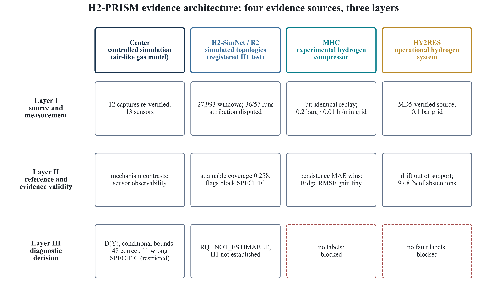

*Q1_I01 — Evidence architecture.* Evidence sources (columns) and evidence layers (rows) of the integrated package. Layer I: source identity, measurement and recording qualification. Layer II: reference behaviour and evidence validity. Layer III: diagnostic decisions. Dashed boxes: blocked by evidence (no qualified labels, bounds or locations). Numbers are taken from T01–T10 and the H1 report; studies are never pooled. ([caption](captions/Q1_I01_integrated_evidence_architecture.md))

#### T01 — Study source and data qualification

Evidence sources, identity checks and independent units. Studies are never pooled.

| study | system | data | source_identity | independent_units | verification | qualification |
|---|---|---|---|---|---|---|
| Center | controlled Simscape network simulation (air-like gas, R = 0.287 kJ/(kg·K)) | 12 accepted captures; 13 sensors (PS1–PS10 MPa, MFS1–MFS3 kg/s); 0.2 s step | frozen baseline h2prism-center-baseline-v1 (6fee8a0); per-capture raw SHA-256 | one source family; 0 verified independent generating families | baseline_freeze --verify: 12 captures, 410 files matched | VERIFIED (integrity); controlled simulation only |
| R2 / H2-SimNet | simulated pipeline topologies (Center, Downstream, Upstream) | 27,993 windows of 60 s, 128 features; 4 classes | run key a10530f1fcf2; predictions SHA-256 4338c8c9ecec… | 51 runs, 39 families, 17 scenario ancestors | 161 H1 reproduction checks matched | REGISTERED (inspected); 36/57 runs attribution disputed (D1 pending) |
| MHC (Study B) | dual-stage metal-hydride hydrogen compressor (MHC v1.2, CC BY 4.0) | 29 workbooks; 8 eligible; P-2 (barg), MFC-3 (ln/min) | ZIP SHA-256 91755fb1e555…, MD5 64cbe2a68c0a… | 3 held-out runs of one apparatus (rows serially dependent) | frozen replay bit-identical (24/24 metrics) | VALIDATED WITHIN SCOPE (reference prediction) |
| HY2RES (Study C) | residential PV–electrolyzer–storage–fuel-cell hydrogen system (Zenodo 15166733 v1) | 300,768 rows at 5 s; targets pres_buf, pres_comp (bar), h2_flow (NL/h) | 38,621,947 bytes; MD5 9a3c3e3b1668…; SHA-256 c9adf30dc1ac… | one system, 414 test segments (serially dependent) | 60/60 archived metrics reconciled; decision counts reproduced | VERIFIED WITHIN SCOPE (reference, evidence validity) |

Source: `center execution_manifest.json`; `study_b replay_manifest.json, TAB_B01.csv`; `hy2res analysis_manifest.json, recording_grid.csv`; `h1_validation/analysis` · Script: `publication_q1/scripts/build_tables.py`

**Interpretation.** Each study contributes to different layers; only Center reaches Layer III, and only conditionally.

**Limitation.** Evidence levels differ by study; the matrix is a qualification summary, not a measurement.

## 2.1 Center — observability and controlled response

- **Question.** Which sensors observe a controlled withdrawal, and how large are the responses?
- **Evidence.** Hash-verified Center captures; channel_signal.csv.
- **Method.** Intervention − matched control differences in native units.
- **Comparator.** Matched control run of the same capture pair.

**Results.**

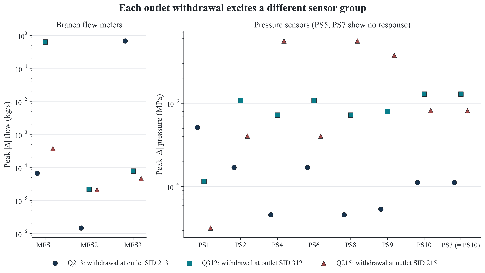

*Q1_C01 — Sensor observability of each outlet withdrawal.* Peak absolute intervention − control difference per sensor for the three outlet withdrawals (30 s prefix window). SID 213 excites branch meter MFS3 (0.691 kg/s) and SID 312 excites MFS1 (0.647 kg/s). SID 215 has no branch flow meter: its largest flow response is 3.8e-04 kg/s, and it appears mainly in pressure (largest 0.0056 MPa, PS4/PS8). PS3 duplicates PS10 bitwise; PS5 and PS7 (command channel) do not respond to withdrawals. Logarithmic axes; units are kept in separate panels. ([caption](captions/Q1_C01_center_branch_observability.md))

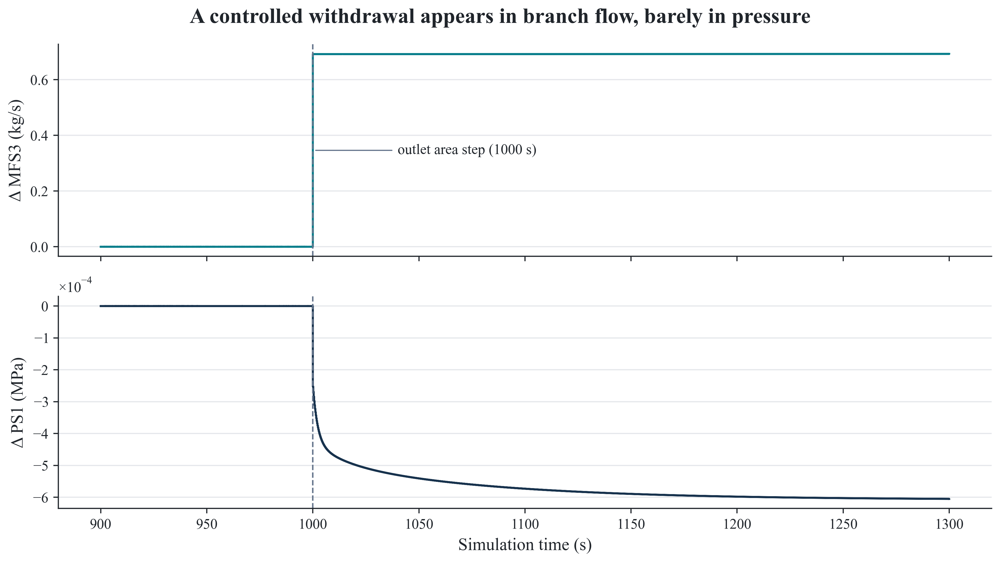

*Q1_C02 — Controlled withdrawal response.* Intervention minus matched control for the alternate-profile withdrawal at outlet SID 213 (both runs share the +5 kPa reservoir profile; the outlet area steps 0.0010 → 0.0011 m² at 1000 s in the intervention only). Exact recorded samples at 0.2 s, 900–1300 s. Branch flow MFS3 changes by up to 0.692 kg/s, junction pressure PS1 by at most 6.05e-04 MPa. ([caption](captions/Q1_C02_center_controlled_response.md))

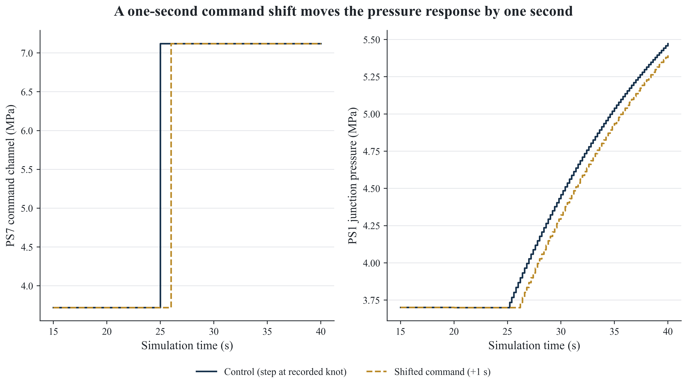

*Q1_C03 — Command timing shift.* Command-issuance timing pair. The PS7 command channel steps by 3.40 MPa at 25.0 s in the control and at 26.0 s in the intervention; PS1 follows each command. Exact recorded samples, 15–40 s. Event alignment of these traces is retrospective and does not measure actuator lag. ([caption](captions/Q1_C03_center_timing_alignment.md))

**Interpretation.** Each outlet excites a different sensor group; SID 215 is visible only in pressure. Responses are flow-dominated.

**Limitation.** One controlled simulation family with an air-like gas model.

## 2.2 Center — archive benchmark, detection and sensor stress

- **Question.** What do the historical event-window benchmark and detection replays show?
- **Evidence.** publication_final_v1 TAB_03–TAB_05.
- **Method.** Re-plot of frozen tables.
- **Comparator.** Constant 'LEAK' rule; majority and always-event rules.

**Results.**

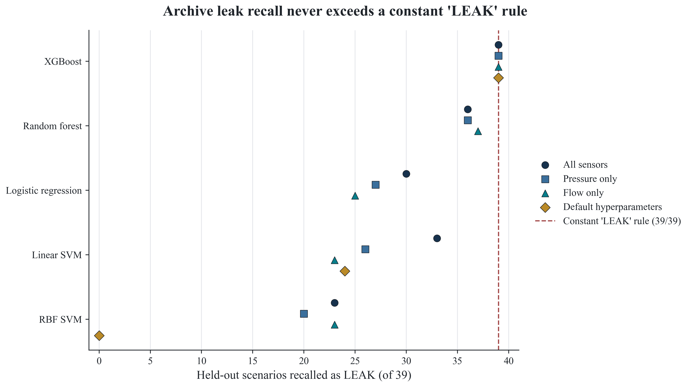

*Q1_C04 — Archive benchmark recall.* Oracle-onset event-window benchmark on the historical archive. All 39 scored held-out scenarios carry LEAK annotations, so a constant 'LEAK' rule recalls 39/39. XGBoost reaches 39/39 in every sensor variant (ties the constant rule); the best random forest recall is 0.949. Multiclass accuracy is not reported because only one class is present. ([caption](captions/Q1_C04_center_archive_recall.md))

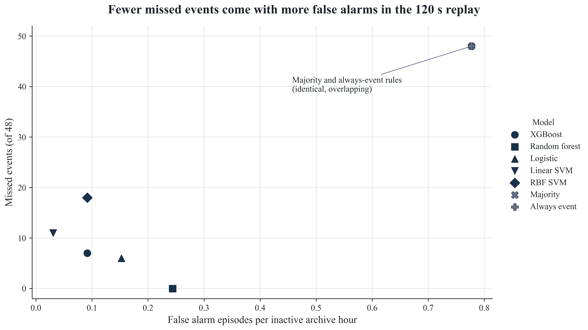

*Q1_C05 — Detection completeness versus false alarms.* Clean cumulative replay of the frozen 120 s decision cadence (51 scenarios, 48 events, 65.63 inactive hours). Random forest misses 0 events at 0.244 false episodes per hour; the trivial rules (grey) miss all 48 new-alert detections. Lower-left is better on both axes. ([caption](captions/Q1_C05_center_detection_tradeoff.md))

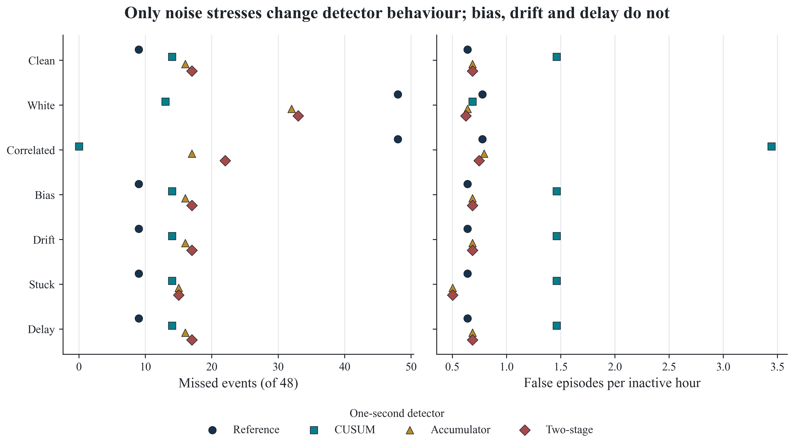

*Q1_C06 — Detector behaviour under sensor stress.* One-second causal replay under hypothetical sensor perturbations (white and correlated noise, bias, drift, stuck, delay). Correlated noise drives CUSUM to 3.44 false episodes per hour, and the reference detector raises a persistent alarm (no new-alert detections) under white and correlated noise. Each metric keeps its own scale. ([caption](captions/Q1_C06_center_sensor_stress.md))

**Interpretation.** Recall cannot show discrimination because all held-out scenarios are LEAK; detectors trade missed events for false alarms; only noise stresses change detector behaviour.

**Limitation.** Archive replay of simulated scenarios; hypothetical perturbations.

## 2.3 Center — mechanism recognition

- **Question.** Does mechanism recognition survive removal of the query's own template?
- **Evidence.** TAB_C02, TAB_C07.
- **Method.** Nearest B3 template with and without self-templates (LOTO).
- **Comparator.** Frozen library with self-templates.

**Results.**

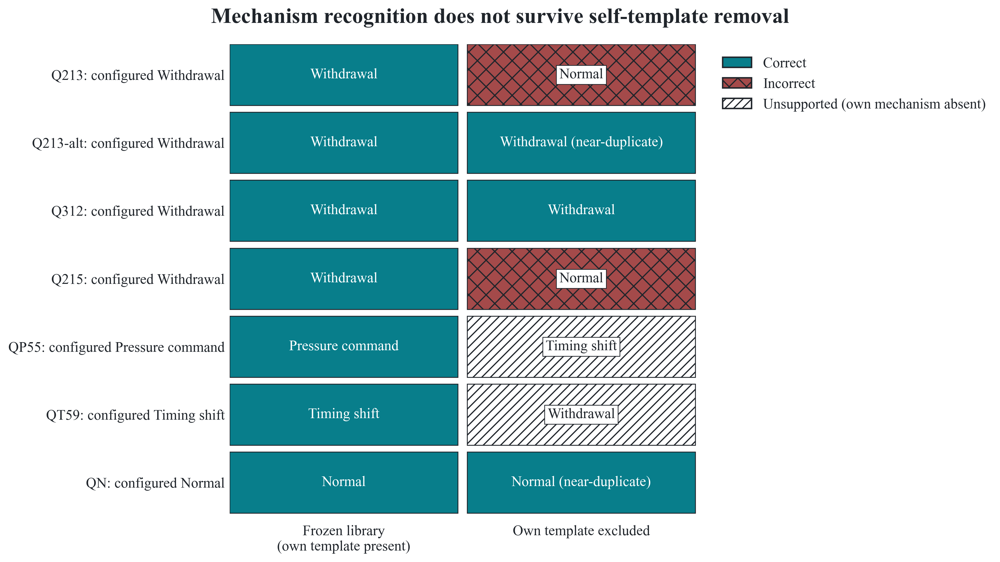

*Q1_C07 — Mechanism recognition with and without self-templates.* Nearest-mechanism label (normalized B3 RMS, all sensors, 30 s prefix, ±1 s shift) for each controlled query. With its own template present every query is labelled correctly at distance 0 by construction. With the own template excluded, 2/4 supported controlled queries agree (QN, the nominal run, is matched to a near-duplicate nominal transient), 2 are unsupported, and Q213-alt matches only because a near-duplicate SID 213 template exists. Counts from one source family. ([caption](captions/Q1_C07_center_mechanism_recognition.md))

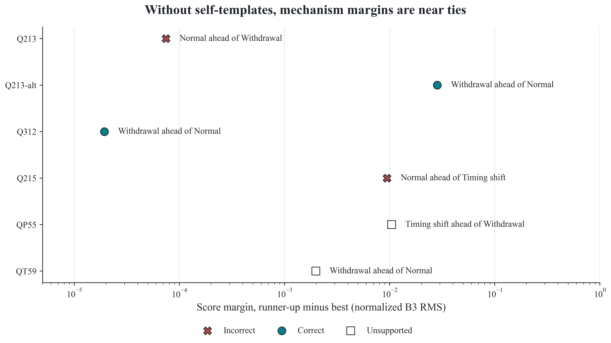

*Q1_C08 — Mechanism ranking margins.* Margin between the best and runner-up mechanism with the query's own template excluded (logarithmic axis). Q213 falls behind the zero residual 'Normal' by 7.4e-05; Q312 is correct only by 1.9e-05. Labels next to the markers name the leading and runner-up mechanisms. ([caption](captions/Q1_C08_center_mechanism_margins.md))

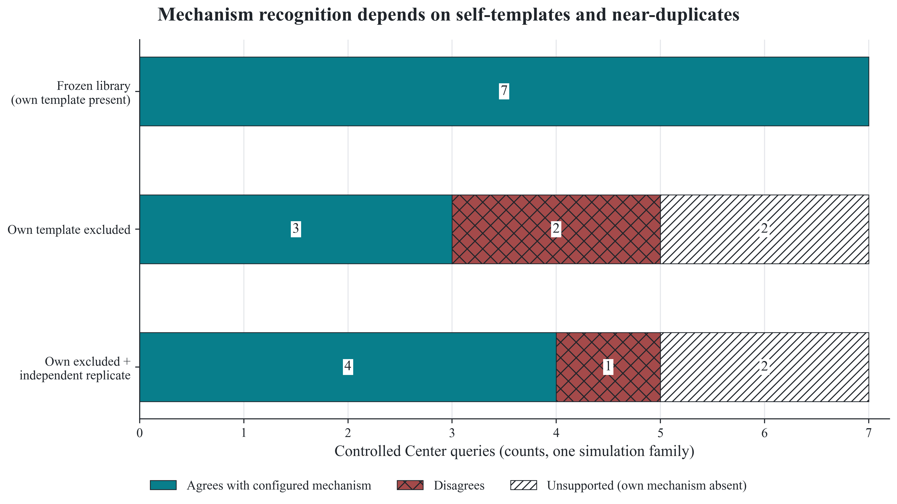

*Q1_I04 — Mechanism-recognition potential.* Nearest-mechanism recognition for the 7 controlled Center queries (normalized B3 RMS, all sensors). With the frozen library every query matches a self (5) or near-duplicate (2) template. Excluding the own template leaves 5 supported queries, of which 3 agree; adding the alternate-profile SID 213 capture as a replicate raises agreement to 4/5. Counts from one source family, not rates; details in Q1_C07. ([caption](captions/Q1_I04_integrated_mechanism_recognition.md))

#### T05 — Center mechanism recognition

Nearest-mechanism decisions (normalized B3 RMS, all sensors, 30 s prefix, ±1 s). frozen = own template present; loto = own template excluded. One source family; counts, not rates.

| query | condition | true_mechanism | templates | predicted | best_template | runner_up | margin | status | near_duplicate |
|---|---|---|---|---|---|---|---|---|---|
| SID213 | frozen | Withdrawal | 7 | Withdrawal | SID213 | Normal | 0.02836 | CORRECT | SID213 |
| SID213 | loto | Withdrawal | 6 | Normal | NORMAL_ZERO | Withdrawal | 7.44e-05 | INCORRECT | — |
| SID312 | frozen | Withdrawal | 7 | Withdrawal | SID312 | Normal | 0.02941 | CORRECT | SID312 |
| SID312 | loto | Withdrawal | 6 | Withdrawal | SID215 | Normal | 1.94e-05 | CORRECT | — |
| SID215 | frozen | Withdrawal | 7 | Withdrawal | SID215 | Normal | 0.002185 | CORRECT | SID215 |
| SID215 | loto | Withdrawal | 6 | Normal | NORMAL_ZERO | Timing shift | 0.009448 | INCORRECT | — |
| PRESSURE | frozen | Pressure command | 7 | Pressure command | PRESSURE | Timing shift | 0.03692 | CORRECT | PRESSURE |
| PRESSURE | loto | Pressure command | 6 | Timing shift | TIMING | Withdrawal | 0.01042 | UNSUPPORTED | — |
| TIMING | frozen | Timing shift | 7 | Timing shift | TIMING | Withdrawal | 0.01163 | CORRECT | TIMING |
| TIMING | loto | Timing shift | 6 | Withdrawal | SID215 | Normal | 0.001984 | UNSUPPORTED | — |
| ALT | frozen | Withdrawal | 7 | Withdrawal | SID213 | Normal | 0.02836 | CORRECT | SID213 |
| ALT | loto | Withdrawal | 7 | Withdrawal | SID213 | Normal | 0.02836 | CORRECT | SID213 |
| NOMINAL | frozen | Normal | 7 | Normal | NORMAL_TRANSIENT | Withdrawal | 0.2514 | CORRECT | NORMAL_TRANSIENT |
| NOMINAL | loto | Normal | 7 | Normal | NORMAL_TRANSIENT | Withdrawal | 0.2514 | CORRECT | NORMAL_TRANSIENT |

Source: `03_results/validation/center_evidence_enhancement/tables/TAB_C02.csv` · Script: `publication_q1/scripts/build_tables.py`

**Interpretation.** Recognition is largely a self-match: 3/5 supported queries agree without self-templates, with near-tie margins.

**Limitation.** Seven queries, one source family.

## 2.4 Center — categorical localization and sensor dependence

- **Question.** Can the configured outlet be ranked, and which sensors carry the separation?
- **Evidence.** TAB_C03, pair_contrasts.csv.
- **Method.** Categorical rank among candidate outlets; contrasts by sensor group.
- **Comparator.** Leave-own-template-out.

**Results.**

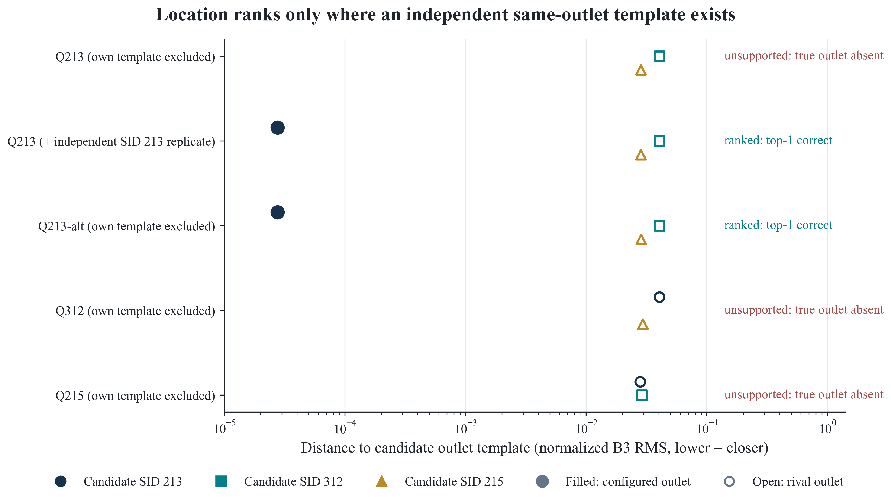

*Q1_C09 — Categorical location ranking.* Categorical location ranking for the withdrawal queries (all sensors, 30 s prefix, ±1 s). Q213 and Q213-alt are ranked correctly (SID 213 first) only because a second SID 213 capture exists; the two captures differ only by a +0.005 MPa reservoir overlay. Q312 and Q215 have no independent same-outlet template and cannot be ranked. This is a categorical rank, not a localization distance or accuracy. ([caption](captions/Q1_C09_center_location_ranking.md))

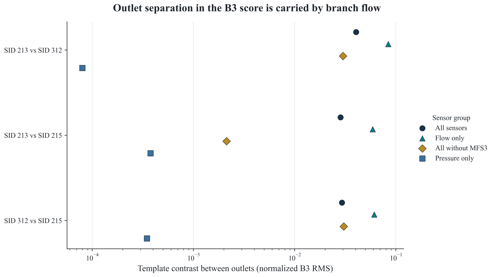

*Q1_C10 — Sensor-group dependence of outlet separation.* B3 contrast between withdrawal templates for each outlet pair and sensor group (±1 s, 30 s prefix). The flow share of the all-sensor contrast is ≥ 1.000 for every pair. Pressure-only contrasts are two to three decades smaller, and withholding MFS3 collapses the SID 213 vs SID 215 contrast, because SID 215 is flow-blind. ([caption](captions/Q1_C10_center_sensor_group_separation.md))

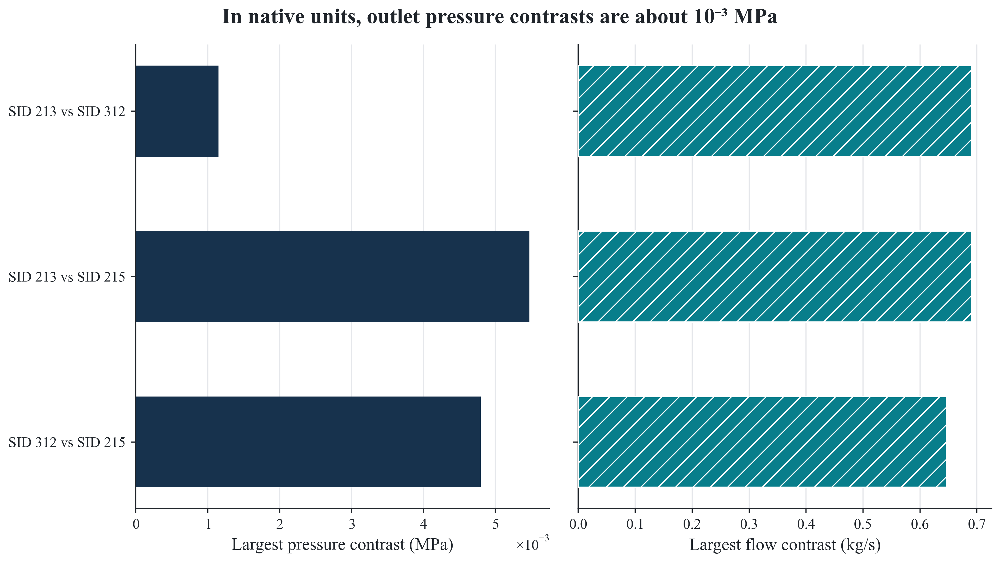

*Q1_C11 — Native-unit outlet contrasts.* Largest absolute template difference between outlet withdrawals at the best shift within ±1 s, in native units: pressure 1.15e-03–5.47e-03 MPa; flow 0.647–0.691 kg/s. Units are not combined. ([caption](captions/Q1_C11_center_native_contrast.md))

#### T06a — Center categorical location ranking

Categorical rank of candidate outlets; not a localization distance or accuracy. Unsupported = the true outlet has no independent template.

| query | condition | true_SID | candidate_SIDs | score_SID213 | score_SID312 | score_SID215 | top1 | top1_result | margin | status | relevant_sensors |
|---|---|---|---|---|---|---|---|---|---|---|---|
| SID213 | loto | 213 | 215, 312 | — | 0.0405 | 0.02843 | 215 | unsupported | 0.01207 | UNSUPPORTED | MFS3 (branch meter SID 218), PS1 (junction SID 50) |
| SID213 | loto_replicate | 213 | 213, 215, 312 | 2.76e-05 | 0.0405 | 0.02843 | 213 | correct | 0.0284 | CORRECT | MFS3 (branch meter SID 218), PS1 (junction SID 50) |
| SID312 | loto | 312 | 215, 213 | 0.04052 | — | 0.02939 | 215 | unsupported | 0.01114 | UNSUPPORTED | MFS1 (branch meter SID 311) |
| SID312 | loto_replicate | 312 | 215, 213 | 0.04052 | — | 0.02939 | 215 | unsupported | 0.01114 | UNSUPPORTED | MFS1 (branch meter SID 311) |
| SID215 | loto | 215 | 213, 312 | 0.02796 | 0.0289 | — | 213 | unsupported | 0.000935 | UNSUPPORTED | PS4/PS8, PS9 (no branch flow meter) |
| SID215 | loto_replicate | 215 | 213, 312 | 0.02796 | 0.0289 | — | 213 | unsupported | 0.000935 | UNSUPPORTED | PS4/PS8, PS9 (no branch flow meter) |
| ALT | loto | 213 | 213, 215, 312 | 2.76e-05 | 0.04052 | 0.02846 | 213 | correct | 0.02843 | CORRECT | MFS3 (branch meter SID 218), PS1 (junction SID 50) |
| ALT | loto_replicate | 213 | 213, 215, 312 | 2.76e-05 | 0.04052 | 0.02846 | 213 | correct | 0.02843 | CORRECT | MFS3 (branch meter SID 218), PS1 (junction SID 50) |

Source: `03_results/validation/center_evidence_enhancement/tables/TAB_C03.csv` · Script: `publication_q1/scripts/build_tables.py`

#### T06b — Center sensor-dependent outlet contrasts

Template contrast between outlet pairs per sensor group (B3, dimensionless) and largest native contrasts (MPa, kg/s), ±1 s.

| a | b | group | b3_rms | flow_share | max_abs_pressure_MPa | max_abs_flow_kg_s |
|---|---|---|---|---|---|---|
| SID213 | SID312 | all | 0.0405 | 1 | 0.001148 | 0.6913 |
| SID213 | SID312 | pressure | 7.99e-05 | 0 | 0.001148 | — |
| SID213 | SID312 | flow | 0.08431 | 1 | — | 0.6913 |
| SID213 | SID312 | omit_MFS3 | 0.03009 | 1 | 0.001148 | 0.6467 |
| SID213 | SID215 | all | 0.02843 | 0.9999 | 0.005474 | 0.6913 |
| SID213 | SID215 | pressure | 0.000377 | 0 | 0.005474 | — |
| SID213 | SID215 | flow | 0.05918 | 1 | — | 0.6913 |
| SID213 | SID215 | omit_MFS3 | 0.002127 | 0.9738 | 0.005474 | 0.000301 |
| SID213 | ALT | all | 2.76e-05 | 1 | 2.45e-06 | 0.000684 |
| SID213 | ALT | pressure | 1.41e-07 | 0 | 2.45e-06 | — |
| SID213 | ALT | flow | 5.75e-05 | 1 | — | 0.000684 |
| SID213 | ALT | omit_MFS3 | 7.95e-07 | 0.9739 | 2.45e-06 | 1.49e-06 |
| SID312 | SID215 | all | 0.02939 | 0.9999 | 0.004797 | 0.6468 |
| SID312 | SID215 | pressure | 0.000347 | 0 | 0.004797 | — |
| SID312 | SID215 | flow | 0.06117 | 1 | — | 0.6468 |
| SID312 | SID215 | omit_MFS3 | 0.03059 | 0.9999 | 0.004797 | 0.6468 |
| SID312 | ALT | all | 0.04054 | 1 | 0.001173 | 0.6919 |
| SID312 | ALT | pressure | 8.35e-05 | 0 | 0.001173 | — |
| SID312 | ALT | flow | 0.0844 | 1 | — | 0.6919 |
| SID312 | ALT | omit_MFS3 | 0.0306 | 1 | 0.001173 | 0.6468 |
| SID215 | ALT | all | 0.02799 | 0.9999 | 0.005523 | 0.6919 |
| SID215 | ALT | pressure | 0.000388 | 0 | 0.005523 | — |
| SID215 | ALT | flow | 0.05826 | 1 | — | 0.6919 |
| SID215 | ALT | omit_MFS3 | 0.002146 | 0.9727 | 0.005523 | 0.000312 |

Source: `03_results/validation/center_evidence_enhancement/analysis/pair_contrasts.csv` · Script: `publication_q1/scripts/build_tables.py`

**Interpretation.** Only the outlet with an independent replicate (SID 213) is ranked first; separation is carried by branch flow, and SID 215 is flow-blind.

**Limitation.** Two supported queries for one outlet; no localization distance or accuracy.

## 2.5 Center — formal D(Y) under conditional hypothetical bounds

- **Question.** Which hypotheses does formal D(Y) exclude, at what precision, and how do decisions depend on the declared universe?
- **Evidence.** dy_decisions.json, TAB_C05, TAB_C06.
- **Method.** Closed-form exclusion and feasibility onsets; engine decisions per bound scenario.
- **Comparator.** Full declared universe vs restricted (modelled) universe.

**Results.**

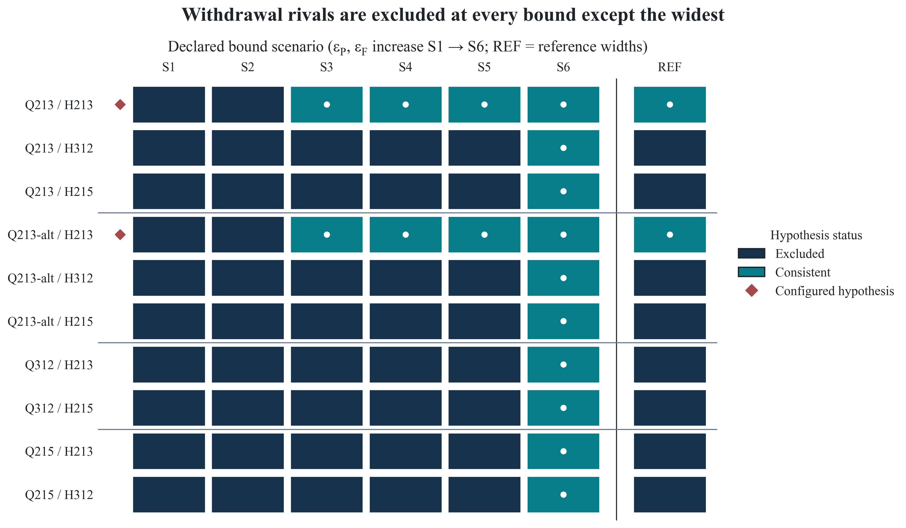

*Q1_C12a — Withdrawal rivals are excluded at every bound except the widest.* Status of withdrawal hypotheses for the four withdrawal queries. Rows are query/hypothesis pairs (IDs in TS02_center_dy_id_map.csv); columns are declared total bound scenarios (ε_total = ε_obs + ε_model per kind; S1: 1e-06 MPa, 1e-05 kg/s; S2: 1e-05 MPa, 0.0001 kg/s; S3: 0.0001 MPa, 0.001 kg/s; S4: 0.001 MPa, 0.01 kg/s; S5: 0.01 MPa, 0.1 kg/s; S6: 0.1 MPa, 1 kg/s; REF: 0.0344 MPa, 0.0182 kg/s). Full declared universe, all sensors, ±1 s clock. Cell counts: excluded 52, consistent 18. The complete matrix for every universe, sensor group and clock bound is in TS01_center_dy_status_matrix.csv. Conditional hypothetical bounds — not calibrated uncertainty. ([caption](captions/Q1_C12a_center_dy_status_withdrawal_rivals.md))

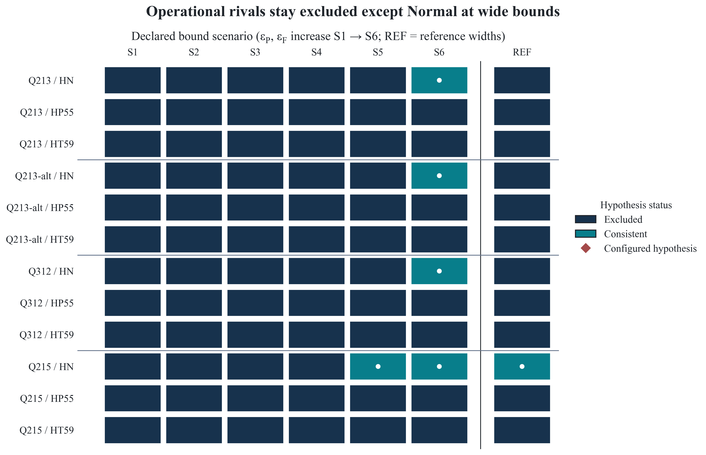

*Q1_C12b — Operational rivals stay excluded except Normal at wide bounds.* Status of the normal, pressure-command and timing hypotheses for the withdrawal queries. Rows are query/hypothesis pairs (IDs in TS02_center_dy_id_map.csv); columns are declared total bound scenarios (ε_total = ε_obs + ε_model per kind; S1: 1e-06 MPa, 1e-05 kg/s; S2: 1e-05 MPa, 0.0001 kg/s; S3: 0.0001 MPa, 0.001 kg/s; S4: 0.001 MPa, 0.01 kg/s; S5: 0.01 MPa, 0.1 kg/s; S6: 0.1 MPa, 1 kg/s; REF: 0.0344 MPa, 0.0182 kg/s). Full declared universe, all sensors, ±1 s clock. Cell counts: excluded 78, consistent 6. The complete matrix for every universe, sensor group and clock bound is in TS01_center_dy_status_matrix.csv. Conditional hypothetical bounds — not calibrated uncertainty. ([caption](captions/Q1_C12b_center_dy_status_operational_rivals.md))

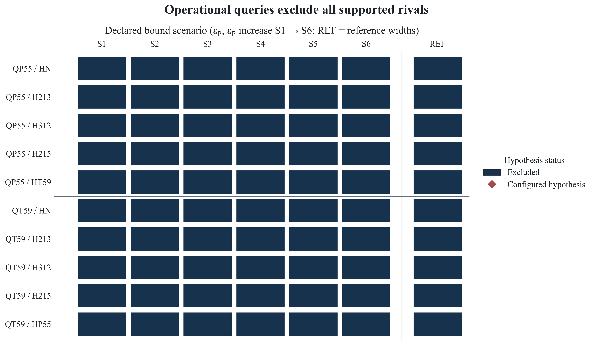

*Q1_C12c — Operational queries exclude all supported rivals.* Status of all supported hypotheses for the two operational queries (their own mechanism has no independent adapter and is shown in Q1_C12d). Rows are query/hypothesis pairs (IDs in TS02_center_dy_id_map.csv); columns are declared total bound scenarios (ε_total = ε_obs + ε_model per kind; S1: 1e-06 MPa, 1e-05 kg/s; S2: 1e-05 MPa, 0.0001 kg/s; S3: 0.0001 MPa, 0.001 kg/s; S4: 0.001 MPa, 0.01 kg/s; S5: 0.01 MPa, 0.1 kg/s; S6: 0.1 MPa, 1 kg/s; REF: 0.0344 MPa, 0.0182 kg/s). Full declared universe, all sensors, ±1 s clock. Cell counts: excluded 70. The complete matrix for every universe, sensor group and clock bound is in TS01_center_dy_status_matrix.csv. Conditional hypothetical bounds — not calibrated uncertainty. ([caption](captions/Q1_C12c_center_dy_status_operational_queries.md))

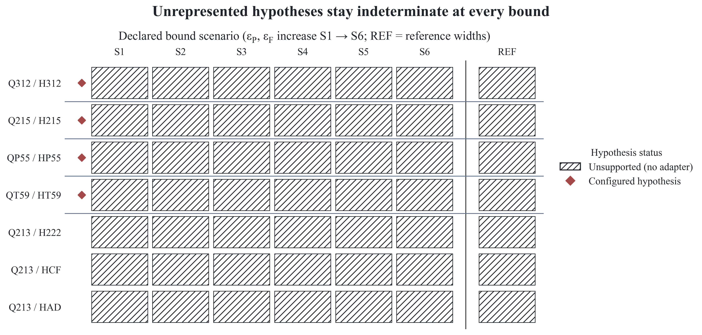

*Q1_C12d — Unrepresented hypotheses stay indeterminate at every bound.* Unsupported cases: four configured hypotheses whose only template is the query itself, and three declared hypotheses with no adapter (H222, HCF, HAD; shown for Q213 — their status is identical for all six queries, asserted). Rows are query/hypothesis pairs (IDs in TS02_center_dy_id_map.csv); columns are declared total bound scenarios (ε_total = ε_obs + ε_model per kind; S1: 1e-06 MPa, 1e-05 kg/s; S2: 1e-05 MPa, 0.0001 kg/s; S3: 0.0001 MPa, 0.001 kg/s; S4: 0.001 MPa, 0.01 kg/s; S5: 0.01 MPa, 0.1 kg/s; S6: 0.1 MPa, 1 kg/s; REF: 0.0344 MPa, 0.0182 kg/s). Full declared universe, all sensors, ±1 s clock. Cell counts: unsupported (no adapter) 49. The complete matrix for every universe, sensor group and clock bound is in TS01_center_dy_status_matrix.csv. Conditional hypothetical bounds — not calibrated uncertainty. ([caption](captions/Q1_C12d_center_dy_status_unsupported.md))

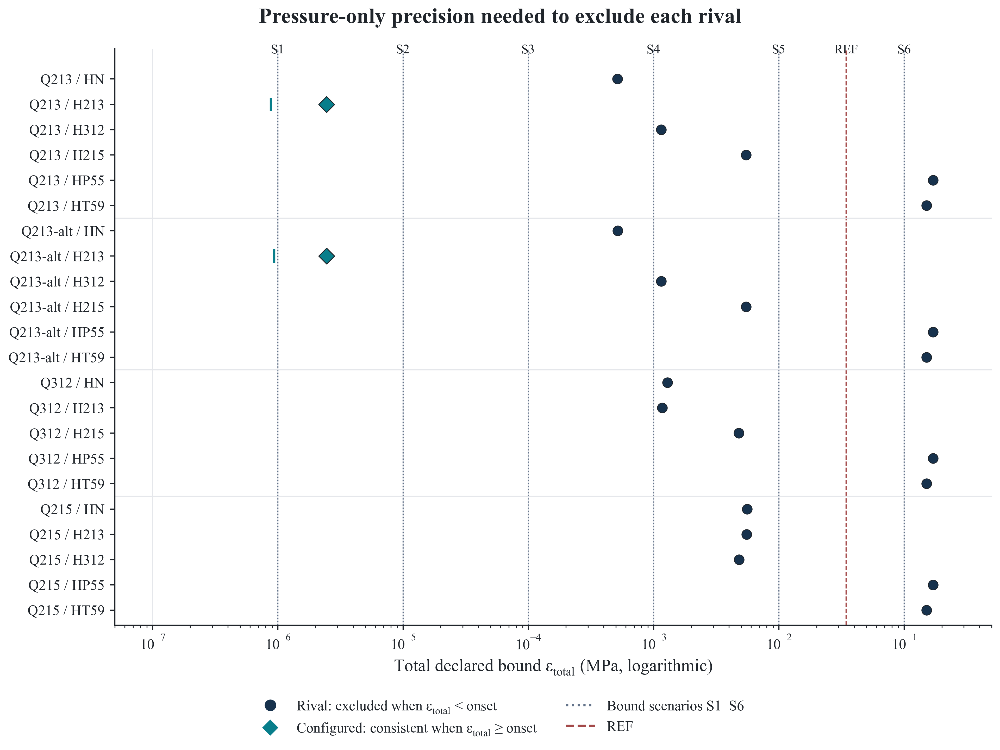

*Q1_C13a — Pressure-only exclusion onsets.* Exact pressure-only exclusion onsets (closed form, exact-rational confirmed) for each supported hypothesis of the withdrawal queries, ±1 s clock, 30 s prefix. A rival is excluded while ε_total lies below its onset; the configured hypothesis becomes consistent at its feasibility onset (diamond; the tick marks its exclusion onset). For Q213 the correct-SPECIFIC window is [2.45e-06, 0.000514) MPa. Rows absent for Q312 and Q215 configured hypotheses are unsupported (no independent template). Values are listed in TAB_C05. ([caption](captions/Q1_C13a_center_dy_thresholds_pressure.md))

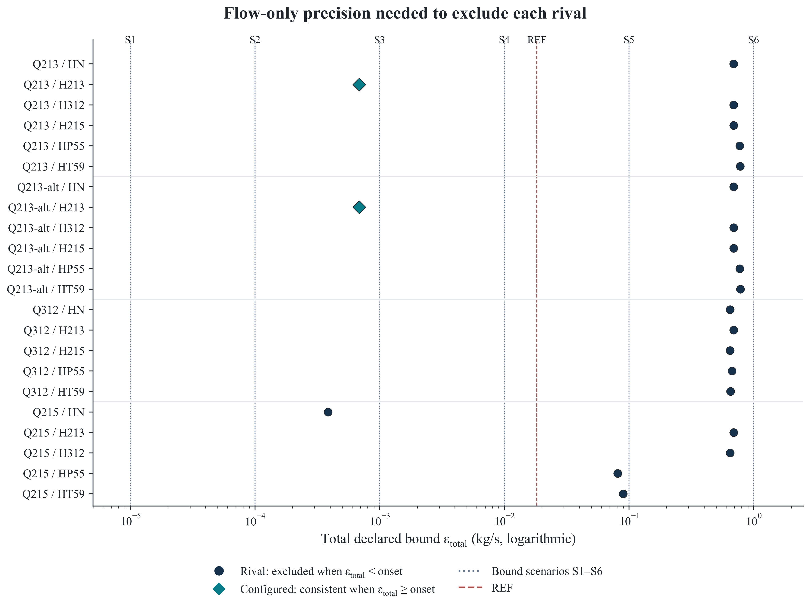

*Q1_C13b — Flow-only exclusion onsets.* Exact flow-only exclusion onsets (closed form, exact-rational confirmed) for each supported hypothesis of the withdrawal queries, ±1 s clock, 30 s prefix. A rival is excluded while ε_total lies below its onset; the configured hypothesis becomes consistent at its feasibility onset (diamond; the tick marks its exclusion onset). For Q213 the correct-SPECIFIC window is [0.000684, 0.691) kg/s. Rows absent for Q312 and Q215 configured hypotheses are unsupported (no independent template). Values are listed in TAB_C05. ([caption](captions/Q1_C13b_center_dy_thresholds_flow.md))

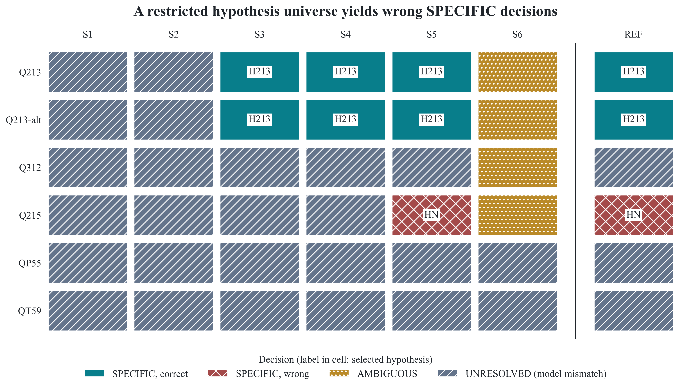

*Q1_C14 — Restricted-universe decisions.* Set-valued D(Y) decisions in the restricted universe (only hypotheses with adapters), all sensors, ±1 s. 8 SPECIFIC decisions are correct (the two SID 213 queries) and 2 are wrong: the flow-blind SID 215 withdrawal is classed as normal operation (HN) once the flow bound exceeds its tiny flow signal. In the full declared universe all 42 cells are UNRESOLVED (INDETERMINATE_HYPOTHESES). Conditional hypothetical bounds — not calibrated uncertainty. ([caption](captions/Q1_C14_center_dy_restricted_decisions.md))

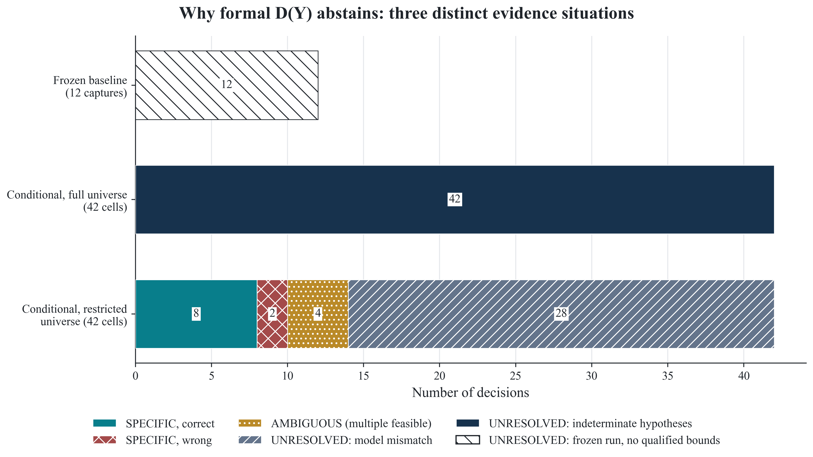

*Q1_C15 — D(Y) decision reasons.* Decision reasons. The frozen baseline returned UNRESOLVED for all 12 captures because no qualified bounds existed. Under conditional hypothetical bounds (6 queries × 7 bound scenarios, all sensors, ±1 s) the full declared universe never decides because three declared hypotheses have no adapter; the restricted universe decides, but includes wrong SPECIFIC decisions (Q1_C14). ([caption](captions/Q1_C15_center_dy_evidence_breakdown.md))

#### T07a — Formal D(Y) decisions by universe, sensor group and clock bound

CONDITIONAL_HYPOTHETICAL_BOUNDS — not calibrated uncertainty. 42 cells per row (6 queries × 7 bound scenarios); rows are repeated views of the same captures.

| universe | group | clock_bound_s | cells | specific | specific_correct | specific_wrong | ambiguous | unresolved |
|---|---|---|---|---|---|---|---|---|
| full | all | 0 | 42 | 0 | 0 | 0 | 0 | 42 |
| full | all | 1 | 42 | 0 | 0 | 0 | 0 | 42 |
| full | flow | 0 | 42 | 0 | 0 | 0 | 0 | 42 |
| full | flow | 1 | 42 | 0 | 0 | 0 | 0 | 42 |
| full | omit_MFS3 | 0 | 42 | 0 | 0 | 0 | 0 | 42 |
| full | omit_MFS3 | 1 | 42 | 0 | 0 | 0 | 0 | 42 |
| full | pressure | 0 | 42 | 0 | 0 | 0 | 0 | 42 |
| full | pressure | 1 | 42 | 0 | 0 | 0 | 0 | 42 |
| restricted | all | 0 | 42 | 10 | 8 | 2 | 4 | 28 |
| restricted | all | 1 | 42 | 10 | 8 | 2 | 4 | 28 |
| restricted | flow | 0 | 42 | 11 | 8 | 3 | 8 | 23 |
| restricted | flow | 1 | 42 | 12 | 8 | 4 | 7 | 23 |
| restricted | omit_MFS3 | 0 | 42 | 4 | 4 | 0 | 12 | 26 |
| restricted | omit_MFS3 | 1 | 42 | 4 | 4 | 0 | 12 | 26 |
| restricted | pressure | 0 | 42 | 4 | 4 | 0 | 14 | 24 |
| restricted | pressure | 1 | 42 | 4 | 4 | 0 | 14 | 24 |

Source: `03_results/validation/center_evidence_enhancement/analysis/dy_decisions.json` · Script: `publication_q1/scripts/build_tables.py`

#### T07b — Formal D(Y) decision reasons (all sensors, ±1 s)

Engine reason codes per universe; 42 cells per universe.

| universe | decision | reason | cells_all_sensors_1s |
|---|---|---|---|
| full | UNRESOLVED | INDETERMINATE_HYPOTHESES | 42 |
| restricted | AMBIGUOUS | MULTIPLE_FEASIBLE | 4 |
| restricted | SPECIFIC | UNIQUE_FEASIBLE | 10 |
| restricted | UNRESOLVED | MODEL_MISMATCH | 28 |

Source: `center TAB_C06.csv` · Script: `publication_q1/scripts/build_tables.py`

**Interpretation.** The full universe never decides; the restricted universe decides and is wrong whenever the true mechanism is unmodelled.

**Limitation.** Conditional hypothetical bounds — not calibrated uncertainty; repeated views of six captures.

## 3.1 MHC — measurement context and partition

- **Question.** Which channels and runs are evaluated?
- **Evidence.** MHC v1.2 workbooks (TAB_B01).
- **Method.** Eligibility from the frozen Study B protocol.
- **Comparator.** —

**Results.**

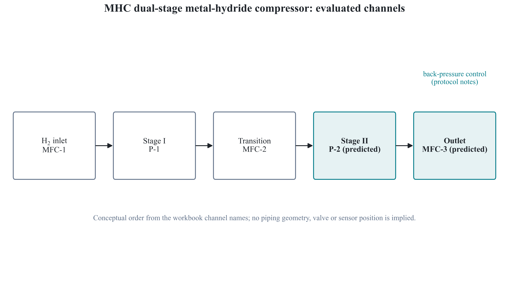

*Q1_B01 — Measurement context.* Hydrogen path of the MHC v1.2 apparatus as named in the workbook channel headers ('MFC1-H2 Inlet', 'P-1 H2 Stage I', 'MFC2-H2 Transition', 'P-2 H2 Stage II', 'MFC3-H2 Outlet'). Study B predicts P-2 (barg) and MFC-3 (ln/min) one step ahead. 8 of 29 workbooks are dual-stage compression runs and eligible: 5 development and 3 held-out test runs. MFC-3 is described in the protocol notes as the outlet back-pressure controller. ([caption](captions/Q1_B01_mhc_measurement_context.md))

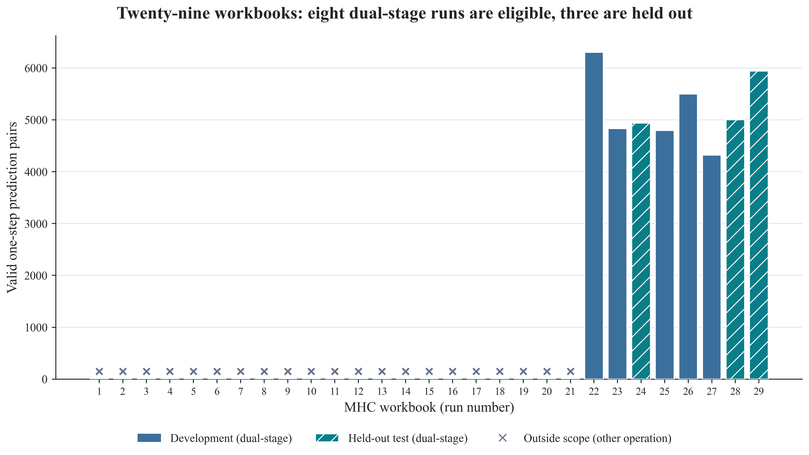

*Q1_B02 — Run eligibility and partition.* Eligibility and partition of all 29 MHC v1.2 workbooks (frozen Study B values; valid pairs recounted by the bit-identical replay). Outside scope: single stage compression (14), capacity measurement (5), thermal analysis without hydrogen (2). Held-out test runs 24, 28 and 29 contribute 15,885 pairs per channel. ([caption](captions/Q1_B02_mhc_run_partition.md))

**Interpretation.** Eight dual-stage runs are eligible; three are held out.

**Limitation.** One apparatus.

## 3.2 MHC — reference prediction

- **Question.** Is the learned Ridge reference better than persistence on held-out runs?
- **Evidence.** Bit-identical frozen replay.
- **Method.** MAE and RMSE per run and pooled; units never combined.
- **Comparator.** Persistence (previous value).

**Results.**

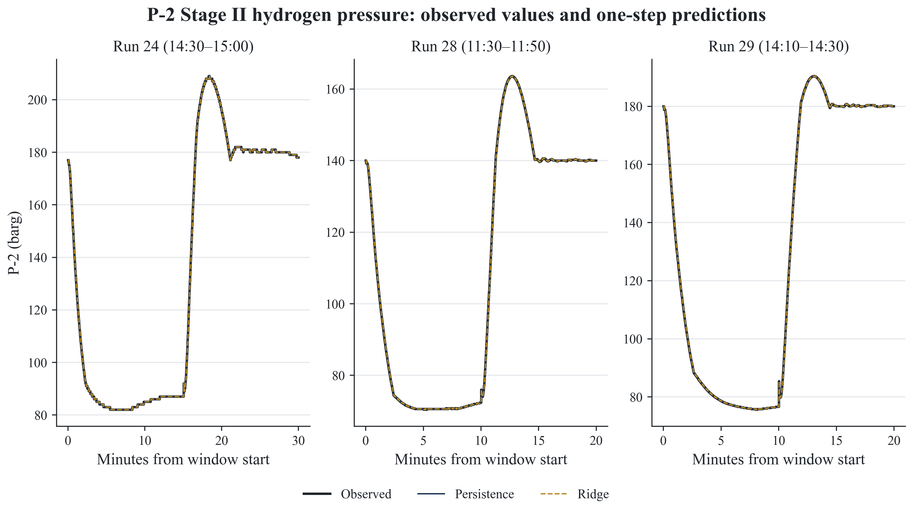

*Q1_B03 — P-2 prediction traces.* P-2 Stage II hydrogen pressure in the three held-out runs over the representative cycles declared in the analysis manifest (4,200 displayed observations), with the frozen persistence and Ridge one-step predictions. Persistence repeats the previous recorded value; Ridge is the frozen two-input linear reference. Times are workbook clock times. ([caption](captions/Q1_B03_mhc_p2_prediction_traces.md))

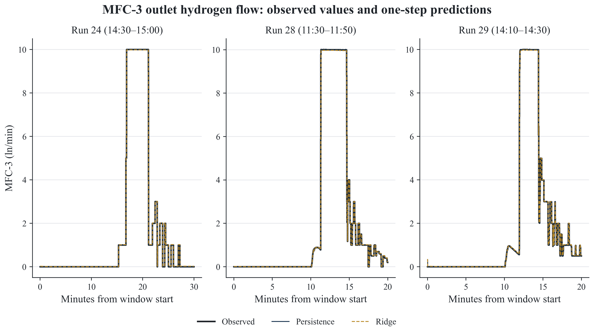

*Q1_B04 — MFC-3 prediction traces.* MFC-3 outlet hydrogen flow in the three held-out runs over the representative cycles declared in the analysis manifest (4,200 displayed observations), with the frozen persistence and Ridge one-step predictions. Persistence repeats the previous recorded value; Ridge is the frozen two-input linear reference. Times are workbook clock times. ([caption](captions/Q1_B04_mhc_mfc3_prediction_traces.md))

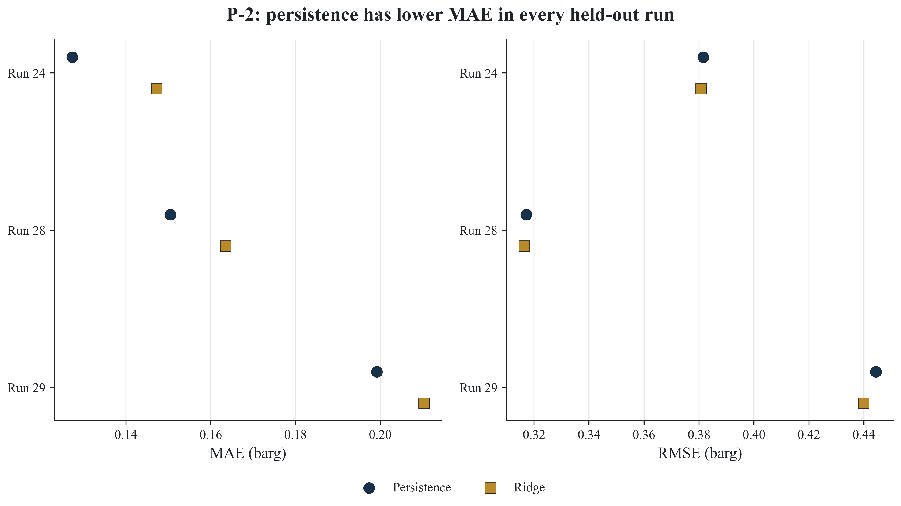

*Q1_B05 — P-2 per-run performance.* Run-level MAE and RMSE of the two frozen references for P-2 Stage II hydrogen pressure (barg; units never combined). Ridge − persistence ΔMAE / ΔRMSE: run 24: +0.0199 / -0.00077; run 28: +0.0130 / -0.00071; run 29: +0.0111 / -0.00453. The largest relative RMSE change is 1.02% of the persistence RMSE. ([caption](captions/Q1_B05_mhc_p2_per_run.md))

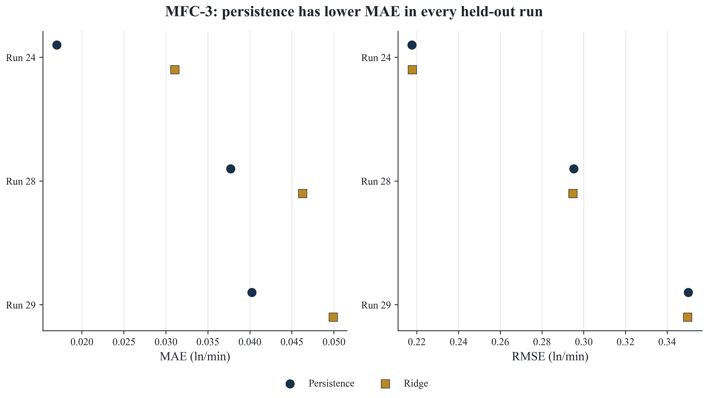

*Q1_B06 — MFC-3 per-run performance.* Run-level MAE and RMSE of the two frozen references for MFC-3 outlet hydrogen flow (ln/min; units never combined). Ridge − persistence ΔMAE / ΔRMSE: run 24: +0.0141 / +0.00012; run 28: +0.0086 / -0.00044; run 29: +0.0097 / -0.00038. The largest relative RMSE change is 0.15% of the persistence RMSE. ([caption](captions/Q1_B06_mhc_mfc3_per_run.md))

#### T02 — Reference prediction benchmark

Frozen one-step references on held-out data, in native units (units never combined). Δ = Ridge − persistence; negative favours Ridge. HY2RES 'Ridge' is the contextual Ridge reference.

| study | channel | unit | scope | rows | persistence_MAE | ridge_MAE | persistence_RMSE | ridge_RMSE | delta_MAE | delta_RMSE |
|---|---|---|---|---|---|---|---|---|---|---|
| MHC | P-2 | barg | 3 held-out runs pooled | 15,885 | 0.1615 | 0.1759 | 0.3883 | 0.386 | 0.01443 | -0.002353 |
| MHC | P-2 | barg | run 24 | 4,940 | 0.1273 | 0.1472 | 0.3815 | 0.3807 | 0.01988 | -0.000771 |
| MHC | P-2 | barg | run 28 | 5,002 | 0.1505 | 0.1635 | 0.3171 | 0.3164 | 0.01303 | -0.000713 |
| MHC | P-2 | barg | run 29 | 5,943 | 0.1992 | 0.2103 | 0.4444 | 0.4398 | 0.01109 | -0.004526 |
| MHC | MFC-3 | ln/min | 3 held-out runs pooled | 15,885 | 0.03221 | 0.0429 | 0.2967 | 0.2964 | 0.01068 | -0.000279 |
| MHC | MFC-3 | ln/min | run 24 | 4,940 | 0.017 | 0.03106 | 0.2176 | 0.2178 | 0.01406 | 0.000116 |
| MHC | MFC-3 | ln/min | run 28 | 5,002 | 0.03771 | 0.04627 | 0.2952 | 0.2948 | 0.008558 | -0.000437 |
| MHC | MFC-3 | ln/min | run 29 | 5,943 | 0.04023 | 0.0499 | 0.3501 | 0.3497 | 0.00967 | -0.000382 |
| HY2RES | pres_buf | bar | test, overall | 43,168 | 0.003964 | 0.0055 | 0.01991 | 0.01714 | 0.001537 | -0.002771 |
| HY2RES | pres_buf | bar | test, electrolyzer_active | 42,367 | 0.003574 | 0.004973 | 0.0189 | 0.01647 | 0.0014 | -0.002434 |
| HY2RES | pres_buf | bar | test, multiple_active | 801 | 0.02459 | 0.03336 | 0.04959 | 0.03847 | 0.008765 | -0.01112 |
| HY2RES | pres_comp | bar | test, overall | 43,168 | 0.0256 | 0.02514 | 0.0506 | 0.0407 | -0.000456 | -0.009901 |
| HY2RES | pres_comp | bar | test, electrolyzer_active | 42,367 | 0.02564 | 0.02507 | 0.05064 | 0.04072 | -0.000577 | -0.009922 |
| HY2RES | pres_comp | bar | test, multiple_active | 801 | 0.02322 | 0.02913 | 0.04819 | 0.03944 | 0.005912 | -0.00875 |
| HY2RES | h2_flow | NL/h | test, overall | 43,168 | 0.03273 | 0.178 | 1.257 | 1.185 | 0.1453 | -0.07171 |
| HY2RES | h2_flow | NL/h | test, electrolyzer_active | 42,367 | 0.03139 | 0.1717 | 1.269 | 1.193 | 0.1403 | -0.07555 |
| HY2RES | h2_flow | NL/h | test, multiple_active | 801 | 0.1036 | 0.5116 | 0.1347 | 0.6465 | 0.408 | 0.5118 |

Source: `study_b/.../replayed_predictions.csv.gz, run_metrics.csv`; `hy2res publication/TABLE_2_HELD_OUT.csv` · Script: `publication_q1/scripts/build_tables.py`

**Interpretation.** Persistence wins MAE in every run; Ridge's RMSE gains are tiny and not consistent for MFC-3.

**Limitation.** Three held-out runs; serially dependent rows.

## 3.3 MHC — error structure

- **Question.** Why do MAE and RMSE rank the references differently?
- **Evidence.** Replayed predictions; error tables.
- **Method.** Error ECDF, concentration curves, error by observed change.
- **Comparator.** Persistence.

**Results.**

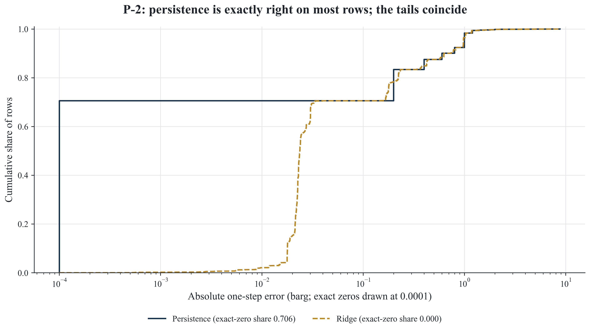

*Q1_B07 — P-2 error distribution.* Empirical cumulative distribution of absolute errors for P-2 Stage II hydrogen pressure, pooled over the three held-out runs (15,885 rows; serially dependent). Persistence is exactly right on 70.6% of rows; Ridge never is (continuous output). Median error: persistence 0, Ridge 0.0237; p99: 1.2 vs 1.18 barg. ([caption](captions/Q1_B07_mhc_p2_error_ecdf.md))

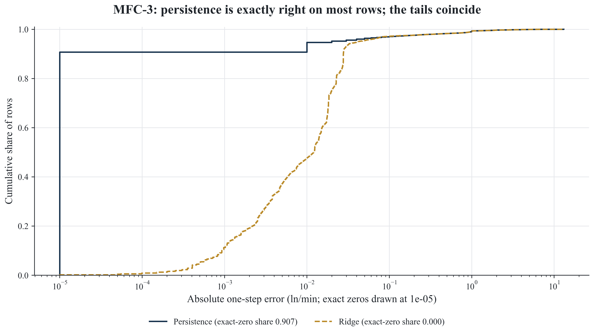

*Q1_B08 — MFC-3 error distribution.* Empirical cumulative distribution of absolute errors for MFC-3 outlet hydrogen flow, pooled over the three held-out runs (15,885 rows; serially dependent). Persistence is exactly right on 90.7% of rows; Ridge never is (continuous output). Median error: persistence 0, Ridge 0.0121; p99: 0.99 vs 0.973 ln/min. ([caption](captions/Q1_B08_mhc_mfc3_error_ecdf.md))

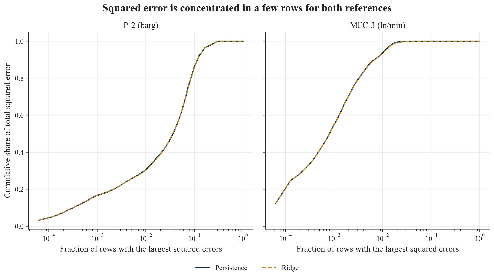

*Q1_B09 — Error-tail concentration.* Concentration curves of squared error, pooled over the three held-out runs: the share of total SSE carried by the given fraction of largest-error rows (dimensionless; channels in separate panels). The two references' curves almost coincide. For MFC-3 the top 1 % of rows carry 91.1%–100.0% of persistence SSE per run (TAB_B05), so RMSE comparisons are decided by rare large steps. ([caption](captions/Q1_B09_mhc_error_concentration.md))

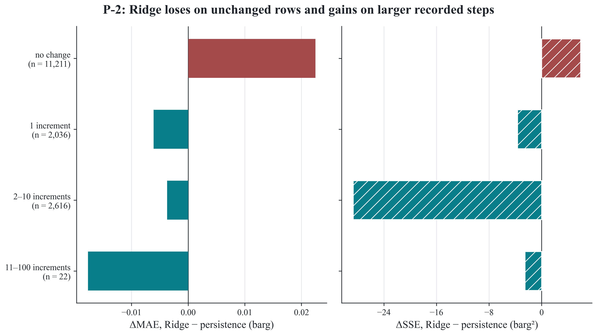

*Q1_B10 — P-2 error versus observed change.* Ridge − persistence differences for P-2 Stage II hydrogen pressure by observed one-step change |Δy| in recording increments (bins fixed before scoring; pooled held-out runs). Positive (burgundy) favours persistence, negative (teal) favours Ridge. Total ΔSSE -28.95 barg²: Ridge's small RMSE gain comes from rows with recorded changes, while its MAE loss accumulates on unchanged rows. Retrospective: |Δy| uses the outcome. ([caption](captions/Q1_B10_mhc_p2_error_vs_change.md))

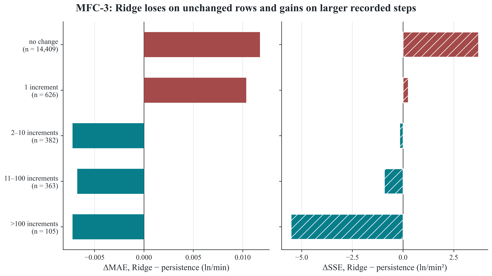

*Q1_B11 — MFC-3 error versus observed change.* Ridge − persistence differences for MFC-3 outlet hydrogen flow by observed one-step change |Δy| in recording increments (bins fixed before scoring; pooled held-out runs). Positive (burgundy) favours persistence, negative (teal) favours Ridge. Total ΔSSE -2.63 ln/min²: Ridge's small RMSE gain comes from rows with recorded changes, while its MAE loss accumulates on unchanged rows. Retrospective: |Δy| uses the outcome. ([caption](captions/Q1_B11_mhc_mfc3_error_vs_change.md))

**Interpretation.** Persistence is exact on most rows; RMSE is decided by rare large steps that both references miss alike.

**Limitation.** Change bins use the outcome (retrospective).

## 3.4 MHC — recording resolution and controller role

- **Question.** Are differences resolvable on the recording grid, and how must MFC-3 be interpreted?
- **Evidence.** resolution.csv, controller_role.csv.
- **Method.** Errors in recording increments; P-2 conditioned on MFC-3 flow.
- **Comparator.** One recording increment.

**Results.**

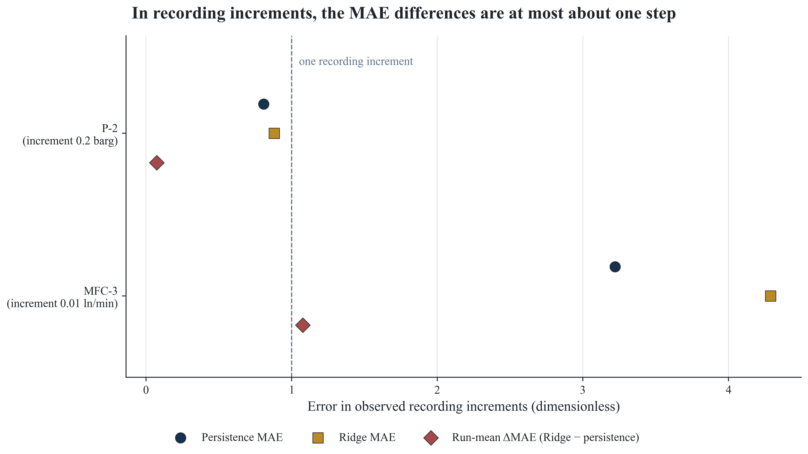

*Q1_B12 — Errors in recording increments.* Errors divided by each channel's observed recording increment (smallest step between distinct recorded values: P-2 0.2 barg, MFC-3 0.01 ln/min; all values on grid). Run-mean ΔMAE is 0.073 increments for P-2 and 1.08 for MFC-3. Persistence exact-match share: 0.706 and 0.907. The increment is recorded quantization, not instrument resolution or accuracy (neither is documented in the source). ([caption](captions/Q1_B12_mhc_recording_resolution.md))

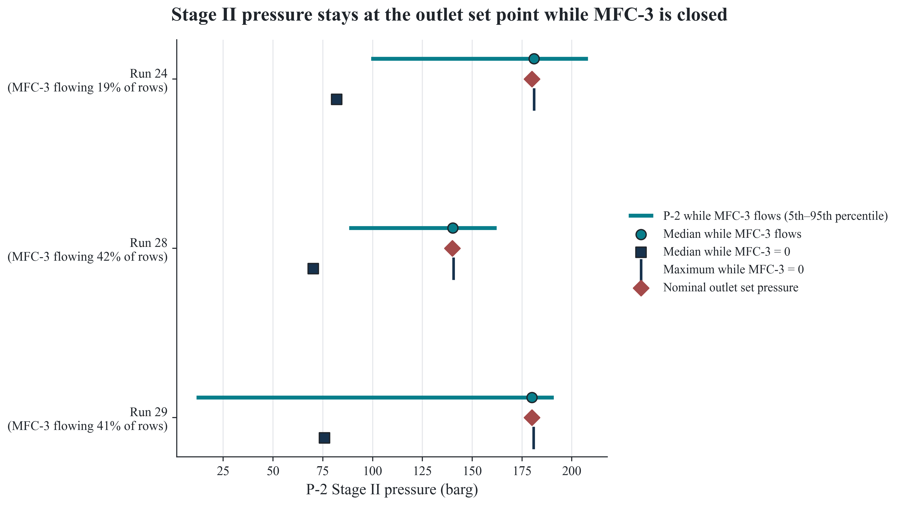

*Q1_B13 — MFC-3 control role.* Stage II pressure P-2 conditioned on whether the outlet controller MFC-3 records flow, per held-out run. While MFC-3 is zero, P-2 never exceeds the nominal outlet set pressure by more than 1.0 bar (maxima 181, 140.6, 180.8 vs set points 180, 140, 180 barg). This is consistent with MFC-3 acting as a back-pressure release: MFC-3 is a controlled output, not an independent disturbance. The set-point signal itself is not recorded. ([caption](captions/Q1_B13_mhc_mfc3_control_role.md))

#### T03 — Errors and recording resolution

Errors divided by the observed recording increment (dimensionless). The increment is recorded quantization, not instrument resolution or accuracy (undocumented in both sources).

| study | channel | unit | recording_increment | on_grid_fraction | persistence_exact_share | persistence_MAE_incr | ridge_MAE_incr | persistence_RMSE_incr | ridge_RMSE_incr | delta_MAE_incr | delta_RMSE_incr |
|---|---|---|---|---|---|---|---|---|---|---|---|
| MHC | P-2 | barg | 0.2 | 1 | 0.7058 | 0.8075 | 0.8797 | 1.942 | 1.93 | 0.07217 | -0.01177 |
| MHC | MFC-3 | ln/min | 0.01 | 1 | 0.9071 | 3.221 | 4.29 | 29.67 | 29.64 | 1.068 | -0.02791 |
| HY2RES | pres_buf | bar | 0.1 | 1 | 0.9604 | 0.03964 | 0.055 | 0.1991 | 0.1714 | 0.01537 | -0.02771 |
| HY2RES | pres_comp | bar | 0.1 | 1 | 0.744 | 0.256 | 0.2514 | 0.506 | 0.407 | -0.004562 | -0.09901 |

Source: `study_b/.../analysis/resolution.csv`; `hy2res .../analysis/quantization_comparison.csv, recording_grid.csv` · Script: `publication_q1/scripts/build_tables.py`

**Interpretation.** Differences are at most about one recorded step; MFC-3 behaves as a controlled back-pressure release.

**Limitation.** Increment is recorded quantization, not instrument accuracy; set point not recorded.

## 4.1 HY2RES — measurement architecture and causal segmentation

- **Question.** What does the record contain, and how is causal prediction ensured?
- **Evidence.** CHANNEL_SCHEMA, segment registry, chronology.
- **Method.** Published definitions; chronological partition with embargo; same-segment lag-1 inputs.
- **Comparator.** —

**Results.**

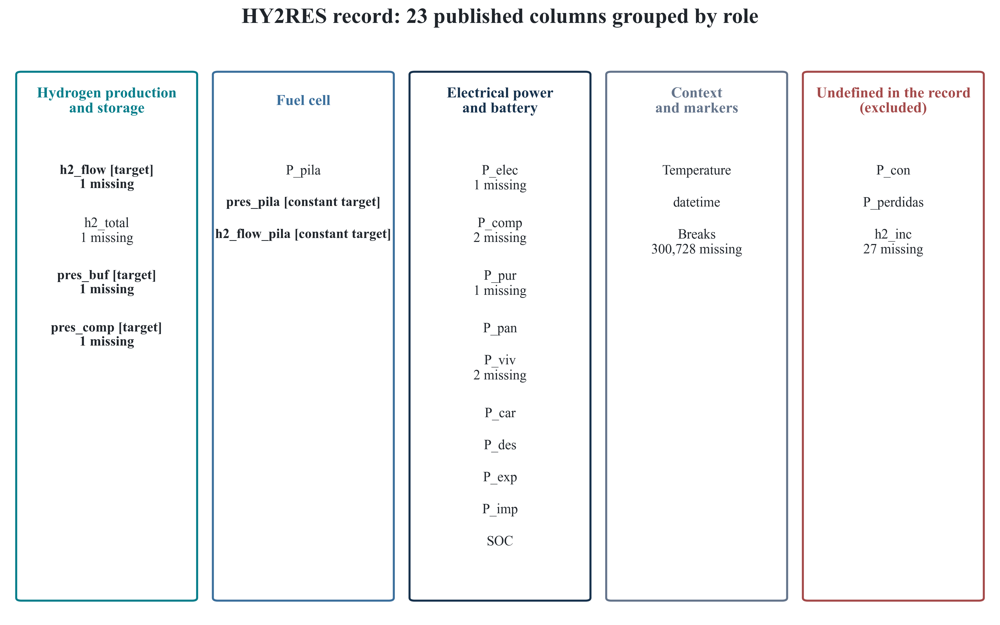

*Q1_H01 — Measurement architecture.* Columns of the official HY2RES_202404.csv (Zenodo 15166733 v1; 300,768 rows at a 5 s PLC clock), grouped by published definition. Bold entries are the Study C prediction targets: buffer pressure pres_buf (bar), tank pressure pres_comp (bar; not identified as compressor-discharge pressure) and electrolyzer flow h2_flow (NL/h, over the preceding interval); the two fuel-cell targets are constant in the test period. Three columns have no published definition and are excluded. Missing counts from CHANNEL_SCHEMA.csv. ([caption](captions/Q1_H01_hy2res_channel_architecture.md))

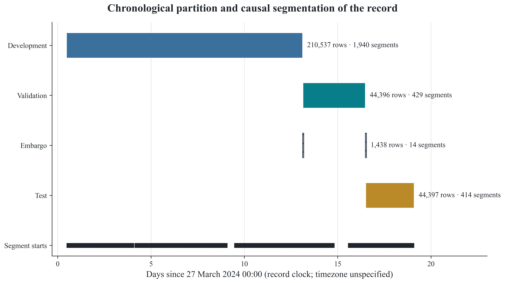

*Q1_H02 — Partition and causal segmentation.* Frozen chronological partition: development (2024-03-27 11:34:27 – 2024-04-09 02:34:59), validation, a one-hour embargo on each side, and the held-out test period from 2024-04-12 12:13:56. Causal segments (2,793 in total) break at OPEN/CLOSE markers and at any step other than 5 s; models use only same-segment lag-1 inputs, with no interpolation. No development segment is shared with the test period. ([caption](captions/Q1_H02_hy2res_partition_timeline.md))

**Interpretation.** Three targets; no development segment is shared with the test period.

**Limitation.** Timezone unspecified.

## 4.2 HY2RES — reference prediction

- **Question.** How do the references follow held-out pressure and flow, and does this depend on the operating state?
- **Evidence.** Frozen test predictions; TABLE_2_HELD_OUT.
- **Method.** Trace display; per-state relative error change.
- **Comparator.** Persistence.

**Results.**

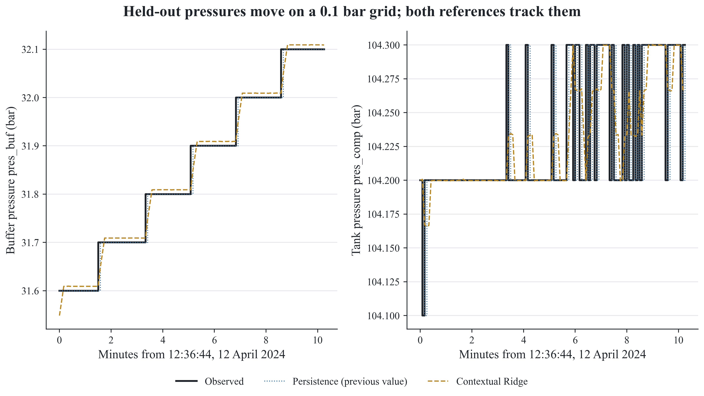

*Q1_H03 — Held-out pressure traces.* Held-out test segment 2382 (124 five-second steps, 12:36:44–12:46:59 on 12 April 2024; the interval chosen by chronology and segment length in the original publication script). Observed values change in single 0.1 bar steps; persistence repeats the previous value and the contextual Ridge reference responds smoothly. Buffer and tank pressure are drawn on separate axes. ([caption](captions/Q1_H03_hy2res_pressure_traces.md))

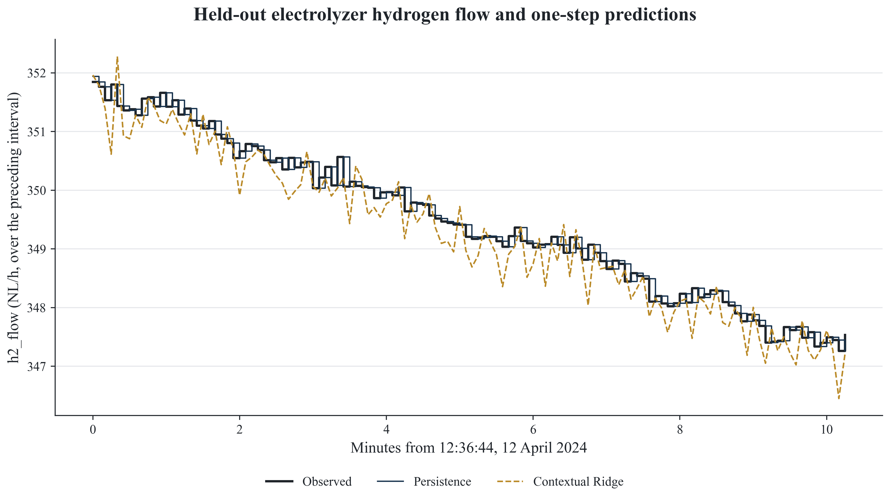

*Q1_H04 — Held-out flow trace.* Electrolyzer hydrogen flow in the same held-out segment 2382 (124 steps). h2_flow is a normalised volumetric production over the preceding sample interval and is not quantised at 0.1 (TAB_H01). ([caption](captions/Q1_H04_hy2res_flow_trace.md))

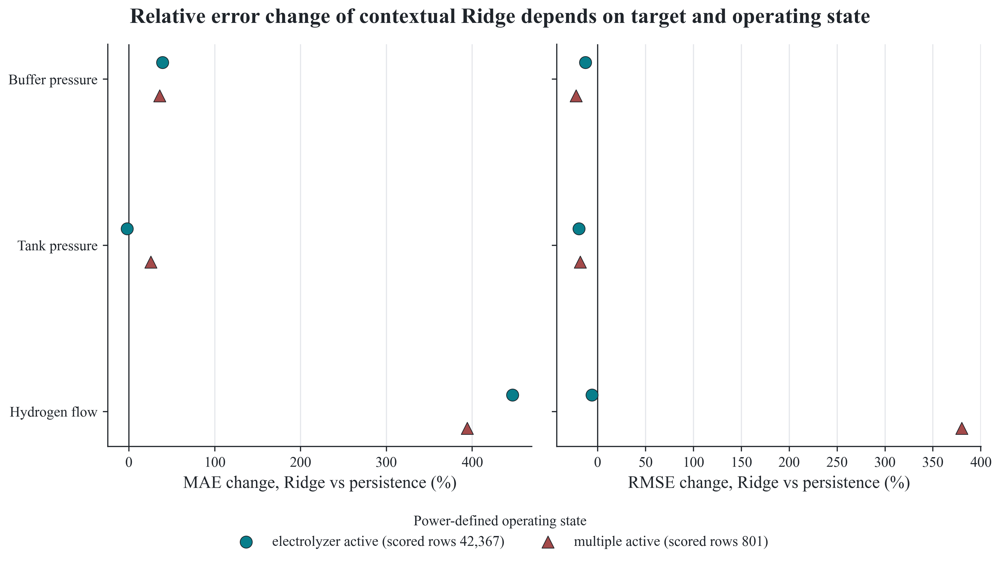

*Q1_H05 — State-dependent reference error.* Relative change (Ridge − persistence) / persistence of MAE and RMSE on the frozen held-out test mask, per target and power-defined operating state (states with scored rows). Negative favours Ridge. In the minority compressor-powered state the flow RMSE rises from 0.1347 to 0.6465 NL/h (+380 %). Unknown-power rows (412–413) are not scored. ([caption](captions/Q1_H05_hy2res_state_dependent_error.md))

**Interpretation.** Pressures move on a 0.1 bar grid; Ridge's relative advantage depends on target and state and reverses for flow in the minority state.

**Limitation.** One system, one test period.

## 4.3 HY2RES — quantization and error trade-off

- **Question.** How large are the errors relative to the recording grid, and why does RMSE favour Ridge?
- **Evidence.** quantization_comparison, step_contribution.
- **Method.** Errors in increments; ΔSSE by recorded step class.
- **Comparator.** Persistence.

**Results.**

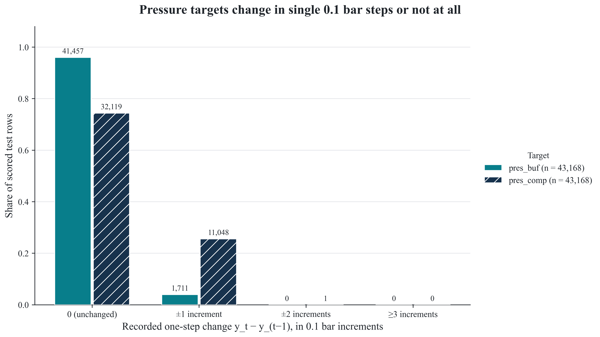

*Q1_H06 — Pressure quantization.* Distribution of recorded one-step changes on the shared 43,168-row held-out mask. Both pressures lie 100 % on a 0.1 bar grid over the full source (64 and 263 distinct values; TAB_H01). Buffer pressure is unchanged on 96.0 % of rows and tank pressure on 74.4 %; otherwise the change is exactly one increment (one tank row changes by two). 0.1 bar is the recording increment, not documented instrument resolution or accuracy. ([caption](captions/Q1_H06_hy2res_pressure_quantization.md))

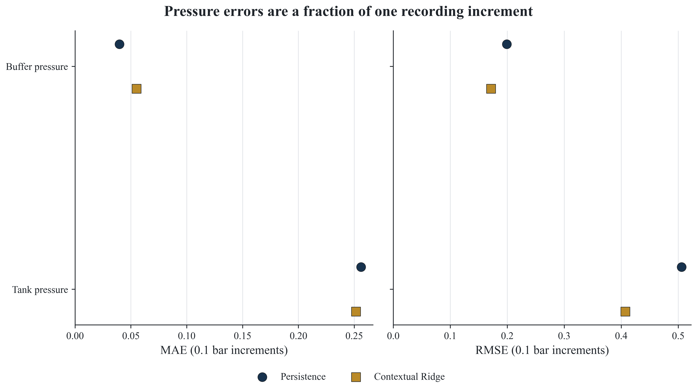

*Q1_H07 — Errors in recording increments.* Held-out MAE and RMSE divided by the 0.1 bar recording increment (43,168 rows, 409 segments). ΔMAE (Ridge − persistence): buffer +0.0154, tank -0.0046 increments; ΔRMSE: -0.0277 and -0.0990. All differences are below 0.1 of one recorded step. Persistence is exactly right on 96.0% (buffer) and 74.4% (tank) of rows. ([caption](captions/Q1_H07_hy2res_error_in_increments.md))

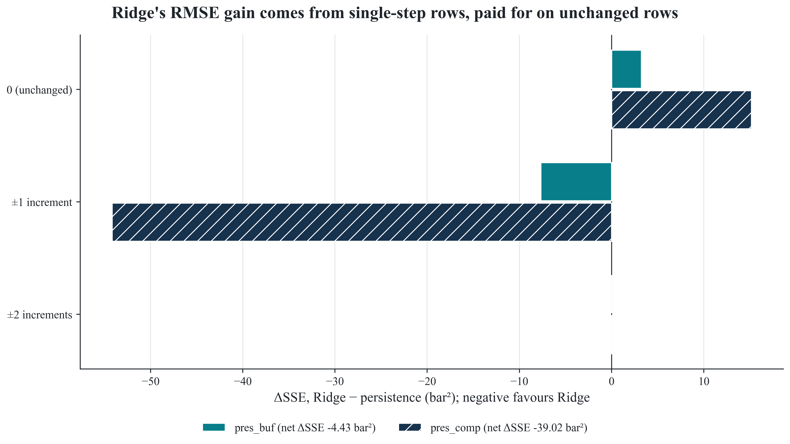

*Q1_H08 — Error trade-off by step class.* Squared-error difference by recorded step class on the held-out mask. Tank pressure: Ridge gains -54.2 bar² on single-step rows and loses +15.2 bar² on unchanged rows. Ridge predictions are not rounded to the grid. The RMSE improvement therefore reflects partial anticipation of single-increment transitions, not physically resolved accuracy. ([caption](captions/Q1_H08_hy2res_error_tradeoff.md))

**Interpretation.** All pressure differences are below 0.1 of a recorded step; Ridge partly anticipates single-step transitions.

**Limitation.** Increment ≠ instrument accuracy.

## 4.4 HY2RES — drift and operating support

- **Question.** Does the test period stay inside the development support?
- **Evidence.** chronology, support_attribution.
- **Method.** Per-partition distributions; channel-level support violations.
- **Comparator.** Development min–max.

**Results.**

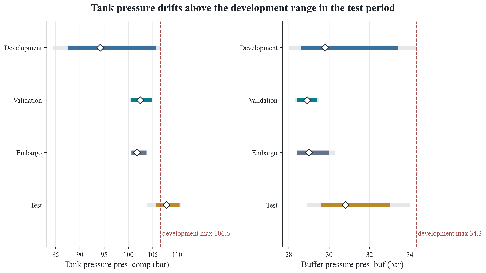

*Q1_H09 — Tank-pressure drift.* Per-partition distributions of the raw source values (thin grey: min–max; coloured: 5th–95th percentile; diamond: median). Tank-pressure medians rise from 94.2 bar (development) to 102.4 (validation) and 107.8 (test); 71.8% of test rows exceed the development maximum 106.6 bar. Buffer pressure stays inside its development range. Validation contained no out-of-range rows, so development-only checks could not reveal the drift. ([caption](captions/Q1_H09_hy2res_tank_pressure_drift.md))

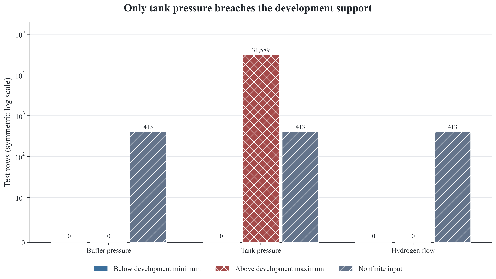

*Q1_H14 — Support violations by channel.* Development-support violations per channel among the 44,397 test rows (non-exclusive per channel). Tank pressure exceeds the development maximum on 31,589 rows (299 segments, up to 4.1 bar above); no channel falls below its development minimum; buffer pressure and flow never leave their support. The 413 nonfinite rows are the same rows in every channel (segment-start origins). ([caption](captions/Q1_H14_hy2res_support_breach.md))

**Interpretation.** Tank pressure drifts above the development maximum; it is the only channel that breaches support.

**Limitation.** Physical cause of the drift not established.

## 4.5 HY2RES — abstention and evidence validity

- **Question.** Why does the frozen state rule abstain, and does abstention follow the breach over time?
- **Evidence.** unresolved_taxonomy, time_bins.
- **Method.** Exclusive reason reconstruction; 6 h bins.
- **Comparator.** —

**Results.**

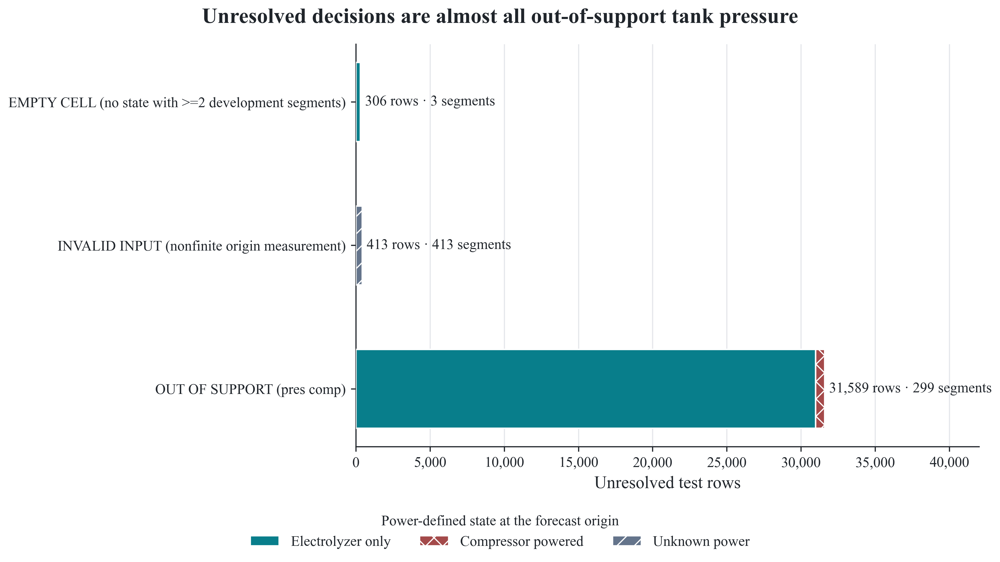

*Q1_H10 — Unresolved-reason decomposition.* Exclusive primary reason for each of the 32,308 UNRESOLVED test rows (denominator 44,397 test rows). OUT_OF_SUPPORT (tank pressure above the development maximum) accounts for 31,589 (97.8%); INVALID_INPUT (nonfinite origin measurement) and EMPTY_CELL (no state with two development segments) account for the rest. These are kept distinct from ambiguity. Reasons reproduce the frozen min–max guard exactly. ([caption](captions/Q1_H10_hy2res_unresolved_reasons.md))

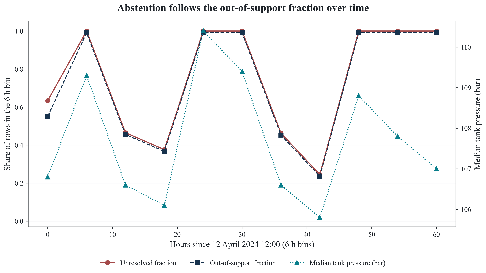

*Q1_H11 — Decision validity over time.* Held-out test rows in 11 six-hour bins: unresolved and out-of-support fractions (left axis) and median tank pressure (right axis; thin line = development maximum 106.6 bar). Bins whose median tank pressure is at or above 107.0 bar are fully unresolved. Descriptive association only. ([caption](captions/Q1_H11_hy2res_validity_over_time.md))

#### T04a — HY2RES decision taxonomy and unresolved reasons

Frozen state-rule decisions on the 44,397 test rows with the reconstructed exclusive primary reason. OUT_OF_SUPPORT, INVALID_INPUT and EMPTY_CELL are distinct from ambiguity.

| part | decision | primary_reason | rows | segments | electrolyzer_only | compressor_powered | unknown_power | pct_of_test_rows | pct_of_unresolved |
|---|---|---|---|---|---|---|---|---|---|
| decision taxonomy | Ambiguous | — | 1,327 | 15 | 1,126 | 201 | 0 | 0.02989 | — |
| decision taxonomy | Electrolyzer only | — | 10,762 | 106 | 10,762 | 0 | 0 | 0.2424 | — |
| decision taxonomy | Unresolved | EMPTY_CELL (no state with >=2 development segments) | 306 | 3 | 306 | 0 | 0 | 0.006892 | 0.009471 |
| decision taxonomy | Unresolved | INVALID_INPUT (nonfinite origin measurement) | 413 | 413 | 0 | 0 | 413 | 0.009302 | 0.01278 |
| decision taxonomy | Unresolved | OUT_OF_SUPPORT (pres_comp) | 31,589 | 299 | 30,973 | 616 | 0 | 0.7115 | 0.9777 |

Source: `hy2res .../analysis/unresolved_taxonomy.csv` · Script: `publication_q1/scripts/build_tables.py`

**Interpretation.** Abstention is almost entirely out-of-support tank pressure, distinct from ambiguity and invalid input.

**Limitation.** Descriptive association.

## 4.6 HY2RES — operating-state recognition

- **Question.** Does the rule recognise the minority operating state, and do the channels separate the states?
- **Evidence.** state_outcomes, distinguishability.
- **Method.** Outcome counts per state; empirical rank probabilities.
- **Comparator.** Constant majority rule.

**Results.**

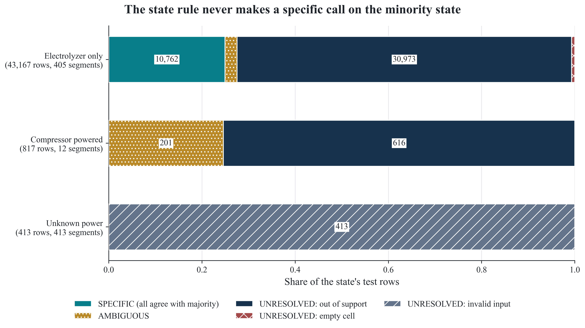

*Q1_H12 — Operating-state decision outcomes.* Frozen state-rule outcomes per power-defined operating state (44,397 test rows). The compressor-powered minority state (817 rows) receives 0 SPECIFIC calls: 201 ambiguous and 616 unresolved. All 10,762 SPECIFIC calls agree with a constant 'electrolyzer only' baseline. Operating-state labels are not fault labels; this is not compressor-fault detection. ([caption](captions/Q1_H12_hy2res_state_outcomes.md))

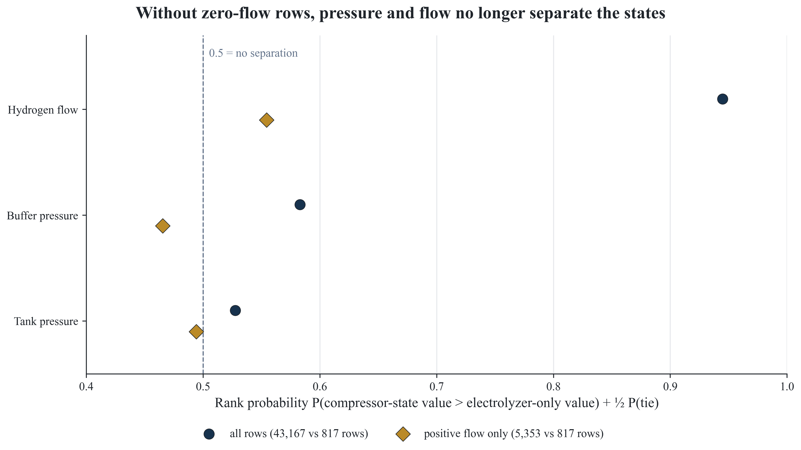

*Q1_H13 — Positive-flow distinguishability.* Empirical rank probability between compressor-powered (12 segments) and electrolyzer-only test rows. Flow separates the states with all rows (0.945) only because most electrolyzer-only rows have zero flow; restricted to positive flow it falls to 0.554; with positive flow all three channels lie between 0.46 and 0.56. This is evidence sufficiency, not state classification accuracy. ([caption](captions/Q1_H13_hy2res_positive_flow_distinguishability.md))

#### T04b — HY2RES outcomes per power-defined operating state

Operating-state labels are power-defined, not fault labels. majority_baseline_agree = rows a constant 'electrolyzer only' rule would match.

| primary_reason | rows | segments | specific | ambiguous | unresolved | unresolved_out_of_support | unresolved_invalid | unresolved_empty_cell | majority_baseline_agree |
|---|---|---|---|---|---|---|---|---|---|
| electrolyzer_active | 43,167 | 405 | 10,762 | 1,126 | 31,279 | 30,973 | 0 | 306 | 43,167 |
| multiple_active | 817 | 12 | 0 | 201 | 616 | 616 | 0 | 0 | 0 |
| unknown | 413 | 413 | 0 | 0 | 413 | 0 | 413 | 0 | 0 |

Source: `hy2res .../analysis/state_outcomes.csv` · Script: `publication_q1/scripts/build_tables.py`

**Interpretation.** Zero specific calls on the minority state; separation is zero versus positive flow, not state recognition.

**Limitation.** Power-defined states, not fault labels.

## 5. Cross-study comparison

- **Question.** What do the studies jointly show about references, measurement grids and classification evidence?
- **Evidence.** MHC, HY2RES and R2 tables.
- **Method.** Errors in recording increments; R2 confusion and independence units.
- **Comparator.** Persistence; registered classifier.

**Results.**

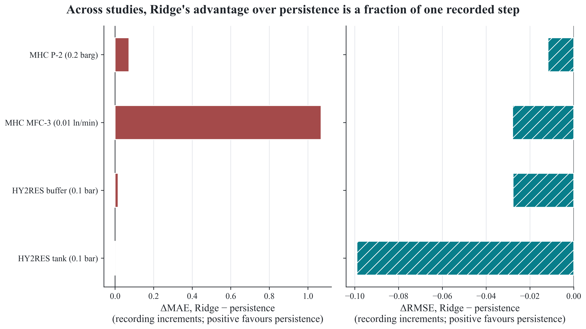

*Q1_I02 — Cross-study reference comparison.* Pooled held-out differences between the frozen Ridge and persistence references, divided by each channel's observed recording increment so the studies can be read on one dimensionless scale (values are not pooled). MHC P-2 (0.2 barg): ΔMAE +0.072, ΔRMSE -0.012; MHC MFC-3 (0.01 ln/min): ΔMAE +1.068, ΔRMSE -0.028; HY2RES buffer (0.1 bar): ΔMAE +0.015, ΔRMSE -0.028; HY2RES tank (0.1 bar): ΔMAE -0.005, ΔRMSE -0.099. Ridge is worse on MAE except for HY2RES tank pressure and better on RMSE by small amounts; MHC per-run values are in Q1_B05/B06. ([caption](captions/Q1_I02_integrated_reference_comparison.md))

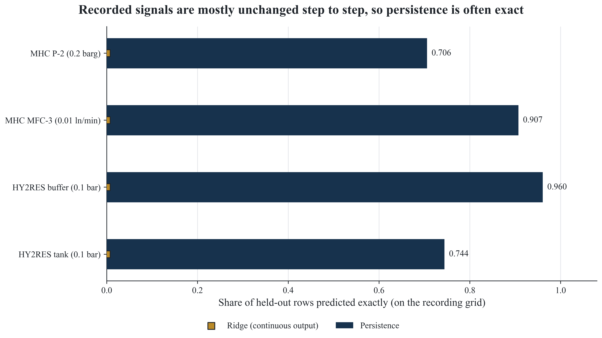

*Q1_I03 — Measurement-grid limitation.* Exact-hit share of the persistence reference on the held-out rows of each channel (MHC: 15,885 rows per channel; HY2RES: 43,168 rows). Ridge never predicts a recorded value exactly. Because most recorded values repeat, MAE rewards persistence, while RMSE is decided by the few rows with recorded changes. This is a property of the recording grid, not of instrument accuracy. ([caption](captions/Q1_I03_integrated_exact_hits.md))

*Q1_I05 — R2 classification by topology.* Window-count confusion matrices of the registered R2 classifier per held-out topology (shading: row share). Center LEAK → NORMAL (7,307 windows) and Downstream NORMAL → LEAK (662) are the dominant errors; both trace to the source-folder attribution defect (D1 pending). Upstream is error-free. Windows are serially dependent; independent units are scenario families and ancestors (Q1_I06). ([caption](captions/Q1_I05_integrated_r2_confusion.md))

*Q1_I06 — Dataset composition and independence.* Units of the registered R2 dataset per class (all three topologies). 27,993 windows come from 51 runs, 39 scenario families and only 17 scenario ancestors, because every template is simulated in all three topologies. Compressor delay and normal operation each rest on one ancestor. Recomputed from the frozen predictions; identical to the forensic independence table. ([caption](captions/Q1_I06_integrated_independence_units.md))

*Q1_I07 — Formal D(Y) qualification across studies.* Inputs required by the formal set-membership decision D(Y) = (H_consistent, H_excluded, H_indeterminate), per evidence source. Only Center provides configured events and locations, and its bounds are declared hypothetically (conditional hypothetical bounds — not calibrated uncertainty); three of nine declared Center hypotheses have no adapter. R2 used the empirical D(x), not D(Y). MHC and HY2RES have no event labels or locations, so D(Y) is blocked by evidence (TAB_B08, TAB_H09). ([caption](captions/Q1_I07_integrated_dy_qualification.md))

**Interpretation.** Learned references gain at most a fraction of one recorded step; R2 classification errors concentrate in the topologies affected by the attribution defect and rest on 17 scenario templates.

**Limitation.** Studies are not pooled.

## 6.1 RQ1 / H1 — incremental decision value of distinguishability

- **Question.** At matched coverage, does the distinguishability assessment reduce selective risk?
- **Evidence.** Registered R2; H1 analysis (h1_validation).
- **Method.** Registered SAP; exploratory shared-coverage reanalysis.
- **Comparator.** s_C−D; conventional confidence.

**Results.**

*H1-F01 — Attainable coverage versus registered targets.* Maximum attainable SPECIFIC coverage per outer fold of the registered run R2 (9,331 windows per fold). Center reaches 0.258, Downstream 0.722 and Upstream 0.736, so the primary target 0.80 is unattainable in every fold and 0.60 in Center; because a pooled result needs every fold, RQ1 is NOT_ESTIMABLE. Development maxima (threshold-transfer mode) are 0.569, 5.4e-05 and 0.035. The binding constraint is the specific-blocking support flags (fewer than two independent families or scenarios among a window's 25 nearest development neighbours). ([caption](../h1_validation/captions/H1-F01_attainable_coverage.md))

*H1-F02a — Selective risk at shared attainable coverage.* Pooled empirical selective risk of the registered policy scores at the exploratory grid {0.05, …, 0.25} that the R2 diagnostics fixed before this analysis; 0.25 is the largest grid point inside the shared attainable region. At 0.25 (6,999 SPECIFIC calls each): s_C 0.146, s_C−D 0.152, guarded confidence 0.238, conventional confidence 0.422. Margin and −entropy are listed in H1-T04 and the analysis CSV. No point beyond the shared region is drawn; uncertainty is shown in H1-F02b. ([caption](../h1_validation/captions/H1-F02a_selective_risk_shared_coverage.md))

*H1-F02b — Paired selective-risk differences with intervals.* Paired differences with 95 % percentile bootstrap intervals (2,000 replicates, seed 20261104). Left: the registered contrast. Δ ranges from -0.134 to 0.000, and every family- and ancestor-level interval includes 0 (upper bounds ≥ 0). Discordant errors come from at most 3 scenario ancestors, and neither policy makes an error in runs with undisputed attribution. Right: the full evidence policy against conventional confidence abstention without the support guard; Δ from -0.467 to -0.277, with ancestor-level intervals below 0 at 3/5 points. The family intervals reproduce the registered diagnostics exactly; the ancestor intervals treat the 17 scenario templates shared by all topologies as units. ([caption](../h1_validation/captions/H1-F02b_paired_risk_difference.md))

*H1-F03 — Selection changes caused by D(x).* Windows selected by exactly one of the two registered policies at each grid point (identical SPECIFIC counts). Adding D(x) exchanges 1,272–2,066 windows. The windows only s_C−D accepts contain 0–563 errors; those only s_C accepts contain 0–29. All discordant errors come from 1–3 scenario ancestors, all in Center runs whose topology attribution is disputed; they are not independent replications. ([caption](../h1_validation/captions/H1-F03_selection_swap.md))

#### T08a — RQ1 / H1 — registered result

Registered primary-contrast rows of R2 (both policy variants). Verdict: NOT_ESTIMABLE; H1 not established.

| evidence | variant | target | mode | status | folds_estimable | n_folds |
|---|---|---|---|---|---|---|
| registered R2 (s_C vs s_C−D) | primary | 0.6 | rank_matched | NOT_ESTIMABLE_UNDER_PRIMARY_PROTOCOL | 2 | 3 |
| registered R2 (s_C vs s_C−D) | primary | 0.6 | threshold_transfer | NOT_ESTIMABLE_UNDER_PRIMARY_PROTOCOL | 0 | 3 |
| registered R2 (s_C vs s_C−D) | primary | 0.8 | rank_matched | NOT_ESTIMABLE_UNDER_PRIMARY_PROTOCOL | 0 | 3 |
| registered R2 (s_C vs s_C−D) | primary | 0.8 | threshold_transfer | NOT_ESTIMABLE_UNDER_PRIMARY_PROTOCOL | 0 | 3 |
| registered R2 (s_C vs s_C−D) | primary | 0.9 | rank_matched | NOT_ESTIMABLE_UNDER_PRIMARY_PROTOCOL | 0 | 3 |
| registered R2 (s_C vs s_C−D) | primary | 0.9 | threshold_transfer | NOT_ESTIMABLE_UNDER_PRIMARY_PROTOCOL | 0 | 3 |
| registered R2 (s_C vs s_C−D) | warning_only | 0.6 | rank_matched | NOT_ESTIMABLE_UNDER_PRIMARY_PROTOCOL | 2 | 3 |
| registered R2 (s_C vs s_C−D) | warning_only | 0.6 | threshold_transfer | NOT_ESTIMABLE_UNDER_PRIMARY_PROTOCOL | 0 | 3 |
| registered R2 (s_C vs s_C−D) | warning_only | 0.8 | rank_matched | NOT_ESTIMABLE_UNDER_PRIMARY_PROTOCOL | 0 | 3 |
| registered R2 (s_C vs s_C−D) | warning_only | 0.8 | threshold_transfer | NOT_ESTIMABLE_UNDER_PRIMARY_PROTOCOL | 0 | 3 |
| registered R2 (s_C vs s_C−D) | warning_only | 0.9 | rank_matched | NOT_ESTIMABLE_UNDER_PRIMARY_PROTOCOL | 0 | 3 |
| registered R2 (s_C vs s_C−D) | warning_only | 0.9 | threshold_transfer | NOT_ESTIMABLE_UNDER_PRIMARY_PROTOCOL | 0 | 3 |

Source: `03_results/primary_protocol/PRIMARY/rq1.csv` · Script: `publication_q1/scripts/build_tables.py`

#### T08b — RQ1 / H1 — exploratory shared-coverage contrast

EXPLORATORY_POST_HOC on inspected windows; Δ = R_sel(s_C) − R_sel(s_C−D); 95 % family and ancestor bootstrap intervals; errors among windows from undisputed runs. Not a test of H1.

| coverage | accepted_each | risk_s_C | risk_comparator | delta_R | family_ci_low | family_ci_high | ancestor_ci_low | ancestor_ci_high | ancestors_discordant_errors | errors_undisputed_runs_s_C | errors_undisputed_runs_comparator |
|---|---|---|---|---|---|---|---|---|---|---|---|
| 0.05 | 1,401 | 0 | 0 | 0 | 0 | 0 | 0 | 0 | 0 | 0 | 0 |
| 0.1 | 2,802 | 0 | 0.1003 | -0.1003 | -0.365 | 0 | -0.3926 | 0 | 1 | 0 | 0 |
| 0.15 | 4,200 | 0.03548 | 0.1693 | -0.1338 | -0.3166 | 0 | -0.312 | 0 | 2 | 0 | 0 |
| 0.2 | 5,601 | 0.1012 | 0.1896 | -0.08838 | -0.2134 | 0.001363 | -0.1819 | 0.001153 | 3 | 0 | 0 |
| 0.25 | 6,999 | 0.1456 | 0.1517 | -0.006144 | -0.04941 | 0.03373 | -0.04422 | 0.02301 | 3 | 0 | 0 |

Source: `h1_validation/tables/H1-T04.csv` · Script: `publication_q1/scripts/build_tables.py`

**Interpretation.** Registered verdict NOT_ESTIMABLE; exploratory contrast inconclusive; see H1_RESULTS.md for the full analysis.

**Limitation.** All windows inspected; attribution defect; 17 ancestors.

## 6.2 RQ2 — information beyond confidence

- **Question.** Does D(x) add decision-relevant information beyond confidence, margin and entropy?
- **Evidence.** Protocol 2.0 development ablation; R2 score rankings.
- **Method.** Group-balanced risk at the development-fixed operating point; AUROC.
- **Comparator.** Confidence, margin, −entropy.

**Results.**

*H1-F04a — Development ablation of D(x).* Protocol 2.0 development ablation (means over outer folds; same 27,993 windows). In every arm where the operating point is estimable, s_C, s_C−D and confidence have identical group-balanced risk (A, D, E: 0 vs 0 floor on one topology; C: 0.045; G1: 0.091; G2: s_C and s_C−D 0.091, confidence 0.095). Arms B and F have no estimable operating point and are omitted from the plot (listed in H1-T05a). ([caption](../h1_validation/captions/H1-F04a_development_ablation.md))

*H1-F04b — Score ranking quality on the outer test.* Correctness AUROC of each registered selection score on the windows eligible for SPECIFIC. Downstream: confidence, margin and −entropy are perfectly anti-informative (AUROC 0: the 650 errors are the most confident windows), while both meta-model scores reach 1.0 with or without D(x). Center: adding D(x) moves the meta-model from 0.522 to 0.981, the same level as confidence (0.983). Upstream has no errors (not shown). Both topologies' errors are tied to the disputed attribution. ([caption](../h1_validation/captions/H1-F04b_score_ranking_quality.md))

#### T09a — RQ2 — development ablation of D(x)

Protocol 2.0 development arms (exploratory). Where estimable, s_C = s_C−D = confidence: no incremental value of D(x).

| setting | evidence | s_C_estimable_dev_topologies | s_C_group_balanced_risk_mean | s_C_minus_D_group_balanced_risk_mean | confidence_group_balanced_risk_mean | min_auroc_confidence_over_dev_topologies | min_auroc_D_only_over_dev_topologies | auroc_s_C_minus_auroc_s_C_minus_D_mean | meta_model_undefined_folds |
|---|---|---|---|---|---|---|---|---|---|
| A_P11_DEV | development ablation (exploratory) | 1 | 0 | 0 | 0 | 0.07296 | 0.494 | -0.006561 | 0 |
| B_TOPOLOGY | development ablation (exploratory) | 0 | — | — | — | 0.5135 | 0.5 | 0.01163 | 1 |
| C_COMMON_SENSORS | development ablation (exploratory) | 2 | 0.04545 | 0.04545 | 0.04545 | 0.005 | 0.289 | -0.0153 | 0 |
| F_EVIDENCE_MARGIN | development ablation (exploratory) | 0 | — | — | — | 0.07296 | 0.4903 | — | 2 |
| G1_DATA_CORRECTIONS | development ablation (exploratory) | 2 | 0.09091 | 0.09091 | 0.09091 | 0.6148 | 0.341 | 0.02979 | 0 |
| G2_FULL_CANDIDATE | development ablation (exploratory) | 2 | 0.09091 | 0.09091 | 0.09545 | 0.6148 | 0.2692 | 0.1215 | 2 |

Source: `03_results/ablation/ARM_SUMMARY.csv` · Script: `publication_q1/scripts/build_tables.py`

**Interpretation.** No incremental value of D(x) where estimable.

**Limitation.** Development-only, exploratory.

## 6.3 RQ3 — validity of specific, ambiguous and unresolved decisions

- **Question.** Are the three outcomes valid and informative?
- **Evidence.** R2 registered decisions; Center D(Y).
- **Method.** Per-class outcome shares; error destination; universe dependence.
- **Comparator.** Conventional confidence abstention.

**Results.**

*Q1_I08 — Three-outcome decision shares.* Registered RQ3 outcome shares of the s_C policy at rank-matched coverage 0.60, pooled over the two outer folds where 0.60 is attainable (Center absent). Every SPECIFIC decision is correct (0 of 11,198 wrong) and all 31 ambiguity sets (size 2) contain the true class; compressor-fault windows are never decided because the support flags block them. LEAK is reported as 'restricted', the other classes as descriptive only (registered rule). ([caption](captions/Q1_I08_integrated_rq3_outcomes.md))

*H1-F05 — Decision errors and abstention.* Fate of the classifier's top-1 errors at rank-matched coverage 0.25 (equal SPECIFIC counts per fold). The evidence-support flags block 6,271 of 8,012 errors (78.3%); the error rate is 0.523 among blocked and 0.109 among eligible windows (base rate 0.286). Conventional confidence abstention issues far more of the same errors as SPECIFIC. Segments below 5 % are unlabelled; exact counts are in h1_05_error_capture.csv and h1_04_selection_by_method.csv. Upstream has no classifier errors. 7,347 of the errors lie in runs with disputed topology attribution, so this shows the guard reacting to an attribution defect, not to independently labelled diagnostic difficulty. ([caption](../h1_validation/captions/H1-F05_error_abstention.md))

*H1-F06 — Hypothesis-library completeness risk.* Formal D(Y) decisions on the Center controlled captures under conditional hypothetical bounds. With the full declared universe every decision is UNRESOLVED, because three declared hypotheses have no adapter. Restricting the universe to modelled hypotheses yields SPECIFIC decisions: over both clock bounds and all sensor groups 48 are correct and 11 wrong, and every wrong decision has a true hypothesis that is absent from the library (asserted). Rows are repeated views of the same six captures, not independent trials. Conditional hypothetical bounds — not calibrated uncertainty. ([caption](../h1_validation/captions/H1-F06_library_completeness_risk.md))

#### T09b — RQ3 — registered three-outcome shares (s_C, target 0.60)

Shares of each class's windows in the two folds where 0.60 is attainable; specific_correct and ambiguity_inclusion are rates among SPECIFIC and ambiguity sets ('—' = none).

| class | n | n_families | specific | ambiguity_set | unresolved | specific_correct | ambiguity_inclusion | reporting |
|---|---|---|---|---|---|---|---|---|
| COMPRESSOR_DELAY | 62 | 2 | 0 | 0.5 | 0.5 | — | 1 | descriptive_only |
| COMPRESSOR_FAULT | 2,656 | 2 | 0 | 0 | 1 | — | — | descriptive_only |
| LEAK | 14,614 | 20 | 0.7322 | 0 | 0.2678 | 1 | — | restricted |
| NORMAL | 1,330 | 2 | 0.3737 | 0 | 0.6263 | 1 | — | descriptive_only |

Source: `03_results/primary_protocol/PRIMARY/rq2.csv` · Script: `publication_q1/scripts/build_tables.py`

**Interpretation.** No wrong SPECIFIC where evaluable; ambiguity sets contain the truth; D(Y) false specificity arises only from incomplete libraries.

**Limitation.** Thin classes; conditional bounds.

## 7. Claim-to-evidence qualification

- **Question.** What is established, and at which evidence level?
- **Evidence.** T10 (all claim tables).
- **Method.** Qualification in the project vocabulary.
- **Comparator.** —

**Results.**

*Q1_I09 — Claim-to-evidence qualification.* Claim-to-evidence qualification per capability (rows) and evidence source (columns), in the project vocabulary; '–' = not addressed by that source. Every cell is traced in T10. Fault classification, localization accuracy and industrial transfer are blocked everywhere; H1 is not estimable under the registered protocol. ([caption](captions/Q1_I09_integrated_capability_matrix.md))

*H1-F07 — H1 evidence and feasibility map.* Qualification of each H1 component (rows) in the project's evidence vocabulary (columns); values and sources in H1-T07. Only the reproduction of the frozen R2 results is numerically verified; the registered contrast remains NOT_ESTIMABLE; the shared-coverage comparisons are exploratory and confounded by the disputed attribution; the formal D(Y) results are conditional on hypothetical bounds; a corrected replication needs owner decision D1, and confirmation needs new independent scenarios. ([caption](../h1_validation/captions/H1-F07_evidence_map.md))

#### T10 — Claim-to-evidence matrix

Every claim of the integrated package with its evidence, number and qualification, quoted from the accepted study claim tables and the H1 qualification table.

| study | claim | evidence | numerical_result | qualification | limitation |
|---|---|---|---|---|---|
| Center | The 12 accepted captures and 410 frozen files are unchanged | baseline_freeze --verify (before and after) | 12 captures; 410 files matched | VERIFIED | integrity, not validity |
| Center | Center model is air-like | source SLX gas block R | R = 0.287 kJ/(kg·K), Z = 0.998386 | VERIFIED | no hydrogen material claim possible |
| Center | Mechanism recognition does not survive self-template removal | TAB C-02 | 3/5 supported queries agree; 2 unsupported; frozen library 7/7 with self or near-duplicate templates | DESCRIPTIVE (one family) | 7 queries, 1 family |
| Center | Withdrawal signatures are outlet-specific | TAB C-04, channel_signal.csv | SID 213→MFS3 0.691 kg/s; SID 312→MFS1 0.647 kg/s; SID 215 flow ≤3.9e-4 kg/s | DESCRIPTIVE | sensor configuration of one model |
| Center | Categorical location ranking with an independent same-outlet template | TAB C-03 | SID 213 ranked 1st for 2/2 supported queries (all four sensor groups); SID 312 and SID 215 unsupported | DESCRIPTIVE (2 queries, 1 outlet) | near-duplicate template |
| Center | Flow-dependent B3 localization; pressure contrasts exist in native units | TAB C-04 | B3 flow share ≥ 0.97 for every outlet pair; pressure contrasts 1.1–5.5 kPa; withholding MFS3 cuts the SID 213 margin 0.028→0.0021 while the correct/runner-up ratio rises 1,030×→2,676×; pressure alone 569× | DESCRIPTIVE | normalization by absolute level |
| Center | Conditional correct SPECIFIC window | TAB C-05/C-06 | pressure eps ∈ [2.5e-6, 5.1e-4) MPa; flow eps ∈ [6.8e-4, 0.69) kg/s | CONDITIONAL_HYPOTHETICAL_BOUNDS | hypothetical bounds; replicate template |
| Center | Restricted universe can be confidently wrong | TAB C-06 | 2 wrong vs 8 correct SPECIFIC cells (all sensors, 7 scenarios × 6 queries) | CONDITIONAL_HYPOTHETICAL_BOUNDS | true mechanism unrepresented |
| Center | Full declared universe never decides | TAB C-06 | 42/42 UNRESOLVED (INDETERMINATE_HYPOTHESES) | CONDITIONAL_HYPOTHETICAL_BOUNDS | unmodelled FAULT/DELAY/SID 222 |
| Center | Frozen 12/12 UNRESOLVED unchanged | TAB_13, research_evidence.json | 12/12 UNRESOLVED, INVALID_UNCERTAINTY; all hypotheses adapter=None | VERIFIED | — |
| Center | RQ1 (registered) | 03_results/primary_protocol/PRIMARY/rq1.csv | NOT_ESTIMABLE at 0.60/0.80/0.90 | REGISTERED RESULT | max Center coverage 0.258 |
| Center | H1 | PRIMARY + exploratory shared coverage | all intervals vs s_C−D include 0 | NOT ESTABLISHED | inspected partitions |
| Center | RQ2 (development) | PROTOCOL_2_ABLATION_REPORT.md | s_C = s_C−D = confidence at matched development coverage | NEGATIVE (exploratory) | 13 groups |
| Center | Leak localization / fault diagnosis in hydrogen pipelines | — | — | NOT ESTABLISHED | no field truth |
| MHC | Causal one-step prediction | frozen benchmark + bit-identical replay | 15,885 rows/channel, 3 runs | VALIDATED WITHIN SCOPE | prohibited: Generality beyond this apparatus |
| MHC | Reference error behaviour | replayed predictions | Ridge RMSE gain from rare large steps; MAE loss on unchanged rows | DESCRIPTIVELY SUPPORTED | prohibited: Practical superiority of Ridge |
| MHC | Measurement resolution | recorded values only | P-2 0.2 barg grid; MFC-3 0.01 ln/min grid | NUMERICALLY VERIFIED (observed grid) | prohibited: Certified accuracy statements |
| MHC | Controller role of MFC-3 | workbook notes + coupled P-2/MFC-3 data | P-2 ≤ outlet set pressure + 1 barg whenever MFC-3 = 0 (3/3 runs) | DESCRIPTIVELY SUPPORTED | prohibited: Modelling the control law (setpoint not recorded) |
| MHC | Operating-condition dependence | 3 runs, confounded settings | Run 29 carries 82 % of P-2 ΔSSE | DESCRIPTIVELY SUPPORTED | prohibited: Attribution to material, pressure or cycle time |
| MHC | Competing event hypotheses | operator notes (valve timing, safety valve, back-pressure error) | notes only | NOT ESTABLISHED | prohibited: Event labels |
| MHC | Fault classification / localization | none | — | BLOCKED BY EVIDENCE | prohibited: Any accuracy or localization metric |
| MHC | Formal D(Y) | none | — | BLOCKED BY EVIDENCE | prohibited: Exclusion or certified diagnosis |
| MHC | Independent equipment transfer | one apparatus | — | NOT ESTABLISHED | prohibited: Industrial generalization |
| HY2RES | Source identity | MD5/size of restored source | 38,621,947 bytes, MD5 9a3c3e3b… | VERIFIED WITHIN SCOPE | does not establish: Calibration or synchronisation |
| HY2RES | Pressure recording grid | TAB_H01 | both pressures 100 % on 0.1 bar grid | NUMERICALLY VERIFIED | does not establish: Instrument accuracy |
| HY2RES | Ridge vs persistence | TAB_H02/H03 | buffer ΔMAE +0.015 incr., ΔRMSE −0.028 incr.; tank −0.005/−0.099 | DESCRIPTIVELY SUPPORTED | does not establish: Practical superiority; new held-out claim |
| HY2RES | Tank-pressure drift | TAB_H04, FIG_H04 | dev max 106.6 bar; 71.8 % of test source rows above | DESCRIPTIVELY SUPPORTED | does not establish: Physical cause |
| HY2RES | Unresolved mechanism | TAB_H06 | 31,589 / 32,308 unresolved = tank out of support | NUMERICALLY VERIFIED (reconciled) | does not establish: That abstention is diagnostically correct |
| HY2RES | Minority state | TAB_H07 | 0 of 817 compressor rows specific | DESCRIPTIVELY SUPPORTED | does not establish: Compressor fault detection |
| HY2RES | Positive-flow distinction | TAB_H08 | flow rank probability 0.945 → 0.554 | DESCRIPTIVELY SUPPORTED | does not establish: Classification accuracy |
| HY2RES | Formal D(Y) | source scope | no qualified bounds, fault library, labels or locations | NOT ESTABLISHED | does not establish: Any exclusion or certified diagnosis |
| HY2RES | Fault / leak / localization / transfer | source scope | no truth | BLOCKED BY EVIDENCE | does not establish: Any accuracy, localization or generalisation claim |
| R2 / H1 | Registered RQ1 / H1 contrast (s_C vs s_C−D) | h1_validation | R2 rq1.csv: 12/12 rows; Center coverage 0.258 < 0.60 | NOT_ESTIMABLE | see H1_LIMITATIONS.md |
| R2 / H1 | D(x) neighbourhood statistic and s_C meta-model | h1_validation | 02_methodology/DISTINGUISHABILITY_MATHEMATICAL_SPEC.md | IMPLEMENTED, TESTED | see H1_LIMITATIONS.md |
| R2 / H1 | Reproduction of R2 selections and registered intervals | h1_validation | 161/161 checks (h1_verification.csv) | NUMERICALLY VERIFIED | see H1_LIMITATIONS.md |
| R2 / H1 | D(x) incremental value at development level | h1_validation | G1: s_C = s_C−D = confidence = 0.091 | NOT SUPPORTED (exploratory) | see H1_LIMITATIONS.md |
| R2 / H1 | s_C lower risk than s_C−D at shared coverage ≤ 0.25 | h1_validation | Δ ≤ 0 at 5/5 points; all intervals include 0; 0 errors outside disputed runs for both | EXPLORATORY EVIDENCE ONLY — INCONCLUSIVE | see H1_LIMITATIONS.md |
| R2 / H1 | Evidence guard withholds errors accepted by confidence abstention | h1_validation | 78.3 % of classifier errors blocked; ancestor CI < 0 at 3/5 points | EXPLORATORY, CONFOUNDED BY D1 DEFECT | see H1_LIMITATIONS.md |
| R2 / H1 | Three-outcome policy produces SPECIFIC / AMBIGUITY / UNRESOLVED | h1_validation | 0 wrong SPECIFIC of 11,198; 31/31 ambiguity sets include truth | DESCRIPTIVELY DEMONSTRATED (R2 folds 2–3) | see H1_LIMITATIONS.md |
| R2 / H1 | Formal D(Y) three outcomes on Center | h1_validation | restricted 48 correct / 11 wrong SPECIFIC; full universe 336/336 UNRESOLVED | CONDITIONALLY DEMONSTRATED (hypothetical bounds) | see H1_LIMITATIONS.md |
| R2 / H1 | Incomplete hypothesis library causes false specificity | h1_validation | 11/11 wrong SPECIFIC with unsupported truth; 0/48 with supported truth | CONDITIONALLY DEMONSTRATED | see H1_LIMITATIONS.md |
| R2 / H1 | Corrected-attribution replication | h1_validation | EXPERIMENT_F_PROPOSAL.md | BLOCKED (D1 not recorded) | see H1_LIMITATIONS.md |
| R2 / H1 | H1 independent confirmation | h1_validation | no untouched partition; 17 scenario ancestors | BLOCKED BY EVIDENCE | see H1_LIMITATIONS.md |
| R2 / H1 | Industrial / hydrogen-field transfer | h1_validation | simulated topologies; air-like Center model | NOT ESTABLISHED | see H1_LIMITATIONS.md |

Source: `center TAB_C08`; `study_b TAB_B08`; `hy2res TAB_H09`; `h1_validation/tables/H1-T07.csv` · Script: `publication_q1/scripts/build_tables.py`

**Interpretation.** Reference prediction is validated within scope; diagnostic, localization and transfer claims are blocked by evidence.

**Limitation.** Qualification, not new measurement.
