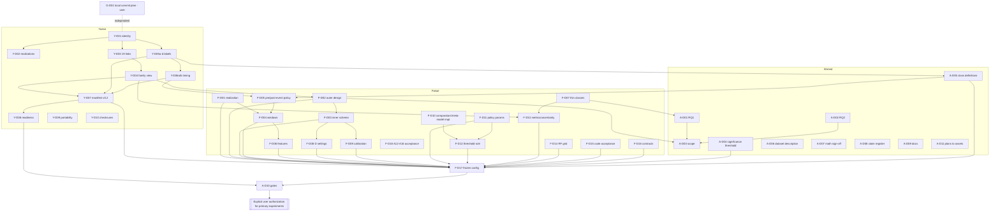

# Approval Dependency Graph

A dependency model, **not** an approval. Arrows mean "must be decided before".



## Can start now, in parallel (no upstream decision)

- **Yazan:** Y-D01, Y-D02, Y-D03, Y-D05a–d, Y-D09, Y-D10.
- **Faisal:** F-D01, F-D02, F-D10 (implementation), F-D14, F-D15, F-D16, F-D18. F-D11 is independent of the data.
- **Ahmed:** A-D01, A-D02, A-D04, A-D06–A-D09, A-D11.
- **User:** G-D01.

## Critical path to a valid primary experiment

```
Y-D01 → Y-D05 → (A-D05 + Y-D06) → F-D05 → F-D04 → F-D06 → F-D17 → A-D10 → user authorization
            └→ Y-D03 → Y-D04 → (Y-D07 → Y-D08) and (F-D02 → F-D03 → F-D08/F-D09) ─┘
plus implementation: F-D10 meta-model and the window/feature table builder (needs F-D01, F-D04, F-D05)
```

## Reopening rule

A change to any pinned hash in `CANDIDATE_DATASET_FREEZE_SPEC.md` or `CANDIDATE_EVALUATION_FREEZE_SPEC.md` reopens every decision downstream of it in this graph.
